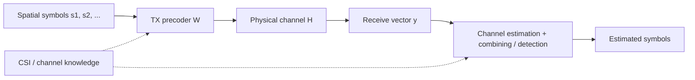
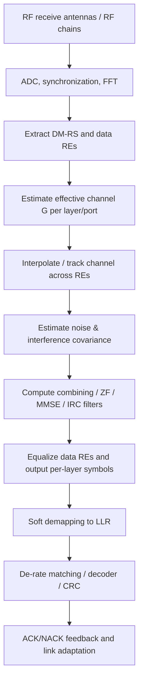
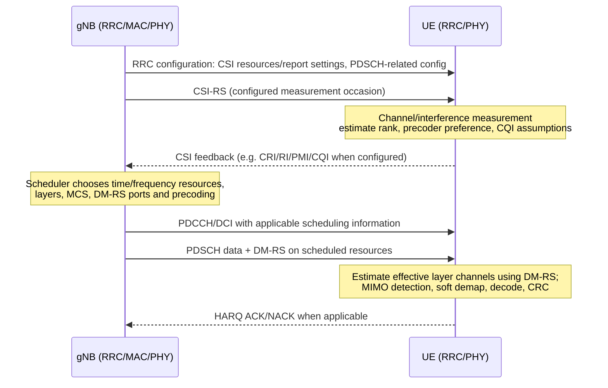
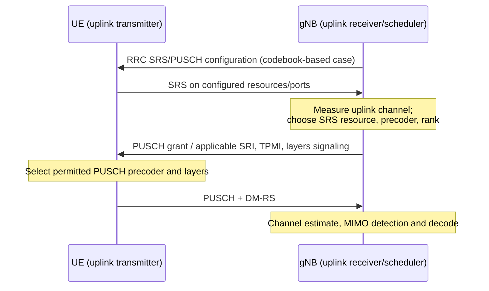

<span id="siso-simo-miso-và-mimo-bản-chất-kênh-vô-tuyến-toán-học-và-cách-triển-khai-trong-4g-lte--5g-nr"></span>

> **Đối tượng:** Kỹ sư PHY Layer / DSP / Baseband / 4G LTE / 5G NR  
> **Cập nhật nghiên cứu:** 19/11/2026  
> **Phạm vi:** Antenna configuration, channel matrix, diversity, combining, precoding, spatial multiplexing, CSI, layer mapping, receiver detection, các hệ quả triển khai và troubleshooting.  
> **Lưu ý về nguồn:** Ví dụ toán học là mô hình lý thuyết hoặc ví dụ minh họa, **không** phải toàn bộ thuật toán được 3GPP bắt buộc. Các điều khoản 3GPP được dẫn từ phiên bản nêu trong phần *Nguồn tham khảo*.

Đọc thêm về [layer mapping trong LTE]() và [luồng xử lý LTE TM9 từ CSI-RS đến PDSCH]().

## 1. Sự khác biệt thực chất: hệ thống có bao nhiêu chiều không gian để truyền và thu?

Câu trả lời ngắn gọn:

| Mô hình | Số antenna/phần tử phát trong mô hình | Số antenna/phần tử thu trong mô hình | Phương trình trên một RE | Khả năng nổi bật | Giới hạn spatial streams tới một thiết bị thu |
|---|---:|---:|---|---|---:|
| **SISO** (Single Input Single Output) | 1 | 1 | $y=hx+n$ | Đường truyền đơn, đơn giản | 1 |
| **SIMO** (Single Input Multiple Output) | 1 | $N_r>1$ | $\mathbf y=\mathbf h x+\mathbf n$ | Receive diversity, combining | 1 |
| **MISO** (Multiple Input Single Output) | $N_t>1$ | 1 | $y=\mathbf h^T\mathbf x+n$ | Transmit diversity, beamforming | 1 |
| **MIMO** (Multiple Input Multiple Output) | $N_t>1$ | $N_r>1$ | $\mathbf y=\mathbf H\mathbf x+\mathbf n$ | Diversity, beamforming, spatial multiplexing | $\leq\min(N_t,N_r,\operatorname{rank}\mathbf H)$ |

Ở đây $N_t$ là số **transmit signal dimensions** lý tưởng hóa, $N_r$ là số **receive signal dimensions**; đối với trạm phát có nhiều phần tử antenna nhưng chỉ một RF chain / một effective antenna port, không được tự động coi toàn bộ số phần tử là các đầu vào độc lập của ma trận $\mathbf H$.

```text
SISO (1×1)                          SIMO (1×3)

Tx0  ────── h11 ──────> Rx0        Tx0 ────── h11 ──────> Rx0
                                      ├────── h21 ──────> Rx1
                                      └────── h31 ──────> Rx2
                                                    ↓
                                                RX combining

MISO (3×1)                          MIMO (2×2)

Tx0 ─────── h11 ──────┐             Tx0 ─── h11 ───> Rx0
Tx1 ─────── h12 ──────┼──> Rx0          └── h21 ───> Rx1
Tx2 ─────── h13 ──────┘             Tx1 ─── h12 ───> Rx0
                                          └── h22 ───> Rx1
                                    (mỗi Rx quan sát tổng tín hiệu từ mọi Tx)
```

**Điều quan trọng hơn tên gọi:** antenna nhiều hơn chưa chắc tăng tốc độ. Có ít nhất ba lợi ích vật lý khác nhau thường bị gộp làm một:

1. **Array gain:** kết hợp pha để tăng SNR/SINR hiệu dụng của *cùng một data stream*.
2. **Diversity gain:** chống deep fading bằng nhiều nhánh kênh có fading không hoàn toàn tương quan, làm giảm xác suất lỗi/outage.
3. **Spatial multiplexing gain:** truyền **nhiều data streams độc lập trên cùng time-frequency resource** và tách chúng bằng sự khác biệt giữa các vector kênh.

SIMO thường khai thác (1) và (2); MISO thường khai thác (1) hoặc (2); MIMO có thể khai thác cả ba, **nhưng không đồng thời đạt cực đại cả ba trong mọi channel realization**.

### Vì sao cần nhiều antenna khi phổ tần hữu hạn?

Khi chỉ có một kênh SISO, một RE có một quan sát phức $y$. Tăng throughput thường cần thêm bandwidth, tăng modulation/coding efficiency, hoặc tăng SNR, mỗi cách đều bị giới hạn bởi phổ, interference và công suất. Nhiều antenna cung cấp thêm những **phép quan sát tuyến tính độc lập** hoặc khả năng **điều khiển trường điện từ**. Nếu kênh tạo ra nhiều hướng không gian phân biệt được, cùng RE có thể mang nhiều symbol độc lập. Nếu kênh chỉ có một hướng, nhiều antenna vẫn có thể hữu ích để tập trung năng lượng hoặc chống fading nhưng không tự tạo ra nhiều streams phân biệt được.

---

## 2. Xuất phát từ phương trình tín hiệu: một RE nhận được gì?

Xét một subcarrier $k$ và một OFDM symbol $\ell$ (một **Resource Element – RE**) trong vùng dữ liệu, giả sử OFDM synchronization và CP hoạt động đủ tốt để mô hình kênh gần như phẳng theo từng subcarrier. Khi đó:

$$
\boxed{\mathbf y[k,\ell] = \mathbf H[k,\ell]\,\mathbf x[k,\ell]+\mathbf n[k,\ell]}
$$

Với:

- $\mathbf x\in\mathbb C^{N_t\times1}$: complex baseband symbols được đưa lên $N_t$ transmit dimensions (sau precoding nếu dùng $\mathbf x=\mathbf W\mathbf s$).
- $\mathbf y\in\mathbb C^{N_r\times1}$: complex samples được lấy ở $N_r$ receive chains sau FFT.
- $\mathbf H\in\mathbb C^{N_r\times N_t}$: **channel matrix** tại RE, với $h_{r,t}$ là complex channel từ Tx dimension $t$ đến Rx dimension $r$.
- $\mathbf n\in\mathbb C^{N_r\times1}$: noise; trong bài toán đa cell có thể bổ sung nhiễu giao thoa $\mathbf i$, hoặc gộp vào tổng noise-plus-interference có covariance $\mathbf R_{in}$.
- $|h_{r,t}|$ biểu thị suy hao/độ lợi biên độ; $\angle h_{r,t}$ biểu thị phase. Hệ số thay đổi theo frequency, time, geometry, polarization, fading và RF impairments.

Dạng thành phần của mô hình MIMO $2\times2$:

$$
\begin{bmatrix}y_1\\y_2\end{bmatrix} =
\begin{bmatrix}h_{11}&h_{12}\\h_{21}&h_{22}\end{bmatrix}
\begin{bmatrix}x_1\\x_2\end{bmatrix}
+
\begin{bmatrix}n_1\\n_2\end{bmatrix}.
$$

Tức là:

$$y_1=h_{11}x_1+h_{12}x_2+n_1,\qquad y_2=h_{21}x_1+h_{22}x_2+n_2.$$

**Tại sao Rx0 nghe cả Tx0 lẫn Tx1?** Vì sóng điện từ từ các nguồn phát cùng tần số chồng lên nhau tuyến tính (trong mô hình tuyến tính). Không tồn tại mặc định một đường riêng `Tx0 → Rx0`. Receiver phải dùng các hệ số $h_{r,t}$ và nhiều phương trình quan sát để khôi phục các unknown transmitted symbols.

**Tại sao dùng complex baseband?** I/Q phức giữ cả amplitude và relative phase; hai tín hiệu cộng nhau có thể tăng cường hoặc triệt tiêu theo phase. Chỉ cộng cường độ công suất là không đủ để mô tả beamforming, precoding hay spatial separation.

### Kênh $\mathbf H$ được hình thành từ multipath như thế nào?

Một mô hình narrowband theo từng subcarrier:

$$
h_{r,t}[k,\ell]\approx \sum_{p=1}^{L} a_{r,t,p}(\ell)\,
 e^{-j2\pi f_k\tau_p}\, e^{j\phi_{r,t,p}(\ell)}.
$$

Trong đó $L$ là số paths hiệu dụng, $a$ là biên độ phức hoặc hệ số biên độ theo từng path tùy quy ước, $\tau_p$ (giây) là delay, $f_k$ (Hz) là tần số subcarrier, $\phi$ (rad) là pha bổ sung (ví dụ do geometry/mobility). Mô hình này mang tính minh họa; các mô hình channel chuẩn hóa chi tiết hơn xử lý antenna patterns, clusters, polarization và Doppler.

Khi UE di chuyển hoặc môi trường thay đổi, pha của các paths biến đổi; hai paths có thể triệt tiêu làm $|h|\approx0$ (**deep fading**). Nếu nhiều Rx antennas quan sát các tổ hợp paths khác nhau, xác suất chúng cùng deep fade có thể thấp hơn. Đó là một trong các nền tảng của **diversity**.

**Giới hạn mô hình theo từng RE:** nếu Doppler quá lớn, CFO còn dư hoặc phase noise làm mất orthogonality, xuất hiện inter-carrier interference; khi đó $\mathbf y[k]\approx\mathbf H[k]\mathbf x[k]+\mathbf n[k]$ không còn là mô hình hoàn chỉnh. Không được quy mọi lỗi equalization về MIMO rank.

---

## 3. SISO: tại sao một kênh vẫn cần channel estimation và equalization?

Với một Tx và một Rx:

$$y=hx+n.$$

Nếu receiver ước lượng đúng $h$ và $h\neq0$, phương án Zero-Forcing cơ bản là:

$$\hat x_{\text{ZF}}=\frac{y}{\hat h}.$$

Giả sử $\hat h=h$:

$$\hat x_{\text{ZF}}=x+\frac{n}{h}.$$

Điều này giải thích tại sao **deep fading nguy hiểm**: khi $|h|$ nhỏ, noise sau equalization được khuếch đại bởi $1/|h|$. Không có antenna thứ hai để nhận được một quan sát độc lập ngay tại cùng time-frequency resource.

Nếu công suất symbol trung bình $E|x|^2=P$ và noise $E|n|^2=N_0$, thì:

$$\gamma_{\mathrm{SISO}}=\frac{P|h|^2}{N_0}.$$

Với kênh Gaussian lý tưởng, receiver biết kênh và $h$ cố định, spectral efficiency capacity:

$$C_{\mathrm{SISO}}=\log_2(1+\gamma_{\mathrm{SISO}})\quad [\mathrm{bit/s/Hz}].$$

Ví dụ $\gamma=10$ (linear, tức 10 dB):

$$C=\log_2(11)\approx3.459\ \mathrm{bit/s/Hz}.$$

**Không được đọc 3.459 bit/s/Hz như throughput PDSCH thực tế:** giá trị trên không trừ DM-RS, PDCCH, CP, guard, coding finite-blocklength, HARQ, scheduling, BLER target hay giới hạn MCS.

### Khi nào vẫn dùng SISO logic trong mạng có nhiều antenna?

Một UE có thể chỉ nhận **một layer** trên một effective antenna port, dù gNB có hàng chục antenna elements và đang dùng beamforming. Số phần tử vật lý trong array **không** xác định trực tiếp số layer. Về mặt luồng dữ liệu, truyền một layer tới một receiver dimension hiệu dụng có hành vi giống SISO sau beamforming, dù phần RF phía phát là array phức tạp.

---

## 4. SIMO: một symbol, nhiều phép quan sát và Maximum Ratio Combining (MRC)

Giả sử Tx phát một symbol $x$, hai Rx chains thu được:

$$y_1=h_1x+n_1,\qquad y_2=h_2x+n_2.$$

Hoặc:

$$\mathbf y=\mathbf h x+\mathbf n,\qquad
\mathbf h=\begin{bmatrix}h_1\\h_2\end{bmatrix}.$$

Hai Rx antennas **không** nhận hai data streams. Cả hai là quan sát khác nhau của **cùng symbol** $x$.

### Tại sao không thể cộng thẳng $y_1+y_2$?

Giả sử $h_1=1$ và $h_2=-1$. Bỏ noise:

$$y_1=x,\qquad y_2=-x\quad\Longrightarrow\quad y_1+y_2=0.$$

Dù mỗi antenna đều thu tín hiệu tốt, cộng mù làm mất hoàn toàn symbol. Vì vậy receiver phải **căn phase** cho các nhánh trước khi cộng, và cân trọng số theo chất lượng kênh.

### MRC được suy ra từ tối đa hóa output SNR

Receiver tạo scalar:

$$z=\mathbf w^H\mathbf y=\mathbf w^H\mathbf h x+\mathbf w^H\mathbf n.$$

Giả sử noise độc lập cùng variance $N_0$, tức $E[\mathbf n\mathbf n^H]=N_0\mathbf I$. Khi đó:

$$\mathrm{SNR}_{out}=\frac{P|\mathbf w^H\mathbf h|^2}{N_0\mathbf w^H\mathbf w}.$$

Theo Cauchy–Schwarz:

$$|\mathbf w^H\mathbf h|^2\leq (\mathbf w^H\mathbf w)(\mathbf h^H\mathbf h).$$

Dấu bằng xảy ra khi $\mathbf w\propto\mathbf h$. Vì thế **Maximum Ratio Combining** chọn $\mathbf w=\mathbf h$ (khác hệ số tỷ lệ không ảnh hưởng output SNR):

$$
\boxed{z=\mathbf h^H\mathbf y=\sum_{r=1}^{N_r}h_r^*y_r}
$$

và

$$
\boxed{\gamma_{\mathrm{MRC}}=\frac{P}{N_0}\sum_{r=1}^{N_r}|h_r|^2.}
$$

Dấu phức liên hợp $h_r^*$ chính là bước bù phase. Nhánh $|h_r|$ lớn đóng góp mạnh hơn trong bài toán noise đồng variance.

```text
                 h1       ┌────────────────┐
Tx x ── radio ───────────>│ Rx0: y1        ├── × h1* ──┐
              \           └────────────────┘           │
               \ h2       ┌────────────────┐           ├── Σ ──> z ──> detector
                └────────>│ Rx1: y2        ├── × h2* ──┘
                          └────────────────┘

MRC: compensation phase + weight theo channel quality + sum.
```

### Ví dụ tính từng bước: khi thêm một Rx được lợi bao nhiêu?

Chọn $P/N_0=10$ (10 dB trên một nhánh có $|h|^2=1$).

- Nếu $h_1=1$, $h_2=1$: $\gamma_{out}=10(1+1)=20$ linear, tương đương **13.01 dB**. Lợi hơn nhánh đơn **3.01 dB** nhờ kết hợp hai quan sát với noise độc lập.
- Nếu $h_1=1$, $|h_2|=0.5$: $\gamma_{out}=10(1+0.25)=12.5$ linear, tương đương **10.97 dB**. Lợi chỉ **0.97 dB**.
- Nếu $h_1\approx0$ nhưng $h_2\approx1$: nhánh 2 cứu tín hiệu khỏi deep fade của nhánh 1.

Do đó câu “2 Rx antennas luôn cho thêm 3 dB” **sai**. 3 dB là ví dụ lý tưởng với hai nhánh bằng công suất và noise độc lập; diversity gain còn phụ thuộc phân bố fading, correlation và tiêu chí BLER/outage.

### Nếu noise/interference không trắng thì MRC có còn tối ưu?

Nếu $\mathbf R_{in}=E[(\mathbf i+\mathbf n)(\mathbf i+\mathbf n)^H]$ không bằng $N_0\mathbf I$, cách kết hợp tối ưu theo SINR của một stream trong mô hình biết covariance là:

$$\boxed{\mathbf w\propto \mathbf R_{in}^{-1}\mathbf h.}$$

Đây là **interference-aware combining / generalized MRC**; trong receiver thực tế có thể thấy MMSE-IRC (Interference Rejection Combining). Receiver không chỉ tăng cường nhánh mạnh mà còn giảm trọng số các directions bị nhiễu giao thoa lớn.

**Khi nào SIMO thể hiện trong LTE/NR?** Một PDSCH/PUSCH một layer có thể được thu qua nhiều receive antennas, với channel estimation theo DM-RS rồi combining/equalization tại UE/gNB. 3GPP chuẩn hóa waveform, reference signals và signaling liên quan; **không bắt mọi vendor phải dùng đúng một thuật toán MRC cụ thể**.

---

## 5. MISO: nhiều Tx nhưng chỉ một phép quan sát ở Rx

Xét $N_t=2$, $N_r=1$:

$$y=h_1x_1+h_2x_2+n.$$

**Khác biệt gốc rễ so với SIMO:** phía phát có thể điều khiển $x_1,x_2$, nhưng receiver chỉ có một phương trình $y$. Nếu cố phát hai symbols độc lập $s_1,s_2$ trên cùng RE mà không có cấu trúc mã hóa qua thời gian/tần số, UE không thể duy nhất khôi phục hai unknown symbols từ một quan sát scalar. Vì vậy MISO một UE **không cung cấp hai spatial streams đồng thời độc lập**.

Có hai chiến lược cần phân biệt: **beamforming/precoding một stream** và **transmit diversity có mã hóa**.

### 5.1. MISO beamforming: tại sao chọn trọng số phức tạo ra năng lượng mạnh hơn?

Gọi $s$ là một data symbol, $E|s|^2=P$; chọn $\mathbf x=\mathbf w s$, với $\|\mathbf w\|^2=1$. Khi đó:

$$y=\underbrace{\mathbf h^T\mathbf w}_{h_{eff}}s+n,\qquad
\mathbf h=\begin{bmatrix}h_1\\h_2\end{bmatrix}.$$

Mục tiêu là tối đa $|\mathbf h^T\mathbf w|^2$ mà vẫn giữ tổng transmit power. Nếu Tx biết $\mathbf h$ chính xác, nghiệm maximum-ratio transmission (MRT) là:

$$\boxed{\mathbf w_{MRT}=\frac{\mathbf h^*}{\|\mathbf h\|}}.$$

Do đó:

$$h_{eff}=\mathbf h^T\mathbf w_{MRT}=\|\mathbf h\|,\qquad
\gamma_{MRT}=\frac{P}{N_0}\sum_{t=1}^{N_t}|h_t|^2.$$

**Tại sao liên hợp phức ở Tx?** Mỗi đường $h_t$ quay phase khác nhau; $w_t$ quay ngược phase đó để khi sóng tới UE, các thành phần cộng **đồng pha**. Beamforming là can thiệp chủ động vào sự chồng chất của trường điện từ ở vị trí/đường truyền đích; không phải phép nhân công suất RF lên số antenna.

Ví dụ: $h_1=1$, $h_2=e^{j\pi/2}=j$. Nếu phát cùng pha $w=[1,1]^T/\sqrt2$, kênh hiệu dụng $(1+j)/\sqrt2$ có $|h_{eff}|^2=1$. Nếu chọn MRT $w=[1,-j]^T/\sqrt2$, $h_{eff}=\sqrt2$ và $|h_{eff}|^2=2$. **Tổng công suất phát không đổi**, nhưng coherent combining tại Rx cải thiện 3 dB trong ví dụ chuẩn hóa này.

```text
                  w1 = phase compensation
            ┌───────────────┐
Data s ────>│ TX precoder   ├── x1 ── h1 ──┐
            │  x = w · s    │              ├── (+) ──> y at single Rx
            └───────────────┤── x2 ── h2 ──┘
                  w2 = phase compensation
```

**Nếu CSI tại Tx cũ/sai thì sao?** Beamforming weights có thể không còn bù đúng channel phase; $|h_{eff}|$ suy giảm, thậm chí các nhánh triệt tiêu. Kỹ thuật này vì vậy nhạy với channel aging, mobility, CSI quantization, feedback delay, reciprocity calibration và interference.

### 5.2. Transmit diversity: nếu Tx không biết CSI, làm sao chống fading?

Một cách cổ điển là mã không gian–thời gian **Alamouti 2×1** (lý thuyết STBC; **không đồng nghĩa mọi chế độ transmit diversity NR đều áp dụng nguyên xi Alamouti**).

Với hai symbols $s_1,s_2$, ma trận phát qua hai thời điểm $t_1,t_2$ là:

$$
\mathbf X=\frac{1}{\sqrt2}
\begin{bmatrix}
 s_1 & -s_2^*\\
 s_2 & \phantom{-}s_1^*
\end{bmatrix}
$$

trong đó **mỗi cột là một thời điểm**, **mỗi hàng là một Tx antenna**; hệ số $1/\sqrt2$ chuẩn hóa tổng công suất trung bình qua hai antenna. Trong hai thời điểm có channel $h_1,h_2$ coi như không đổi:

$$r_1=\frac{h_1s_1+h_2s_2}{\sqrt2}+n_1,$$
$$r_2=\frac{-h_1s_2^*+h_2s_1^*}{\sqrt2}+n_2.$$

Lấy liên hợp phương trình thứ hai:

$$r_2^*=\frac{-h_1^*s_2+h_2^*s_1}{\sqrt2}+n_2^*.$$

Kết hợp để tách hai symbols:

$$z_1=h_1^*r_1+h_2r_2^* = \frac{|h_1|^2+|h_2|^2}{\sqrt2}s_1+\widetilde n_1,$$

$$z_2=h_2^*r_1-h_1r_2^* = \frac{|h_1|^2+|h_2|^2}{\sqrt2}s_2+\widetilde n_2.$$

Ở đây các hệ số giao thoa chéo tự triệt tiêu do cấu trúc trực giao của mã; **không cần Tx biết instantaneous CSI**, nhưng receiver vẫn cần biết/ước lượng channel. Với chuẩn hóa công suất trên và noise variance $N_0$ cho mỗi thời điểm, output SNR mỗi symbol:

$$\gamma_{STBC}=\frac{P}{2N_0}(|h_1|^2+|h_2|^2).$$

Đối với hai biến kênh Rayleigh độc lập, mã này tạo **transmit diversity order 2** trong điều kiện lý tưởng. Khác với hai *streams đồng thời*, mã dùng **hai time slots** để phát *hai symbols*, tức code rate 1 symbol/time slot; không nhân đôi spatial multiplexing throughput.

**What if:**

- Nếu $h_1,h_2$ gần như hoàn toàn tương quan và cùng fading, lợi ích diversity giảm.
- Nếu channel biến đổi đáng kể giữa $t_1,t_2$ mà receiver vẫn giả sử không đổi, việc triệt interference chéo không còn hoàn hảo.
- Nếu Tx có CSI tin cậy và mục tiêu tăng SNR của một UE, MRT có thể hấp dẫn hơn open-loop diversity; nếu CSI kém/độ trễ cao, diversity ít phụ thuộc CSI ở Tx hơn.
- Nếu UE chỉ có một Rx chain, tăng $N_t$ **không thay đổi giới hạn một spatial DoF** cho đường truyền single-user narrowband tức thời.

> **Chú ý về LTE:** TS 36.211 có các điều khoản riêng cho `layer mapping for transmit diversity` và `precoding for transmit diversity`. Cách LTE chuẩn hóa phát diversity không nên được suy đoán đơn giản bằng công thức Alamouti lý thuyết trong mọi cấu hình/antenna-port case. Cần đối chiếu chính xác clause và số port sử dụng.

---

## 6. MIMO: vì sao nhiều Tx và nhiều Rx có thể truyền nhiều symbol trên cùng RE?

MIMO khác MISO ở chỗ **receiver có nhiều phương trình quan sát độc lập**. Xét hai data symbols $s_1,s_2$ truyền đồng thời qua hai Tx:

$$\mathbf x=\begin{bmatrix}s_1\\s_2\end{bmatrix},\qquad
\begin{cases}
y_1=h_{11}s_1+h_{12}s_2+n_1\\
y_2=h_{21}s_1+h_{22}s_2+n_2.
\end{cases}$$

Trong điều kiện noise thấp, nếu hai phương trình không phải là bản sao tuyến tính của nhau, receiver có thể giải hệ để tìm $s_1,s_2$. Điều này **không yêu cầu** hai dòng dữ liệu chiếm hai tần số hoặc hai time slots khác nhau. Chúng cùng dùng một RE và được phân biệt thông qua **spatial signature**.

### 6.1. Ví dụ trực quan: tại sao MIMO 2×2 có thể tách hai streams?

**Trường hợp A – kênh phân biệt tốt hai Tx:**

$$\mathbf H_A=\begin{bmatrix}1&0\\0&1\end{bmatrix},\qquad
\mathbf y=\begin{bmatrix}s_1\\s_2\end{bmatrix}+\mathbf n.$$

Rx0 gần như thấy stream 1, Rx1 gần như thấy stream 2. Receiver tách rất dễ.

**Trường hợp B – hai Tx có spatial signature giống nhau:**

$$\mathbf H_B=\frac{1}{\sqrt2}\begin{bmatrix}1&1\\1&1\end{bmatrix}.$$

Lúc này:

$$y_1=\frac{s_1+s_2}{\sqrt2}+n_1,\quad
y_2=\frac{s_1+s_2}{\sqrt2}+n_2.$$

Bỏ noise, hai quan sát chỉ cho biết **tổng** $s_1+s_2$, không thể giải riêng $s_1$ và $s_2$. MIMO này có **hai Tx và hai Rx nhưng channel rank chỉ bằng 1**.

Cả $\mathbf H_A$ và $\mathbf H_B$ đều có cùng tổng công suất kênh theo Frobenius norm:

$$\|\mathbf H_A\|_F^2=\|\mathbf H_B\|_F^2=2.$$

Vậy nên **khác biệt không phải do tổng năng lượng kênh**, mà do cách năng lượng phân bố trên những spatial directions độc lập.

### 6.2. Channel rank không giống antenna count

Với $\mathbf H\in\mathbb C^{N_r\times N_t}$:

$$\operatorname{rank}(\mathbf H)\leq\min(N_t,N_r).$$

- `Antenna/RF dimension count` cho biết số biến phát và số phương trình thu tối đa.
- `Mathematical channel rank` cho biết số chiều tuyến tính độc lập của channel (trong mô hình instantaneous, không nhiễu).
- `Effective usable rank` còn bị giới hạn bởi SINR, phân bố singular values, interference, CSI quality, hardware capability, overhead và BLER target.
- `Scheduled transmission rank` / số layers được cấp là quyết định cấu hình, có thể **nhỏ hơn** channel rank.

Do đó **4×4 MIMO không bắt buộc có RI=4**, và **rank=1 không có nghĩa chỉ một physical antenna đang phát**.

### 6.3. Từ rank đến singular value decomposition (SVD)

Mọi channel matrix $\mathbf H$ có thể viết:

$$\boxed{\mathbf H=\mathbf U\boldsymbol\Sigma\mathbf V^H},$$

trong đó:

- $\mathbf U$: các receive spatial directions trực giao (left singular vectors).
- $\mathbf V$: các transmit spatial directions trực giao (right singular vectors).
- $\boldsymbol\Sigma$: chứa singular values $\sigma_1\geq\sigma_2\geq\ldots\geq0$.
- $\operatorname{rank}(\mathbf H)$ bằng số singular values **khác 0** theo toán học lý tưởng.

Nếu Tx precodes theo $\mathbf V$ và Rx combines theo $\mathbf U^H$ (giả sử CSI đầy đủ và precoder không bị codebook giới hạn):

$$\mathbf x=\mathbf V\mathbf s,\quad
\mathbf y'=\mathbf U^H\mathbf y=\boldsymbol\Sigma\mathbf s+\mathbf n'.$$

MIMO biến thành các **parallel spatial eigenchannels**:

$$y'_i=\sigma_i s_i+n'_i.$$

**Đó là gốc của spatial multiplexing:** mỗi singular value đủ lớn đóng vai trò một kênh riêng có thể truyền stream độc lập.

Tuy nhiên, đây là công cụ phân tích và precoding lý tưởng. **3GPP không yêu cầu gNB phải chạy SVD và dùng đúng $\mathbf V$**; thực tế có thể dùng quantized codebook precoders, non-codebook/hybrid beamforming, giới hạn RF chains và thuật toán scheduler riêng.



Sơ đồ trên mô tả hai bài toán **khác nhau nhưng liên quan**: (1) Tx chọn phép biến đổi $\mathbf W$ để tín hiệu phù hợp channel; (2) Rx ước lượng kênh hiệu dụng và tách các streams. Trong closed-loop downlink, thông tin ở Tx thường là CSI được báo cáo, lượng tử hóa hoặc suy ra (không nhất thiết là instantaneous full $\mathbf H$).

### 6.4. Capacity MIMO: tại sao nhiều rank tốt hơn một rank khi SNR đủ cao?

Trong kênh Gaussian phẳng, noise trắng $N_0\mathbf I$, channel được biết ở receiver, transmit covariance $\mathbf Q=E[\mathbf x\mathbf x^H]$ và $\operatorname{tr}(\mathbf Q)\leq P$:

$$\boxed{
C=\log_2\det\left(\mathbf I_{N_r}+\frac{1}{N_0}\mathbf H\mathbf Q\mathbf H^H\right)
\quad[\mathrm{bit/s/Hz}].}
$$

Đây là capacity instantaneous của **point-to-point MIMO** dưới giả định Gaussian signaling và các ràng buộc đã nêu; không phải công thức trực tiếp tính throughput 3GPP.

Nếu chia đều tổng công suất $P$ cho $N_t$ transmit dimensions, $\mathbf Q=(P/N_t)\mathbf I$, đặt $\rho=P/N_0$:

$$C_{equal}=\sum_{i=1}^{r}\log_2\left(1+\frac{\rho}{N_t}\sigma_i^2\right),$$

với $r=\operatorname{rank}(\mathbf H)$. Nếu cho phép tối ưu công suất theo singular modes, ta thay $\rho\sigma_i^2/N_t$ bởi $p_i\sigma_i^2/N_0$, $\sum_i p_i\leq P$ (water-filling trong điều kiện phù hợp).

**Ví dụ hai channel có cùng $\|H\|_F^2$ và tổng transmit SNR $\rho=10$:**

| Đại lượng | Kênh A: $H_A=I_2$ | Kênh B: \(H_B=\frac{1}{\sqrt2}\begin{bmatrix}1&1\\1&1\end{bmatrix}\) |
|---|---|---|
| Singular values | $1,1$ | $\sqrt2,0$ |
| Channel rank | 2 | 1 |
| Equal-power input covariance $Q=(P/2)I$ | $2\log_2(1+10/2)=\mathbf{5.170}$ | $\log_2(1+(10/2)\cdot2)=\mathbf{3.459}$ |
| Nếu phát chỉ một stream với tối ưu hướng phát (beamforming) | $\log_2(1+10)=3.459$ | $\log_2(1+20)=4.392$ |

Các giá trị đơn vị bit/s/Hz, theo **mô hình toán học lý tưởng**, không có protocol overhead.

**Tại sao kênh A có capacity cao hơn B trong ví dụ equal-power?** Vì hai singular modes đều có sức mạnh và có thể gửi thông tin riêng. Kênh B dồn năng lượng vào một direction; có array gain tốt cho một stream nhưng không có direction thứ hai để ghép kênh.

**Tại sao số layer càng nhiều không luôn tối ưu?** Mỗi stream chia sẻ tổng công suất; weak singular mode có post-equalization SINR thấp, phát thêm layer làm tăng interference nhạy với CSI error, tiêu tốn pilot và có thể tăng BLER. Scheduler có thể chọn rank 1, MCS cao thay vì rank 2 với MCS thấp; hoặc ngược lại. Quyết định cần tối ưu **expected goodput** chứ không chỉ đếm số streams.

### 6.5. Spatial multiplexing, beamforming và diversity không phải ba chế độ loại trừ tuyệt đối

Một MIMO $8\times2$ có thể phát **hai layers**, đồng thời dùng tám transmit dimensions để beamform từng layer. Một MIMO $4\times4$ có thể chọn rank 1 cùng precoding tập trung năng lượng. Một mã diversity cũng có thể tồn tại bên cạnh cơ chế channel coding, HARQ và receiver combining.

| Mục tiêu | Điều hệ thống tối ưu | Ví dụ dễ hiểu | Trade-off thường gặp |
|---|---|---|---|
| Array gain | Gain/SINR của stream đã chọn | 8 Tx → 1 Rx, 1 layer, MRT | Phụ thuộc CSI/beam accuracy |
| Diversity | Xác suất deep fade/outage/BLER | 1 Tx → 4 Rx, MRC; 2 Tx → 1 Rx, STBC | Có thể phải dùng redundancy qua antenna/time |
| Multiplexing | Số symbol streams độc lập / time-frequency | 2 Tx → 2 Rx, rank 2 | Chia power, cần channel có phân biệt không gian |

**Diversity–multiplexing trade-off:** trong mô hình fading lý tưởng ở high SNR, ưu tiên high multiplexing gain có thể làm giảm diversity order tại một coding/scheduling configuration cố định. Đây là trade-off định lượng của lý thuyết thông tin, nhưng **không** được đọc thành quy tắc “rank 2 luôn kém ổn định hơn rank 1” trong mọi đo đạc LTE/NR; coding, CQI/MCS, interference và receiver tạo khác biệt rất lớn.

---

## 7. Receiver thực sự tách các spatial layers như thế nào?

Khi có $L$ layers và $N_r$ receive chains, viết:

$$\mathbf y=\underbrace{\mathbf H\mathbf W}_{\mathbf G}\mathbf s+\mathbf n,\quad
\mathbf G\in\mathbb C^{N_r\times L}.$$

Trong đó $\mathbf W\in\mathbb C^{N_t\times L}$ là Tx precoder; **$\mathbf G$ là effective channel** mà receiver cần để demodulate từng layer. Receiver không nhất thiết phải biết riêng $\mathbf H$ và $\mathbf W$ nếu pilots nhất quán với cách phát dữ liệu.

### 7.1. Zero-Forcing (ZF): loại giao thoa lớp bằng nghịch đảo ma trận

Giả sử $N_r\geq L$ và $\mathbf G$ có **full column rank**. Bộ lọc ZF:

$$\mathbf F_{ZF}=(\mathbf G^H\mathbf G)^{-1}\mathbf G^H.$$

Đầu ra:

$$\hat{\mathbf s}=\mathbf F_{ZF}\mathbf y
=\mathbf s+\mathbf F_{ZF}\mathbf n.$$

ZF triệt giao thoa giữa các layers trong mô hình lý tưởng vì $\mathbf F_{ZF}\mathbf G=\mathbf I$. Nhưng noise covariance sau equalization là:

$$\mathbf R_{n,out}=N_0\mathbf F_{ZF}\mathbf F_{ZF}^H.$$

Nếu columns của $\mathbf G$ gần tuyến tính phụ thuộc, $\mathbf G^H\mathbf G$ gần singular; phép nghịch đảo tạo coefficients lớn, **noise amplification** mạnh. **Channel rank đầy đủ theo toán học chưa đủ**: nếu singular value nhỏ, vẫn có thể rất khó tách stream dưới noise thực.

### 7.2. MMSE / LMMSE: vì sao đôi khi chấp nhận còn interference lại tốt hơn ZF?

Giả sử streams độc lập, covariance $E[\mathbf s\mathbf s^H]=E_s\mathbf I$, noise trắng $N_0\mathbf I$, một dạng LMMSE estimator:

$$\boxed{\hat{\mathbf s}=\left(\mathbf G^H\mathbf G+\frac{N_0}{E_s}\mathbf I\right)^{-1}\mathbf G^H\mathbf y.}$$

Hệ số regularization $N_0/E_s$ chống việc nghịch đảo các singular values quá nhỏ. Khi SNR rất cao và channel đủ tốt, MMSE tiến gần ZF; khi SNR thấp, MMSE thường có MSE tốt hơn nhờ trade-off giữa interference suppression và noise enhancement.

Nếu interference có spatial covariance không trắng, general LMMSE dùng $\mathbf R_{in}^{-1}$ và channel $\mathbf G$, ví dụ:

$$\mathbf F_{LMMSE}=(\mathbf G^H\mathbf R_{in}^{-1}\mathbf G+\mathbf R_s^{-1})^{-1}\mathbf G^H\mathbf R_{in}^{-1},$$

với $\mathbf R_s=E[\mathbf s\mathbf s^H]$ không suy biến. Đây là biểu thức tổng quát cho **linear MMSE estimator** trong giả định Gaussian/second-order model; cách vendor implement có thể khác.

### 7.3. Ví dụ số: khi hai cột channel gần giống nhau

Chọn:

$$\mathbf H=\begin{bmatrix}1&1\\0&\epsilon\end{bmatrix},\quad \epsilon>0.$$

Từ hai phương trình:

$$y_1=s_1+s_2+n_1,\qquad y_2=\epsilon s_2+n_2.$$

Giải ZF:

$$\hat s_2=\frac{y_2}{\epsilon}=s_2+\frac{n_2}{\epsilon},$$

$$\hat s_1=y_1-\frac{y_2}{\epsilon}=s_1+n_1-\frac{n_2}{\epsilon}.$$

Nếu $\epsilon=0.1$, noise nhánh 2 bị nhân **10 lần về amplitude**, tức **100 lần về noise power (20 dB)** trong những thành phần tương ứng. Nếu $\epsilon=0$ thì thực sự rank 1 và ZF không còn khả nghịch.

=> Khi log cho thấy `rank2 configured` nhưng `layer2 post-SINR rất thấp`, có thể channel gần rank-deficient, không nhất thiết là modulation hay decoder lỗi.

### 7.4. Receiver chain thực tế (khái quát)



- **RF / FFT:** chuyển tín hiệu về frequency-domain samples tại từng receive chain.
- **DM-RS estimation:** ước lượng channel mang dữ liệu trên từng *effective antenna port/layer*.
- **Channel tracking:** ước lượng giữa pilot REs bằng interpolation/tracking thích hợp theo fading selectivity và Doppler.
- **Combiner/detector:** triệt các layers gây interference chéo; với một layer có thể là combining đơn giản, với nhiều layers cần MIMO detection.
- **Soft demapper/decoder:** tính LLR cho coded bits, sau đó giải mã. **Throughput cuối cùng phụ thuộc số block giải mã thành công**, không chỉ output equalizer.

Đây là **sơ đồ thuật toán triển khai điển hình**, không phải trình tự mã nguồn duy nhất hoặc kiến trúc bắt buộc của 3GPP. Một số receiver tích hợp channel estimation/equalization, iterative detection hoặc SIC (successive interference cancellation) tùy thiết kế.

### 7.5. Pseudocode tối giản: lựa chọn rank theo expected goodput

```text
Inputs:
    CSI hoặc channel estimate H_est
    UE capability (max RX layers, ports, decoder limits)
    Candidate ranks R = {1, ..., R_max}
    Candidate precoders/codebooks per rank
    Estimated noise + interference, power constraints, overhead

best_utility = -infinity
for rank r in feasible R:
    for precoder W in allowed_candidates(r):
        G = H_est @ W
        estimate post-equalization SINR of each layer
        derive candidate CQI/MCS or effective code rate
        predict BLER and retransmission cost
        goodput = useful_payload_bits_per_second * (1 - predicted_BLER)
        utility = goodput - cost(implementation, power, overhead, policy)
        if utility > best_utility:
            choose rank, W, MCS

Schedule resources + signal permitted configuration to UE
```

**Đây là heuristic minh họa vendor scheduler**, **không phải thuật toán chuẩn hóa của 3GPP**. Ngoài ra, UE thường báo cáo RI/PMI/CQI dựa trên các giả định CSI report được cấu hình; quyết định cuối cùng vẫn thuộc phía mạng, trong các giới hạn UE capability và signaling.

---

## 8. Khác biệt quan trọng nhất khi đọc 3GPP: physical antenna ≠ antenna port ≠ layer ≠ codeword

Đây là nguồn gốc của nhiều kết luận sai khi đọc LTE/NR logs.

### 8.1. Antenna element, RF chain, antenna port và spatial layer

**Physical antenna element:** cấu trúc bức xạ vật lý trong array. Một panel có thể chứa hàng chục hoặc hàng trăm phần tử và có nhiều polarization.

**RF chain:** đường xử lý analog/digital được trang bị DAC/ADC, mixer, gain/phase controls tùy kiến trúc. Hybrid beamforming có thể dùng ít RF chains hơn số phần tử antenna.

**Antenna port theo 3GPP:** khái niệm **logical reference-signal/channel-consistency**, được định nghĩa để channel qua đó một symbol trên antenna port có thể được suy ra từ symbol khác trên cùng port trong những điều kiện spec chỉ định. **Port không phải tên của một đầu nối vật lý hay một thanh antenna riêng biệt.** Xem TS 38.211 §4.4.1.

**Layer:** luồng symbol sau layer mapping, được truyền qua một effective spatial channel/DM-RS port mapping. Layers trong cấu hình **transmit diversity LTE** cần diễn giải theo mã diversity; **không thể tự động coi số layers của mã diversity là số luồng độc lập và nhân throughput tương ứng**.

**Codeword:** dòng coded bits sau channel coding, rate matching, scrambling và modulation, có thể được phân bố lên một hoặc nhiều layers. Một codeword **không đồng nhất** với một layer hay một antenna port.

**Transport block (TB):** dữ liệu MAC chuyển tới PHY để coding trong một transmission. Quan hệ TB–codeword–layer phụ thuộc scheme, release và cấu hình; không thay bằng quy tắc `1 antenna = 1 TB`.

Ví dụ khái niệm cho một hệ thống NR downlink (không đại diện tất cả vendor implementations):

```text
          gNB antenna panel: 64 physical radiating elements
  ┌─────────────────────────────────────────────────────────┐
  │ o o o o o o o o      ...      o o o o o o o o        │
  │ o o o o o o o o      ...      o o o o o o o o        │
  └─────────────────────────────────────────────────────────┘
              ↑ physical beamforming networks
              │ (analog/digital/hybrid, vendor-specific)
        logical/effective antenna-port signals
             port A              port B
                ↑                  ↑
                └──── precoder ────┘
                      ↑     ↑
                  layer 0 layer 1
                      ↑     ↑
                    codeword(s)

64 physical elements ≠ 64 independent layers.
CSI-RS ports dùng cho channel measurement không nhất thiết là các PDSCH DM-RS ports.
```

Một ví dụ khác: `gNB 64T64R` là thuật ngữ phần cứng/sản phẩm với cách định nghĩa 64T64R tùy thiết bị; **không thể từ đó suy ra PDSCH có 64 layers**. NR PDSCH layer mapping trong TS 38.211 V18.8.0 §7.3.1.3 mô tả tối đa **8 layers** trong bảng được xác minh ở phiên bản này.

### 8.2. Vì sao lại cần logical port thay vì chỉ đánh số antenna vật lý?

Vì UE cần biết **effective channel thực sự mang symbol** để equalize, chứ không nhất thiết cần biết vendor đã chia phase/weight cho từng phần tử của panel ra sao. Nếu gNB dùng beamforming cố định phù hợp trên DM-RS và data, UE có thể ước lượng effective complex channel theo **DM-RS port** rồi giải điều chế mà không phải biết mạch RF bên trong gNB.

$$\underbrace{\mathbf y}_{\text{Rx samples}}
=\underbrace{\mathbf H_{physical}\mathbf B}_{\text{effective port/layer channel}}\mathbf s+\mathbf n.$$

Ở đây $\mathbf B$ gom các phép xử lý RF/precoding có liên quan (quy ước phụ thuộc abstraction). UE ước lượng $\mathbf H_{eff}=\mathbf H_{physical}\mathbf B$ từ pilots phù hợp; không nhất thiết suy ra riêng từng phần tử của $\mathbf H_{physical}$.

**What if gNB thay beam weight mà DM-RS và data không nhất quán?** UE dùng estimate của kênh cũ để equalize kênh mới, tạo constellation rotation, inter-layer leakage, EVM xấu, CRC failure. Mức độ/điều kiện suy diễn channel phụ thuộc resource, slot, PRG và quy định cụ thể trong TS 38.211 §4.4.1; không được giả sử channel không đổi mãi chỉ vì cùng port index.

### 8.3. NR: codeword-to-layer mapping cụ thể và vì sao một codeword vẫn có hai layers

Trong **3GPP TS 38.211 Release 18, V18.8.0, §7.3.1.3, Table 7.3.1.3-1**, PDSCH spatial multiplexing có các trường hợp:

| Số layers | Số codewords theo bảng | Diễn giải |
|---:|---:|---|
| 1 | 1 | Một symbol sequence trên một layer |
| 2 | 1 | Một codeword chia symbols xen kẽ ra hai layers |
| 3 | 1 | Một codeword chia ra ba layers |
| 4 | 1 | Một codeword chia ra bốn layers |
| 5–8 | 2 | Hai codewords phân bố lên các nhóm layers theo bảng |

Với **2 layers, 1 codeword**, nếu chuỗi modulation symbols là $d(0),d(1),d(2),d(3),\ldots$ thì:

$$x^{(0)}(i)=d(2i),\qquad x^{(1)}(i)=d(2i+1).$$

Ví dụ:

```text
Codeword #0:    d0  d1  d2  d3  d4  d5  ...
                   │   │   │   │   │   │
Layer #0:       d0      d2      d4       ...
Layer #1:           d1      d3      d5   ...

Trên cùng một data RE tương ứng cùng i:
  layer 0 = d(2i)
  layer 1 = d(2i+1)
```

**Lý do dùng nhiều layers cho một codeword:** các coded modulation symbols thuộc cùng coding process được phân phối ra nhiều parallel spatial channels. Vì vậy trong log, `numberOfCodewords=1` **không chứng minh transmission rank=1**.

Với **2 layers**, sau mapping các vectors được gắn với antenna ports theo **§7.3.1.4**; đối với PDSCH, các port liên quan tới DM-RS bắt đầu từ **1000** theo quy định trong TS 38.211. Đừng nhầm với **CSI-RS antenna ports** (thường mang số **3000 trở lên** trong các cấu hình CSI-RS của NR), vốn phục vụ một vai trò measurement/feedback khác.

### 8.4. NR Type I codebook cho thấy PMI không phải là “số antenna”

Trong **TS 38.214 Release 18, V18.8.0, §5.2.2.2.1, Table 5.2.2.2.1-1**, đối với báo cáo CSI dùng hai antenna ports **3000, 3001**, các rank-1 precoder candidates có dạng (ví dụ):

$$\mathbf w_0=\frac{1}{\sqrt2}\begin{bmatrix}1\\1\end{bmatrix},\qquad
\mathbf w_1=\frac{1}{\sqrt2}\begin{bmatrix}1\\j\end{bmatrix},$$

$$\mathbf w_2=\frac{1}{\sqrt2}\begin{bmatrix}1\\-1\end{bmatrix},\qquad
\mathbf w_3=\frac{1}{\sqrt2}\begin{bmatrix}1\\-j\end{bmatrix}.$$

Điểm khác nhau là **relative phase** giữa các port signals. UE đánh giá candidate nào cho effective channel và interference conditions tốt hơn theo report configuration. Một **PMI là chỉ số codebook** (hoặc các chỉ số mã hóa cấu trúc precoder trong codebook phức tạp), không phải “physical Tx antenna index”.

**Ràng buộc cần nhớ:** bảng trên nói về **CSI report codebook candidates** cho số port và codebook type xác định; không có nghĩa gNB bắt buộc phát PDSCH bằng đúng matrix đó ở mọi lịch phát. CSI feedback, precoder thực tế và proprietary beamforming phải được phân biệt.

---

## 9. Một vòng downlink MIMO trong 5G NR diễn ra như thế nào?

Dưới đây là **một trường hợp thông dụng: downlink CSI-based, có CSI-RS reporting và PDSCH DM-RS**. Các trường hợp không cấu hình PMI, beam management khác, implicit channel knowledge, không có report period, hay multi-TRP có thể dùng flow khác.



### Bước 1 — UE capability và cấu hình CSI tạo ra những lựa chọn hợp lệ

UE không thể tự nhiên giải mã bất kỳ rank nào gNB muốn. Capabilities quy định giới hạn rank/layers, modulation, bandwidth, receiver processing và band/feature combination tương ứng. Higher-layer configuration tạo resource settings và reporting settings, ví dụ CSI-RS resources, report quantities, codebook type và thời điểm báo cáo. **Số physical antennas trong hộp gNB không override các giới hạn UE capability.**

### Bước 2 — CSI-RS giúp UE đánh giá channel/precoder cho tương lai

gNB truyền CSI-RS trên các resources đã cấu hình. UE nhận các signals từ những CSI-RS ports, đánh giá candidate rank/precoder và channel quality phù hợp giả định report. Không phải mọi report luôn có đầy đủ CRI, RI, PMI, CQI. Ví dụ, **TS 38.214 V18.8.0 §5.2.1.4.2** có nhiều `reportQuantity` khác nhau như `cri-RI-PMI-CQI` hoặc `cri-RI-i1`.

- **CRI (CSI-RS Resource Indicator):** candidate CSI-RS resource liên quan trong report.
- **RI (Rank Indicator):** rank được đề xuất theo tiêu chí và assumptions của CSI report; **không phải instantaneous mathematical rank tuyệt đối**.
- **PMI (Precoding Matrix Indicator):** candidate trong codebook tương ứng rank/report configuration.
- **CQI (Channel Quality Indicator):** chất lượng liên quan khả năng chọn modulation/coding với BLER assumption được chuẩn hóa; **không phải chỉ một số RSRP hay raw SINR**.

**What if measurement occasion quá xa PDSCH?** Channel aging làm RI/PMI/CQI dự đoán kém chính xác. Rank được UE báo cáo khi CSI-RS được đo có thể không còn tối ưu khi gNB phát dữ liệu. Một UE di chuyển nhanh không tự động đồng nghĩa luôn cần rank 1, nhưng feedback freshness và tracking trở nên quan trọng hơn.

### Bước 3 — gNB scheduler chọn transmission parameters

gNB xét channel information đang có, UE capability, allocated PRBs/symbols, total power, interference, QoS, MCS, DM-RS overhead, retransmission state và policy để chọn rank. **RI là input quan trọng nhưng scheduler không bắt buộc làm đúng RI trong mọi hoàn cảnh**; nó phải dùng tổ hợp thông số UE có thể giải mã và được phép signaling.

Thí dụ channel về toán học có rank 2 nhưng singular values rất lệch: scheduler có thể chọn `1 layer + higher MCS`; ở channel cân bằng và SINR tốt, `2 layers + appropriate MCS` có thể tăng goodput. Không có ngưỡng SINR chung áp dụng cho mọi vendor và mọi UE.

### Bước 4 — Layer mapping và truyền trên cùng time–frequency resource

Từ coded bits đến samples (sơ đồ rút gọn):

```text
MAC TB(s)
  ↓
CRC / channel coding / rate matching  (TS 38.212)
  ↓
Scrambling + modulation symbols (QPSK, QAM ...)
  ↓
Codeword → layer mapping             (TS 38.211 §7.3.1.3)
  ↓
Logical antenna-port mapping         (TS 38.211 §7.3.1.4)
  ↓
Precoder/beamforming in physical transmitter
  ↓
DM-RS + PDSCH data mapped to valid REs
  ↓
OFDM processing / RF / antenna array
  ↓
Over-the-air channel H[k,l]
```

Lưu ý: sơ đồ thể hiện **quan hệ logic**, không ấn định thứ tự thực thi tất cả bước vendor-specific. Đặc biệt, trong NR PDSCH, §7.3.1.4 mô tả layer/antenna-port mapping còn phép biến đổi từ logical ports đến antenna elements của panel có thể nằm ở tầng implementation không phơi bày cho UE. Đừng gộp hai phép mapping thành một bảng `physical antenna = DM-RS port`.

Mỗi port/layer mang **symbols trên cùng bộ resource đã được cấp** (với điều kiện DM-RS multiplexing và resource mapping cho phép), nhờ vậy có thể gửi nhiều symbols per RE. Đây là khác biệt so với FDM/TDM truyền hai users trên các resources tách biệt.

### Bước 5 — DM-RS cho biết effective channel trong thời điểm nhận PDSCH

CSI-RS và PDSCH DM-RS giải quyết hai bài toán khác nhau:

- **CSI-RS:** phục vụ channel/interference measurement, selection/reporting, beam/channel tracking tùy cấu hình.
- **PDSCH DM-RS:** phục vụ coherent demodulation của **PDSCH hiện tại**. DM-RS được thiết kế/mapped theo các ports, symbols, patterns và điều kiện chuẩn hóa để UE suy ra effective channel mang data.

Nếu gNB beamforms DM-RS và PDSCH qua cùng effective port channel, receiver lấy $\widehat{\mathbf G}[k,\ell]$ rồi tách layers. Nếu chỉ xem CSI-RS report mà không quan sát DM-RS quality hoặc layer SINR, kỹ sư sẽ bỏ sót sai số liên quan beam mismatch/channel aging.

**Thời điểm/timing:** CSI-RS có occasions phụ thuộc configuration (periodic, semi-persistent, aperiodic và các quy tắc tương ứng); PDSCH/DM-RS nằm trong các resources của lần phát dữ liệu. Không có một độ trễ CSI-RS→PDSCH cố định chung cho mọi NR configuration. Vì vậy **không được vẽ timeline cứng “CSI-RS slot n → PDSCH slot n+1” như quy tắc bắt buộc**.

### Bước 6 — UE MIMO receiver tách các layers, sau đó kiểm tra CRC

Receiver từ multiple antenna chains thu $\mathbf y$, estimate $\mathbf G$, dùng MMSE/ZF/IRC/implementation khác để suy ra per-layer symbols, tính LLR, reassemble codeword bits rồi decode. CRC fail làm HARQ NACK (khi applicable); scheduler có thể giảm rank hoặc MCS ở các opportunities tiếp theo, tùy thuật toán.

**Một lỗi thường gặp khi debug:** thấy `2 layers` và `1 codeword` rồi cho rằng lớp thứ hai là “repetition”. Với mapping NR §7.3.1.3, codeword được phân phối ra hai layers, mỗi layer có modulation symbols khác nhau; hai lớp không đơn giản là hai bản sao của cùng symbol.

---

## 10. Với uplink, vì sao cơ chế MIMO lại khác downlink?

Ở **uplink**, UE là transmitter và gNB là receiver, nên vai trò antenna đảo chiều. UE có thể bị giới hạn bởi công suất, kích thước antenna, spatial separation, số Tx RF chains và thermal constraints; gNB thường có nhiều Rx dimensions hơn. Vì vậy một uplink **1 Tx → nhiều gNB Rx** có thể vận hành gần **SIMO**, còn uplink multi-layer cần UE có đủ khả năng phát và gNB có khả năng tách layers.

### 10.1. NR codebook-based PUSCH: vai trò SRS, SRI, TPMI và rank

Một quy trình khái quát:



Trong **TS 38.214 V18.8.0 §6.1.1.1 (Codebook based UL transmission)**, PUSCH precoder có thể được xác định từ SRS resource indicator (**SRI**), transmitted precoding matrix indicator (**TPMI**) và transmission rank thông qua signaling tương ứng. **TS 38.211 §6.3.1.5** mô tả các phép precoding/ma trận được áp dụng trong những trường hợp uplink. Không được suy từ PMI downlink rằng UE luôn tự chọn uplink $\mathbf W$.

**SRS là tín hiệu reference do UE phát** để gNB đo uplink channel/đưa ra lựa chọn transmission. Nếu cần uplink closed-loop, gNB chọn/cấp thông tin phù hợp. Trong TDD có thể tận dụng channel reciprocity cho một số suy luận downlink, nhưng **RF calibration và tần số/thời gian tương ứng** là điều kiện quan trọng; uplink và downlink không tự động có cùng channel complex coefficients tại mọi thời điểm.

### 10.2. NR non-codebook-based PUSCH

NR còn có **non-codebook-based PUSCH** theo cấu hình và thủ tục tương ứng. Không nên diễn giải `nonCodebook` là “không có precoding”: nó có nghĩa phương thức chỉ định lựa chọn precoder không dựa vào cùng TPMI codebook procedure. Các chi tiết về SRS resources/port assumptions và signaling phải tra theo release/config cụ thể, nhất là khi có feature mở rộng.

**Điểm thực dụng:** phân biệt uplink `txConfig=codebook` và `txConfig=nonCodebook` trong RRC `PUSCH-Config` trước khi debug vì có thể dùng **hai đường điều khiển precoder khác nhau**. Ở đây tên IE `txConfig` và các giá trị `{codebook, nonCodebook}` được đối chiếu với TS 38.331 `PUSCH-Config`; không suy ra từ đó rằng mọi DCI đều có cùng fields.

---

## 11. LTE và NR giống và khác nhau ở đâu về MIMO?

**Giống nhau về vật lý:** cả hai đều dựa vào channel matrix, precoding/combining, channel estimation và rank adaptation. Phương trình $\mathbf y=\mathbf H\mathbf W\mathbf s+\mathbf n$ không phụ thuộc việc waveform mang tên LTE hay NR.

**Khác nhau về chuẩn hóa và thiết kế tín hiệu:**

| Khía cạnh | LTE / LTE-Advanced | NR |
|---|---|---|
| Một số mode/scheme | LTE sử dụng transmission modes (TM) và schemes như single port, transmit diversity, open-/closed-loop spatial multiplexing; cụ thể phụ thuộc TM/DCI/release | NR thiết kế PDSCH với DM-RS-based transmission, CSI report framework và antenna port mapping theo TS 38.211/38.214; không nên ép thành hệ TM1/TM2/TM3/TM4 của LTE |
| LTE transmit diversity | TS 36.211 §6.3.3.3 và §6.3.4.3 có quy tắc rõ cho transmit-diversity layer mapping/precoding (2 và 4 ports trong clause precoding) | Không suy ra rằng NR PDSCH dùng cùng LTE transmit-diversity mapping/Alamouti chỉ vì có >1 Tx antenna hoặc rank 1 |
| Layer mapping | LTE TS 36.211 §6.3.3.2 mô tả mapping cho spatial multiplexing; có cả tình huống một codeword trên nhiều layers | NR TS 38.211 §7.3.1.3 Table 7.3.1.3-1 được xác minh: 1–4 layers ↔ 1 codeword; 5–8 layers ↔ 2 codewords |
| CSI/reference signals | LTE có CRS và CSI-RS/DM-RS với scope tùy TM và release | NR làm rõ CSI-RS (measurement) và DM-RS (demodulation), beam management/QCL/TCI liên quan tùy configuration |
| Uplink | LTE UL có SC-FDMA/DFT-spread-based waveform và các khả năng uplink MIMO theo release/UE category | NR PUSCH có transform-precoding enabled/disabled và thủ tục codebook-/non-codebook-based UL trong những cấu hình tương ứng |

Ví dụ các tên **TM1/TM2/TM3/TM4** thường dùng để định hướng trong LTE: TM1 liên quan single-antenna-port, TM2 transmit diversity, TM3 open-loop spatial multiplexing, TM4 closed-loop spatial multiplexing trong các cách trình bày cơ bản; **không được suy rằng mỗi TM chỉ có duy nhất một transmission scheme ở mọi DCI fallback và mọi release**. Để đọc chính xác trace, phải xét DCI format và bảng transmission scheme của TS 36.213 tương ứng với release đang dùng.

**Một hiểu lầm đặc biệt nguy hiểm:** trong LTE `transmit diversity` có layer mapping sử dụng 2 hoặc 4 **layers** nhưng các layers phục vụ cấu trúc mã diversity; nếu đọc số layer theo cách `LTE diversity 4 layers = 4 độc lập spatial multiplexing streams` thì hoàn toàn sai. Cần xem **transmission scheme**, không chỉ đếm layer.

---

## 12. Tại sao channel rank suy giảm? Phân tích theo môi trường và antenna correlation

### 12.1. Hai antennas đặt rất gần nhau có tạo ra hai spatial dimensions độc lập?

Không chắc. Nếu các phần tử đặt gần, cùng polarization và thấy các multipath angular profiles gần giống nhau, chúng có thể thu được channel vectors tương quan cao. Khi hai columns của $\mathbf H$ gần song song, singular value thứ hai suy giảm và high-rank transmission không hiệu quả.

Một mô hình đơn giản cho hai transmit paths với normalized inner product:

$$\rho_h=\frac{\mathbf h_1^H\mathbf h_2}{\|\mathbf h_1\|\,\|\mathbf h_2\|},\quad 0\leq|\rho_h|\leq1.$$

- $|\rho_h|\approx0$: hai columns gần trực giao → dễ phân biệt, giả sử SNR đủ.
- $|\rho_h|\approx1$: hai columns gần cùng direction → MIMO layer separation khó.

**Đừng nhầm $\rho_h$ trong công thức với SNR $\rho$ ở phần capacity:** đây là channel-vector normalized correlation của một channel realization; nó khác spatial correlation coefficient trung bình thống kê trong channel models.

Antenna spacing lớn hơn **có thể** giảm correlation trong một môi trường cụ thể, nhưng không có quy tắc “cứ cách $\lambda/2$ là độc lập hoàn toàn”. Beamwidth, angular spread, array geometry, mutual coupling, polarization và scattering đều quan trọng.

### 12.2. LoS có nhất thiết khiến MIMO rank 1?

Không. Trong **far-field planar-wave LoS đơn đường** cho các arrays/phân cực đơn giản, channel có thể xấp xỉ outer product của Tx/Rx steering vectors và rank 1. Tuy nhiên, LoS MIMO có thể đạt rank lớn hơn nhờ array geometry/aperture, spherical-wave/near-field effects, phân cực và nhiều đường hiệu dụng; không nên dùng câu “có LoS thì luôn rank 1”. Ngược lại, giàu multipath cũng không bảo đảm rank tối đa khi antenna correlation hoặc received SINR kém.

### 12.3. Singular values quyết định nhiều hơn raw rank

Đặt $\kappa(\mathbf H)=\sigma_{max}/\sigma_{min}$ với matrix full rank. Khi $\kappa$ rất lớn, channel **ill-conditioned**; lý thuyết vẫn rank đủ nhưng ZF phải khuếch đại noise rất mạnh trên weak singular direction.

Ví dụ $\boldsymbol\Sigma=\operatorname{diag}(1,0.02)$ có rank 2 nhưng power gain của mode thứ hai chỉ $0.0004$ so với mode đầu. Với SNR hữu hạn, scheduler có thể hoàn toàn hợp lý nếu chọn rank 1.

### 12.4. Những điều kiện làm thay đổi rank được chọn

| Điều kiện thay đổi | Hệ quả trực tiếp | Vì sao (cơ chế) |
|---|---|---|
| UE dịch chuyển/đổi orientation | RI/PMI và BLER có thể thay đổi | $H[k,t]$ đổi cả amplitude/phase và angular/polarization coupling |
| Giảm SINR | Có xu hướng giảm lợi ích weak layers | Cùng tổng power, layers yếu có post-equalization SINR không đủ MCS đáng dùng |
| Tăng spatial correlation | Rank hiệu dụng thường giảm | Columns/rows of $H$ gần phụ thuộc tuyến tính |
| Tăng angular spread hợp lý | Có thể tăng spatial separability | Multipath tạo channel spatial signatures đa dạng hơn |
| CSI quá cũ | Precoding mismatch, interference leakage | $\hat H(t_0)$ không còn phản ánh $H(t_1)$ |
| Nhiễu giao thoa có direction mạnh | Một số layers suy giảm riêng | SINR phụ thuộc $R_{in}$, không chỉ singular values của $H$ |
| UE đổi band/bandwidth/feature combo | Số layers được phép có thể đổi | UE capabilities không nhất thiết giống giữa cấu hình |
| Một Rx RF branch hỏng/suy giảm | SINR và rank khả dụng giảm | Mất một phương trình quan sát hoặc quan sát quá nhiễu |

---

## 13. Ví dụ gắn với time–frequency grid: rank 1 khác rank 2 ở đâu?

Một PRB NR có **12 subcarriers**. Trong một slot normal-CP có **14 OFDM symbols**. Giả sử scheduler cấp một tập data REs sau khi trừ DM-RS và các reserved resources. Với cùng vị trí $(k,\ell)$ trong vùng PDSCH:

**Rank 1:**

$$x^{(0)}[k,\ell]=s_0,\qquad \mathbf y[k,\ell]=\mathbf g_0[k,\ell]s_0+\mathbf n.$$

**Rank 2:**

$$\begin{bmatrix}x^{(0)}[k,\ell]\\x^{(1)}[k,\ell]\end{bmatrix}=
\begin{bmatrix}s_0\\s_1\end{bmatrix},\qquad
\mathbf y[k,\ell]=\mathbf g_0s_0+\mathbf g_1s_1+\mathbf n.$$

Một RE theo time–frequency là **cùng một tọa độ** cho cả hai layer, không có nghĩa hai streams phải tách ra ở hai RE khác nhau.

```text
Minh họa KHÁI NIỆM (KHÔNG phải bảng DM-RS mapping chuẩn)

                OFDM symbol index →
Subcarrier   l0   l1   l2   l3   l4  ...
    k+2      .    D    D    R    D
    k+1      .    D    D    R    D
    k        .    D    D    R    D

D = PDSCH data RE, R = vùng reference RE minh họa, . = không xét

Ở mỗi D tại tọa độ (k,l):
   Rank 1: layer 0 mang s0
   Rank 2: layer 0 mang s0, layer 1 mang s1
   Các layer được phân biệt bằng effective spatial channels và DM-RS design.

Không dùng hình minh họa này để xác định vị trí DM-RS thực tế.
DM-RS pattern/CDM groups/ports/resource exclusions: tra TS 38.211 §7.4.1.1.
```

**Tại sao thêm layer có thể tăng số bits trong một slot?** Nếu số data REs/layer là $N_{RE}$, modulation order $Q_m$ (bits/complex symbol) và coding rate hiệu dụng xấp xỉ $R$, lượng bits thông tin có thể chở (mô hình sơ cấp) gần:

$$B_{info}\approx L\,N_{RE}\,Q_m\,R.$$

Đây **không phải** công thức chính xác tính Transport Block Size của NR (TBS phải theo TS 38.214 §5.1.3.2, rate matching/overheads và các ràng buộc tương ứng). Nó chỉ cho thấy hệ số layers xuất hiện khi các thông số khác *thực sự giữ được*.

**Ví dụ giả định:** 50 PRBs, mỗi PRB còn đúng 12 OFDM symbols dữ liệu × 12 subcarriers sau khi xét riêng overhead theo giả định, $N_{RE}=50\cdot12\cdot12=7200$ RE mỗi layer. QPSK $Q_m=2$, effective coding rate $R=0.5$:

- Rank 1: $7200\cdot2\cdot0.5=7200$ useful coded-payload-equivalent bits/slot theo mô hình xấp xỉ.
- Rank 2: $2\cdot7200\cdot2\cdot0.5=14400$ bits/slot nếu hai layers đều duy trì chất lượng/BLER giả định.
- Với numerology 30 kHz, normal-CP slot 0.5 ms, các con số trên tương ứng 14.4 và 28.8 Mbit/s **chỉ trong giả định xấp xỉ**; không thể thay cho TBS hoặc throughput thực tế.

Nếu rank 2 buộc giảm $R$ rất nhiều hoặc khiến BLER tăng, goodput thực có thể thấp hơn rank 1. Đó là lý do phải đo **scheduled rank + MCS + post-equalization SINR + BLER/throughput**, không chỉ nhìn rank.

---

## 14. SU-MIMO và MU-MIMO: điều gì xảy ra khi mỗi UE chỉ có một Rx antenna?

**SU-MIMO:** một Tx phân nhiều spatial streams cho **cùng một UE**. UE đó cần đủ independent receive dimensions (hoặc các cơ chế tương ứng) để tách các streams ở cùng RE.

**MU-MIMO:** gNB dùng nhiều Tx dimensions để gửi dữ liệu khác nhau cho **nhiều UEs** trên cùng time-frequency resources; mỗi UE có thể chỉ nhận **một layer riêng**, nhưng tập UE tạo thành nhiều đầu thu phân bố không gian. Ví dụ:

$$\mathbf x=\mathbf w_A s_A+\mathbf w_B s_B.$$

UE A nhận:

$$y_A=\mathbf h_A^T\mathbf w_A s_A+\underbrace{\mathbf h_A^T\mathbf w_B s_B}_{\text{inter-UE interference}}+n_A.$$

UE B có biểu thức tương tự. Nếu $\mathbf w_A,\mathbf w_B$ được thiết kế để hạn chế leakage và channel users đủ phân biệt, gNB có thể tăng **cell spectral efficiency** dù mỗi UE chỉ có một Rx chain.

**Điểm cần phân biệt:** single-user `MISO (2 Tx → 1 Rx)` không thể giải hai unknown simultaneous streams từ một quan sát scalar; nhưng multi-user network với **hai receivers khác vị trí** có thể khai thác hai spatial dimensions trên toàn hệ thống. Đây không phải ngoại lệ phá vỡ giới hạn toán học mà là **bài toán nhiều đầu thu khác nhau**.

SU/MU-MIMO phải xét riêng khi phân tích throughput của **một UE** so với throughput của **toàn cell**.

---

## 15. Troubleshooting: suy luận từ dấu hiệu tới cơ chế gốc

### Tình huống A — gNB cấu hình 4T4R, UE hỗ trợ 4Rx nhưng chỉ thấy rank 1

**Không kết luận ngay “MIMO lỗi”.** Chuỗi kiểm tra hợp lý:

1. **Xác định đang nhìn chỉ số gì:** rank được CSI báo cáo (RI), rank được scheduler cấp, số DM-RS ports hay số layers UE thực sự giải mã? Chúng không phải cùng một trường log.
2. **Kiểm tra UE capability và cấu hình hiện tại:** band, BWP, CA/DC, bandwidth, max supported layers, CSI reporting codebook/report quantity, các giới hạn feature/band combination.
3. **Xem CSI-RS/channel measurements:** rank-2/3/4 candidates có post-equalization SINR đủ tốt? Có mạnh spatial correlation/weak singular values?
4. **Kiểm tra CSI feedback age và PMI/RI stability:** mobility, beam changes, report periodicity/triggering, report restrictions.
5. **Kiểm tra interference, scheduler policy:** network có ưu tiên rank 1 do QoS, congestion, MCS, BLER, power, latency hoặc UE-specific restrictions?
6. **Đối chiếu hiệu quả thực:** rank 1 với throughput/goodput cao không nhất thiết là fault; nếu throughput thấp bất thường mới phân tích sâu layer SINR, EVM, DM-RS, Rx branches.

### Tình huống B — tăng rank 1 → rank 2, throughput giảm và BLER tăng

Khả năng liên quan trực tiếp:

- Channel columns tương quan cao: weak singular mode bị ZF noise amplification.
- Link adaptation dự đoán MCS quá lạc quan cho một layer.
- CSI stale hoặc precoder không phù hợp với channel tại data time.
- Inter-layer interference do channel estimation/DM-RS lỗi, mimo detection mismatch, phase noise/CFO hoặc RF mismatch.
- Power per layer giảm khi tổng transmit power vẫn cố định; scheduler chưa chọn MCS phù hợp.

**Cách cô lập:** giữ gần như cố định bandwidth/MCS/power/environment nếu có môi trường lab; so sánh `rank1 vs rank2` tại cùng channel conditions, raw EVM, per-layer SINR, decoder BLER. Không so sánh throughput ở hai thời điểm mà không kiểm soát channel load/scheduling.

### Tình huống C — thêm Rx antenna nhưng SINR không cải thiện

Kiểm tra Rx path có thật sự enable và có sample hợp lệ không; relative gain/phase calibration, branch noise figure, antenna diversity/correlation, interference covariance, channel estimate accuracy, combiner weights. Nếu nhánh thứ hai nhận channel quá yếu hoặc noise/interference tương quan, tổng gain có thể rất nhỏ; không phải cứ cắm antenna là tự động +3 dB.

### Tình huống D — CSI-RS “đẹp” nhưng PDSCH DM-RS / EVM xấu

Hãy phân biệt CSI-RS measurement channel với **effective PDSCH data channel**. Kiểm tra beam/port consistency, thời gian từ CSI đo tới lúc phát data, TCI/QCL assumptions, DM-RS configuration, frequency-selective precoding, per-PRG behavior, phase tracking và data RE interference. Giá trị CQI ở thời điểm đo không bảo đảm BLER trong mọi slot.

### Tình huống E — một PUSCH rank 2 chỉ giải mã được khi giảm MCS

Có thể do UE Tx power sharing, SRS-based precoder selection, UE capability, uplink Tx chain imbalance, polarization/correlation, PUSCH DM-RS estimation, gNB detector hoặc uplink interference. Kiểm tra `codebook/nonCodebook`, SRI/TPMI/precoding-and-layers indication theo đúng DCI/config; **đừng dùng Downlink PMI để giải thích trực tiếp Uplink TPMI**.

### Bảng đo nên thu thập khi debug

| Nhóm | Ví dụ measurements/logs | Trả lời câu hỏi |
|---|---|---|
| Antenna / HW | Active Tx/Rx paths, gain, phase, polarization, Rx noise figure, chain alarms | Số receive/transmit dimensions có thực sự hoạt động? |
| Channel | Per-port DM-RS/CSI-RS channel estimate, channel correlation, singular values/condition estimate nếu vendor cung cấp | Channel có đủ spatial separability? |
| CSI | RI, PMI, CQI, CRI, CSI report timing, restrictions | Network đang ra quyết định dựa trên channel quality nào? |
| Scheduling | Allocated rank/layers, PRBs, MCS, DM-RS ports, DCI grant, precoder-related data nếu log cho phép | Network đã thực sự phát mode nào? |
| Receiver | Per-layer post-SINR, EVM, equalizer condition, LLR quality, noise/interference covariance | Receiver có tách được layers? |
| Goodput | CRC, HARQ NACK/reTX, BLER, throughput, spectral efficiency | Thay đổi rank có cải thiện useful data không? |

**Không có một bộ tên counter/log universal giữa tất cả vendor.** Bảng trên là checklist kỹ thuật, không phải danh sách KPI bắt buộc có trong 3GPP.

---

## 16. Câu hỏi kỹ thuật thường bị hiểu sai

**Q1. MIMO 4×4 có phải tăng throughput 4 lần SISO?**  
Không. Giới hạn lý thuyết bậc tự do spatial tối đa là 4 trong kênh đủ rank, nhưng throughput tùy SNR, channel eigenvalues, coding, overhead, spatial correlation, power, CSI, UE capability và scheduler. Với effective rank 1, 4×4 chủ yếu có thể đem lại array/diversity benefits.

**Q2. SIMO 1×4 có thể gửi 4 independent streams trên một RE không?**  
Không. Tx chỉ có một transmit signal dimension cho một UE; nhiều Rx observations giúp combining/detection của stream đó, không sinh thêm các transmitted unknown symbols độc lập.

**Q3. MISO 4×1 có phải là spatial multiplexing?**  
Với một single-user single-Rx narrowband RE, không; dùng chủ yếu để diversity/beamforming một independent spatial stream. MU-MIMO đến nhiều UEs là bài toán khác.

**Q4. Beamforming có phải MIMO?**  
Beamforming có thể triển khai với nhiều Tx antennas và **một** data stream (MISO-like), hoặc cùng multi-layer MIMO. Beamforming mô tả *cách điều khiển tín hiệu trên các antennas*, còn MIMO mô tả có multiple Tx/Rx spatial dimensions.

**Q5. PMI=2 có nghĩa UE dùng 2 layers?**  
Không. PMI là codebook indicator; RI/rank và codebook configuration mới liên quan số layers. Ví dụ PMI index 2 ở rank-1 two-port Type I codebook chỉ biểu diễn một beam/relative-phase option.

**Q6. Một codeword có nhất thiết bằng một layer?**  
Không. NR PDSCH §7.3.1.3 cho phép một codeword phân bố trên 2–4 layers trong những trường hợp cụ thể. LTE cũng có codeword-to-layer mappings tùy mode.

**Q7. PDSCH DM-RS port 1000 có phải physical antenna 1000?**  
Không. Đó là logical antenna-port identifier. Physical antenna elements có thể được beamformed vào effective port.

**Q8. Hai antennas ở cùng phân cực và cách nhau $\lambda/2$ chắc chắn full rank?**  
Không. Spacing là một yếu tố; full rank và usable rank phụ thuộc propagation geometry, angular spread, correlation, patterns, polarization và SINR.

**Q9. 5G NR dùng SVD bắt buộc trong precoding?**  
Không. SVD là cách phân tích toán học và có thể là hướng triển khai. 3GPP xác định signaling/port/layer/codebook behaviors; nội bộ thuật toán lựa chọn beam/precoder/scheduler có phạm vi vendor implementation.

**Q10. MIMO chỉ có lợi trong môi trường multipath nhiều?**  
Không. Diversity/spatial multiplexing thường được hưởng lợi từ spatial richness, nhưng beamforming array gain có thể hữu ích trong LoS. Một số cấu trúc LoS geometry/near-field còn tạo được nhiều spatial modes.

**Q11. CSI report rank 2 có chứng minh gNB đang transmit rank 2?**  
Không. Cần kiểm tra scheduled number of layers trong DCI/config/receiver trace. RI là report theo assumptions của CSI configuration, không phải bằng chứng transmit thực tế.

**Q12. Đổi từ rank 1 sang rank 2 có cần hai PRBs khác nhau?**  
Không. Điểm mạnh của spatial multiplexing là dùng **cùng** time–frequency RE cho hai symbols phân biệt trong không gian. Nếu dùng hai PRBs riêng, đó đã có frequency-domain separation ngoài spatial multiplexing.

---

## 17. Tổng kết nguyên nhân–hệ quả

Đi từ equation gốc:

$$\mathbf y=\mathbf H\mathbf W\mathbf s+\mathbf n.$$

- **SISO:** $H$ chỉ là scalar $h$; một quan sát, một stream, không có receive/transmit spatial redundancy.
- **SIMO:** $H$ là column vector; nhiều observations của cùng một symbol. RX combining bù phase và khai thác năng lượng trên các nhánh, giúp SNR/outage. **Không tạo thêm spatial streams.**
- **MISO:** $H$ là row vector; Tx có thể điều khiển pha/biên độ hoặc dùng STBC. Một Rx observation tại một RE không đủ để giải đồng thời nhiều unknown streams cho chính UE đó. **Chủ yếu beamforming/diversity.**
- **MIMO:** $H$ là matrix; khi có nhiều independent usable spatial modes, multiple Rx equations cho phép tách nhiều simultaneous streams. **Rank và singular values**, không phải chỉ antenna count, quyết định khả năng multiplexing.

Trong LTE/NR, cách nhận diện đúng cơ chế trên trace là **đọc đồng thời: logical antenna ports → codewords/layers → CSI report → scheduled rank/precoder → DM-RS effective channel → per-layer detection → CRC/BLER/goodput**.

### Checklist tự đánh giá sau khi đọc

Nếu có thể giải thích được tất cả các câu dưới đây mà không cần học thuộc định nghĩa, bạn đã nắm được bản chất:

1. Vì sao $y_1+y_2$ có thể bằng 0 nhưng MRC vẫn phục hồi symbol?
2. Vì sao MISO có hai Tx antennas và vẫn chỉ một independent stream tới một Rx antenna?
3. Vì sao hai matrix cùng tổng power gain lại cho spatial multiplexing capacity khác nhau?
4. Vì sao ZF noise amplification bùng lên dù $H$ mathematically full rank?
5. Vì sao `4T4R`, `4 CSI-RS ports`, `4 DM-RS ports`, `4 layers` và `rank=4` là năm cách nói khác nhau?
6. Vì sao CSI-RS gợi ý rank/precoder nhưng DM-RS mới mô tả effective channel dùng để coherent demodulate PDSCH đang nhận?
7. Vì sao number of codewords không luôn bằng number of layers?
8. Vì sao thêm layer có thể làm BLER tăng thay vì throughput tăng?

---

## Nguồn tham khảo và mức xác minh

Các link dưới đây là **nguồn chính thống ETSI/3GPP** (ETSI công bố bản PDF của 3GPP specifications) và các trang clause tra cứu hỗ trợ. Đối với các công thức MRC, MRT, SVD, capacity, ZF/MMSE và STBC, chúng là **phân tích lý thuyết thông tin/tín hiệu** dựa trên giả định ghi rõ trong từng phần, không được trình bày như nguyên văn quy định của 3GPP.

| Nguồn | Release / version được đối chiếu | Điều khoản liên quan | Đã xác minh điều gì? |
|---|---|---|---|
| [3GPP TS 36.211 – LTE Physical channels and modulation (ETSI PDF)](https://www.etsi.org/deliver/etsi_ts/136200_136299/136211/17.04.00_60/ts_136211v170400p.pdf) | Release 17, **V17.4.0**, 2023-09 | **§6.3.3.2**, **§6.3.3.3**, **§6.3.4.2**, **§6.3.4.3** | LTE layer mapping cho spatial multiplexing/transmit diversity; precoding cho multiplexing/diversity |
| [3GPP TS 38.211 – NR Physical channels and modulation (ETSI PDF)](https://www.etsi.org/deliver/etsi_ts/138200_138299/138211/18.08.00_60/ts_138211v180800p.pdf) | Release 18, **V18.8.0**, 2026-02 | **§4.4.1**, **§6.3.1.5**, **§7.3.1.3**, **§7.3.1.4**, **§7.4.1.1** | Logical antenna ports, PUSCH precoding, NR PDSCH layer mapping và antenna port mapping, DM-RS structure |
| [3GPP TS 38.214 – NR Physical layer procedures for data (ETSI PDF)](https://www.etsi.org/deliver/etsi_ts/138200_138299/138214/18.08.00_60/ts_138214v180800p.pdf) | Release 18, **V18.8.0**, 2026-02 | **§5.1.3.2**, **§5.2.1.4.2**, **§5.2.2.2.1**, **§6.1.1.1** | TBS procedure, CSI reporting quantities, Type I single-panel PMI codebook, codebook-based PUSCH procedures |
| [3GPP TS 36.213 – LTE Physical layer procedures (ETSI PDF)](https://www.etsi.org/deliver/etsi_ts/136200_136299/136213/17.04.00_60/ts_136213v170400p.pdf) | Release 17, **V17.4.0** | **§7.1** (tham chiếu để kiểm tra theo TM/DCI) | Tài liệu đối chiếu LTE downlink transmission modes/schemes. **[CẦN XÁC NHẬN]** từng row/table cụ thể cho mode, DCI và cấu hình triển khai cần debug |
| [3GPP TS 38.331 – NR RRC (ETSI directory)](https://www.etsi.org/deliver/etsi_ts/138300_138399/138331/18.08.00_60/) | Release 18, **V18.8.0** (file được liệt kê ở ETSI) | `PUSCH-Config`, `CSI-ReportConfig` | Đã đối chiếu generic IE `txConfig` (`codebook`, `nonCodebook`) qua [bản tra clause 38.331](https://itecspec.com/3gpp/38.331/s/pusch-config); **[CẦN XÁC NHẬN]** vị trí/conditions chính xác của từng field trong PDF V18.8.0 nếu cần audit release-specific |

**Thận trọng khi dùng nguồn:** (a) Một clause có thể được bổ sung giữa các Releases; (b) các bảng ví dụ trong tài liệu này chỉ nêu những case đã đối chiếu, không thay toàn bộ Tables trong specification; (c) “shall” thường là ràng buộc behavior trong bối cảnh clause cụ thể, trong khi algorithm nội bộ để chọn beam/rank/MCS không vì thế mà trở thành 3GPP-mandated; (d) với hệ thống thực tế, luôn đối chiếu **release/version do UE và gNB triển khai**, không tự lấy bản cao nhất rồi mặc định tất cả features đều có mặt.
