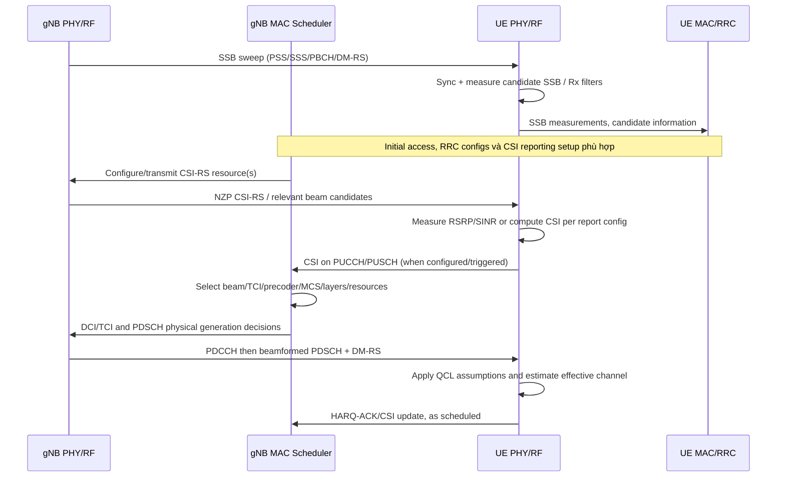
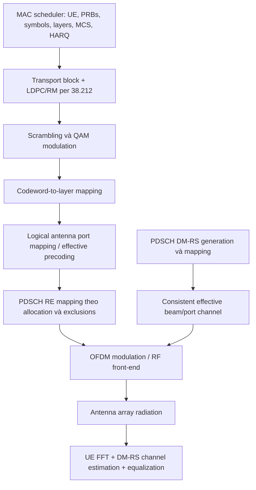
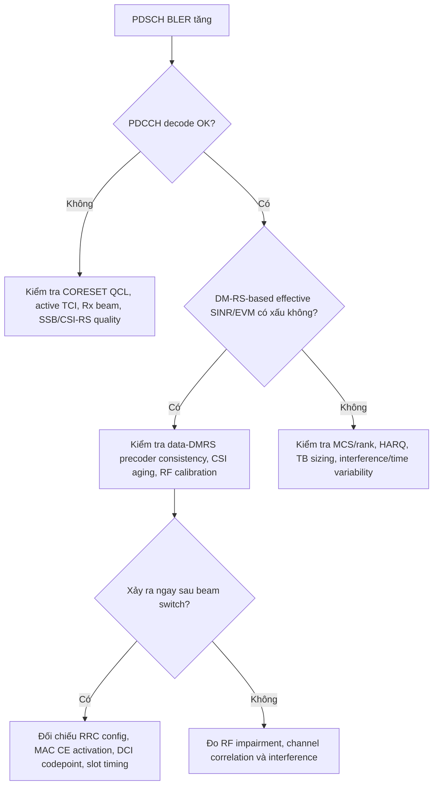

{
  "title": "Beamforming trong 4G LTE và 5G NR: từ điện từ trường đến PHY, CSI, TCI và beam recovery",
  "date": "2026-11-20",
  "draft": false,
  "categories": [
    "4G LTE",
    "5G NR"
  ],
  "tags": [
    "4G LTE",
    "5G NR"
  ],
  "math": true
}

# Beamforming trong 4G LTE và 5G NR: từ điện từ trường đến PHY, CSI, TCI và beam recovery


## Trả lời trực tiếp: beamforming thực chất làm gì?

**Beamforming điều khiển complex weights (biên độ và pha) trên các phần tử phát/thu hoặc antenna ports để tín hiệu cộng tăng cường theo hướng/kênh mong muốn, đồng thời có thể giảm tác động theo các hướng/kênh khác.** Nó là kỹ thuật điều khiển *spatial response*, không chỉ là hình vẽ một chùm sóng hướng tới UE.

Phải phân biệt ba bài toán khác nhau:

1. **Directional beam steering**: chọn hướng làm cho array factor lớn; thường giải thích qua một góc đến/đi (AoA/AoD).
2. **Channel-aware beamforming / precoding**: tối ưu trên **complex channel vector/matrix**, bao gồm multipath, polarization, frequency selectivity, interference; hướng hình học không đủ mô tả toàn bộ.
3. **Beam management**: tìm, đo, lựa chọn, signaling và duy trì cặp Tx/Rx spatial filters trong UE–gNB; 3GPP quy định signal, báo cáo và hành vi UE, nhưng **không** bắt mọi vendor dùng cùng một thuật toán thiết kế weights.

```text
Tín hiệu dữ liệu s[k,l]
         |
         v
  [Digital precoder W[k,l]] -- (nếu có) --> [RF phase-shifter / hybrid network]
         |                                  |   antenna element 0 --> E0(r,t)
         |                                  |   antenna element 1 --> E1(r,t)
         |                                  |   ...
         +--------------------------------> |   antenna element N-1 --> EN-1(r,t)
                                                        |
                                         trường điện từ chồng chập
                                                        v
                                           UE nhận: h[k,l] W[k,l] s + n
```

Khi UE di chuyển, beamforming có thể phải thay đổi vì **channel vector** hoặc **beam pair** thay đổi. Khi môi trường có phản xạ mạnh, hướng beam tối ưu có thể là một đường phản xạ thay vì hướng thẳng hình học về UE. Khi CSI cũ hoặc RF chain không được calibration, một beam trên giấy có thể gây **destructive combining** trên thực tế.

## 1. Tại sao antenna array có thể điều khiển hướng sóng bằng pha?

### 1.1. Bắt đầu từ thời gian sóng đi tới UE, không bắt đầu bằng một thuật toán

Xét **Uniform Linear Array (ULA)** có `N` phần tử đồng dạng, các phần tử nằm trên trục `x`, cách nhau `d`. Góc `θ` đo từ **broadside** (pháp tuyến của array), `θ = 0°` là hướng trước mặt array, không phải hướng dọc array. Giả định far-field, narrowband và môi trường đồng nhất trong bước xây dựng array factor.

```text
                           UE far-field, hướng θ = +30°
                              *
                             / 
                            /  đường truyền gần song song
                     θ     /
                 broadside ↑
                           |
      element 0   1   2   3   4   5   6   7
         o--------o---o---o---o---o---o---o------> trục x
             d (khoảng cách hai phần tử liền kề)
```

Hai phần tử cạnh nhau có chênh lệch quãng đường xấp xỉ `d sinθ` trên hướng quan sát. Với bước sóng `λ=c/f` (m), `c` là tốc độ truyền trong không gian tự do (m/s), `f` là tần số (Hz), độ lệch pha do truyền trong không gian là:

$$
\Delta \phi_{\mathrm{prop}}=\frac{2\pi}{\lambda}d\sin\theta
=kd\sin\theta, \qquad k=\frac{2\pi}{\lambda}.
$$

Dấu của pha phụ thuộc quy ước trường phức và chiều đánh số phần tử. Để nhất quán, tài liệu dùng **transmit array factor**

$$
AF(\theta)=\sum_{n=0}^{N-1} w_n e^{j n k d\sin\theta},
$$

trong đó `w_n` là complex amplitude đưa tới phần tử `n`. Khi muốn cực đại ở `θ₀`, chọn

$$
\boxed{w_n=\frac{1}{\sqrt N}\exp[-j n k d\sin\theta_0]}
\qquad (n=0,\ldots,N-1).
$$

Khi thế vào tại `θ=θ₀`, mọi số hạng có cùng pha:

$$
AF(\theta_0)=\sum_{n=0}^{N-1}\frac1{\sqrt N}=\sqrt N,
\qquad |AF(\theta_0)|^2=N.
$$

**Tại sao không thu được `N²` lần công suất?** Vì lựa chọn `1/√N` giữ nguyên **tổng** công suất do `∑|w_n|²=1` (giả sử cùng công suất ký hiệu đầu vào). Biên độ trường trên hướng cực đại tăng `√N`, nên **mật độ công suất theo hướng** tăng `N` so với một antenna tương đương, trong mô hình lý tưởng. Đó là **array/directivity gain**, không phải tạo thêm công suất từ không khí.

Nếu thay vì cố định tổng công suất, mỗi antenna được giữ công suất bằng một transmitter tham chiếu, tổng công suất phát của array tăng theo `N`; lúc đó mức gain so sánh khác. Khi đọc datasheet hoặc KPI, phải biết **đang cố định total conducted power, per-element power, hay EIRP**.

### 1.2. Array factor và element pattern là hai thứ khác nhau

Phương trình `AF` chỉ mô tả giao thoa do vị trí và weights. Radiation pattern thực tế còn phụ thuộc element pattern, phân cực, mutual coupling, radome, mounting và RF errors:

$$
E_{\mathrm{total}}(\theta,\varphi)\;\approx\;
E_{\mathrm{element}}(\theta,\varphi)\,AF(\theta,\varphi)
$$

Đây chỉ là **pattern multiplication** gần đúng dưới giả thiết array thích hợp. Nếu một beam toán học hướng về vùng có element gain thấp, field thực tế vẫn yếu. Nếu antenna đặt sai mechanical/electrical tilt, beam boresight trong controller không nhất thiết trùng với hướng bức xạ ngoài hiện trường.

### 1.3. Công thức chính xác hơn: vì sao gain và null xuất hiện?

Thay `w_n` vào array factor:

$$
AF(\theta;\theta_0)=\frac1{\sqrt N}
\sum_{n=0}^{N-1}\exp\left[j n k d(\sin\theta-\sin\theta_0)\right].
$$

Đặt

$$
\psi=kd(\sin\theta-\sin\theta_0).
$$

Đây là **cấp số nhân phức**, nên với `ψ` không phải bội số `2π`:

$$
AF=\frac{1}{\sqrt N}
\frac{1-e^{jN\psi}}{1-e^{j\psi}}
=\frac{e^{j(N-1)\psi/2}}{\sqrt N}
\frac{\sin(N\psi/2)}{\sin(\psi/2)}.
$$

Do vậy **normalized power pattern** so với đỉnh chính là:

$$
\boxed{G_{\rm norm}(\theta)=
\left|\frac{\sin(N\psi/2)}{N\sin(\psi/2)}\right|^2}
$$

với giá trị giới hạn bằng 1 khi tử và mẫu cùng tiến tới 0 tại main lobe. Phần `e^{j...}` không làm thay đổi công suất vì module bằng 1. **Null** xuất hiện khi các phasors cộng thành zero, tức `sin(Nψ/2)=0` nhưng `sin(ψ/2)≠0`. **Sidelobes** xuất hiện ở các góc khác nơi phasors chỉ triệt tiêu một phần.

```text
                         Main lobe
                            /\
                 side      /  \       side
                 lobe  /\/    \/\    lobe
-----------------------+--------+------------------ góc θ
                    null       null
```

Hình ASCII này chỉ là cấu trúc định tính: beam thực tế không luôn đối xứng sau steering, đặc biệt với element pattern và array 2D.

### 1.4. Steering không phải duy nhất một cách làm beamforming

Phương pháp trên giả định ta biết một `θ₀` và propagation gần một plane wave. Trong channel multipath, UE nhận nhiều đường:

$$
h_n[k,t]=\sum_{p=1}^{P}\alpha_p[k,t]
\exp[-j n k_c d\sin\theta_p],
$$

trong đó `α_p` là complex path gain, `θ_p` là góc tương ứng và `k_c=2π/λ_c` ở carrier. Kênh còn phụ thuộc subcarrier `k`, thời gian `t` và hardware response. Khi đó beam tối ưu theo effective channel có thể khác beam tạo ra từ một AoD đơn lẻ.

**Điểm gốc rễ**: *phase steering* dựa trên hình học; *channel precoding* dựa trên hàm truyền thực tế. Trong LOS narrowband, hai bài toán gần nhau. Trong NLOS/frequency-selective, không thể đánh đồng.

## 2. Các giới hạn vật lý làm beam rộng/hẹp, méo và gây nhiễu

### 2.1. Số phần tử, aperture, beamwidth

Với ULA broadside, `d≈λ/2`, illumination đồng đều, có thể ước lượng **Half-Power Beamwidth** (HPBW) gần broadside bằng:

$$
\mathrm{HPBW}_{\rm rad}\approx\frac{0.886\lambda}{Nd}
\quad\Longrightarrow\quad
\mathrm{HPBW}_{\rm rad}\approx\frac{1.772}{N}\quad(d=\lambda/2).
$$

Hệ số này là **xấp xỉ main lobe của uniform aperture**, không phải con số cố định cho mọi antenna array. Với scan `θ₀` khác 0, gần hướng scan và chưa gần endfire:

$$
\Delta\theta\approx\frac{0.886\lambda}{Nd\cos\theta_0}.
$$

Nếu `N` tăng từ 8 lên 16 với cùng spacing và excitation, beam hẹp hơn xấp xỉ một nửa theo phương angular near-broadside. Nhưng antenna pattern thực không thể suy ra chỉ từ N: nếu tăng N bằng cách tăng mật độ phần tử trên **cùng physical aperture** thì độ phân giải góc không tự tăng gấp đôi.

| Thay đổi | Lợi ích có điều kiện | Giá phải trả |
|---|---|---|
| Tăng physical aperture | Beam hẹp, phân giải hướng tốt hơn | Kích thước/cơ khí, gần-field và calibration |
| Tăng số phần tử ở `d≈λ/2` | Directivity/gain lý tưởng tăng, nhiều DoF | RF chains/power/cost tùy architecture |
| Amplitude taper (ví dụ Taylor/Chebyshev) | Hạ sidelobes | Main lobe rộng hơn, giảm peak gain với cùng power |
| Scan xa broadside | Truyền theo hướng UE lệch | Beam broadening, scan loss, element pattern giảm |
| Narrower beam | Ít rò năng lượng theo một số hướng | Nhạy hơn với sai lệch steering và movement |

### 2.2. Grating lobes và antenna spacing

Để phase gradient phân biệt được các góc trong miền quan sát, spacing không nên tùy tiện. Với `d>λ/2`, một số góc ngoài main lobe có thể thỏa `ψ=2πm` (m nguyên khác 0), dẫn đến **grating lobe** mạnh như main lobe trong mô hình lý tưởng. Điều kiện alias:

$$
\sin\theta = \sin\theta_0 +m\frac{\lambda}{d}.
$$

Ví dụ `d=λ`, steer tới `θ₀=30°`, ta có `sinθ₀=0.5`. Chọn `m=-1` cho `sinθ=-0.5`, tức `θ=-30°`: main và grating lobe có thể cùng cực đại của array factor. Điều này là **spatial aliasing** chứ không phải DSP tạo thêm một UE. `d≤λ/2` là nguyên tắc phổ biến giúp tránh grating lobes trong miền scan đầy đủ của ULA lý tưởng (với các chi tiết ở biên và real element pattern).

### 2.3. Frequency, aperture và không được nhầm 3.5 GHz với 28 GHz

Giả sử `c≈3×10⁸ m/s`:

| Carrier `f` | `λ=c/f` | `λ/2` | Diễn giải |
|---|---:|---:|---|
| 3.5 GHz | 85.7 mm | 42.9 mm | Array 8 phần tử đơn tuyến có khoảng cách tâm–tâm ~4.3 cm nếu `d=λ/2` |
| 28 GHz | 10.7 mm | 5.36 mm | Có thể đặt nhiều phần tử hơn trên diện tích vật lý tương đương |

**Không** kết luận 28 GHz có beam gain tốt hơn **chỉ vì tần số cao hơn**. Array gain phụ thuộc aperture, số phần tử, hiệu suất và công suất. FR2 thường cần beamforming quyết liệt hơn vì link budget/path loss, blockage và giới hạn phần cứng/độ phủ, trong khi FR1 cũng dùng beamforming, bao gồm Massive MIMO.

### 2.4. Narrowband/far-field có áp dụng cho mọi NR carrier không?

Không. Mô hình `a(θ)` một steering vector độc lập tần số chỉ chuẩn với **narrowband approximation**. Với OFDM rộng băng, phase progression tương đối phụ thuộc tần số:

$$
\psi(f,\theta)=\frac{2\pi f d}{c}\sin\theta.
$$

Một phase shifter được cấu hình ở `f₀` tạo phase fixed theo tần số, nên beam peak tại `f` thỏa xấp xỉ:

$$
\sin\theta_{\rm peak}(f)=\frac{f_0}{f}\sin\theta_0.
$$

Đây là **beam squint**: khi bandwidth rộng, các subcarriers nhìn hướng hơi khác nhau. True-Time-Delay beamforming hoặc frequency-selective digital correction có thể giảm squint, nhưng tăng chi phí/phức tạp [VENDOR]. Với narrowband FR1 điều này có thể nhỏ; với very wideband arrays, aperture lớn, beam hẹp, tác động cần đánh giá.

Far-field thường đòi hỏi khoảng cách lớn so với **Fraunhofer distance** `R_F≈2D²/λ` (`D` là kích thước aperture); khi UE ở gần field, wavefront có độ cong và **near-field focusing** cần mô hình khoảng cách từng element–UE thay vì plane-wave steering. Đừng dùng angle-only model để suy ra mọi tình huống near-field array lớn.

## 3. Numerical example: 8-element array steer 30° rồi UE lệch góc

**[MÔ HÌNH]** ULA `N=8`, `d=λ/2`, `θ₀=30°`, weights equal amplitude, total conducted power chuẩn hóa. Chênh pha weights giữa hai element liên tiếp:

$$
\Delta\phi_{w}=-\frac{2\pi(\lambda/2)}{\lambda}\sin30^\circ=-\frac\pi2=-90^\circ.
$$

Vậy weights:

$$
\mathbf{w}=\frac1{\sqrt8}
\begin{bmatrix}
1 & e^{-j\pi/2} & e^{-j\pi} & e^{-j3\pi/2} &
 e^{-j2\pi} & e^{-j5\pi/2} & e^{-j3\pi} & e^{-j7\pi/2}
\end{bmatrix}^{T}.
$$

Tất cả antenna phát **cùng một data symbol** với phase khác nhau, không phải 8 independent layers. Khi UE đúng hướng 30°, `AF=√8`, array gain lý tưởng `10log₁₀8≈9.03 dB` so với một element được cấp cùng tổng công suất chuẩn hóa.

Nếu UE thực tế nhìn từ 35° nhưng beam chưa cập nhật, dùng công thức `G_norm` ở §1.3:

$$
\Delta u=\sin35^\circ-\sin30^\circ=0.073576,\qquad
\psi=\pi\Delta u,
$$

$$
G_{\rm norm}(35^\circ)
=\left|\frac{\sin(8\pi\Delta u/2)}{8\sin(\pi\Delta u/2)}\right|^2
\approx0.74894.
$$

Sai lệch 5° làm giảm **1.26 dB** so với peak của cùng beam trong mô hình này. Không thể suy ra loss của hệ thống thật chỉ bằng 1.26 dB vì có element pattern, phân cực, scattering và channel tracking.

| Góc UE thực | Sai lệch so với beam 30° | Normalized power | Loss so với beam peak |
|---:|---:|---:|---:|
| 30° | 0° | 1.000 | 0.00 dB |
| 32° | 2° | 0.954 | −0.20 dB |
| 35° | 5° | 0.749 | −1.26 dB |
| 40° | 10° | 0.300 | −5.22 dB |
| 45° | 15° | 0.040 | −13.95 dB |

**WHY**: Narrow beam làm những phasors từng đồng pha tại UE bị lệch tương đối. Khi sai lệch đủ lớn, tổng phasor tiến gần zero. **WHAT IF**: tăng N nhưng giữ `d=λ/2` thường tăng peak gain và làm beam sắc hơn, đồng thời tăng độ nhạy với *một sai số góc cố định*. Thực tế scheduler/beam tracking phải cân bằng beam gain, measurement overhead và mobility.

## 4. Từ steering vector sang channel-aware beamforming / precoding

### 4.1. Mô hình tín hiệu hẹp băng trên một subcarrier

Với `N_t` Tx elements/đường xử lý không gian, `N_r` Rx branches, `L` data layers, một mô hình MIMO **per subcarrier** là:

$$
\boxed{\mathbf y[k,l]=\mathbf H[k,l]\mathbf W[k,l]\mathbf s[k,l]+\mathbf n[k,l]}
$$

- `k`: subcarrier index; `l`: OFDM symbol index.
- `s∈ℂ^{L×1}`: vector modulation symbols của các **layers**; giả định `E[ssᴴ]=I` trước chuẩn hóa transmit power.
- `W∈ℂ^{N_t×L}`: transmit precoding/beamforming matrix, có thể thay theo frequency/time trong giới hạn kiến trúc.
- `H∈ℂ^{N_r×N_t}`: effective MIMO channel, bao gồm propagation và phần hardware/port mapping đã được gộp vào định nghĩa mô hình.
- `y∈ℂ^{N_r×1}`: vector tín hiệu nhận; `n`: noise và có thể thêm interference ngoài cell nếu mở rộng mô hình.

Đây là toán học dùng để **lý giải**, không phải 3GPP ra lệnh mọi base station phải nhân một ma trận tên `W` ở đúng vị trí firmware nhất định. Vendor có thể chia beamforming giữa digital baseband, RF và antenna tile, miễn thỏa giao diện air-interface và UE assumptions.

### 4.2. Single-user rank-1: tại sao conjugate channel cho maximum-ratio transmission (MRT)?

Với một UE single-Rx branch, channel row vector là `h=[h₀,…,h_{N_t−1}]`, tín hiệu là:

$$
y=\mathbf h\mathbf w s+n,
\quad\|\mathbf w\|_2^2=1,
\quad E|s|^2=P.
$$

Tín hiệu hữu ích có công suất `P|h w|²`. Theo **Cauchy–Schwarz**:

$$
|\mathbf h\mathbf w|^2\le\|\mathbf h\|_2^2\|\mathbf w\|_2^2
=\|\mathbf h\|_2^2.
$$

Dấu bằng xảy ra khi `w` cùng hướng với `hᴴ`, tức:

$$
\boxed{\mathbf w_{\rm MRT}=\frac{\mathbf h^H}{\|\mathbf h\|_2}}.
$$

Nếu `h=[1,e^{jπ/3}]` và `||h||=√2`:

$$
\mathbf w=\frac1{\sqrt2}\begin{bmatrix}1\\e^{-j\pi/3}\end{bmatrix},
\qquad \mathbf h\mathbf w=\sqrt2.
$$

Kết quả effective channel gain `|hw|²=2` so với phát trên antenna đầu có gain `1`: **+3.01 dB** trong ví dụ công suất tổng như nhau. Lý do: pha của thành phần thứ hai được quay ngược để hai tín hiệu cộng **coherent**. MRT được coi là giải pháp tối ưu SNR trong bài toán một UE, noise trắng, không ràng buộc interference hoặc per-antenna power ngoài norm.

**WHAT IF** CSI bị sai? Giả sử base station dùng `ĥ` nhưng thực tế là `h`, beam phát sẽ là `w=ĥᴴ/||ĥ||`, không còn đạt Cauchy–Schwarz equality đối với `h`. Nếu UE di chuyển hoặc đổi pha do RF chain, beam có thể mất coherent gain ngay cả khi RSRP của SSB vẫn cao.

### 4.3. Receive beamforming: MRC và MVDR không giải cùng một bài toán

Với một transmitter và `N_r` receiver branches:

$$
\mathbf y=\mathbf h s+\mathbf n, \qquad
z=\mathbf v^H\mathbf y.
$$

Nếu noise covariance là `σ²I`, **MRC** chọn `v=h/||h||`. Công suất tín hiệu sau combining tỷ lệ `||h||²` vì combining đồng pha giữa các receive branches.

Nếu có spatially colored interference covariance `R_i+n`, cấu trúc tối ưu SINR dạng linear receive combining là:

$$
\mathbf v\propto\mathbf R_{i+n}^{-1}\mathbf h.
$$

Điều này dẫn tới **MVDR/IRC-style** receivers: không chỉ bắt tín hiệu mạnh mà còn giảm interference có hướng/covariance xác định. Ở UE, nhận đúng spatial filter quan trọng không kém việc gNB truyền đúng beam. Đặc biệt FR2, UE có thể không quan sát đồng thời tất cả hướng với một analog Rx chain.

### 4.4. Beamforming và spatial multiplexing khác nhau như thế nào?

- **Beamforming rank 1**: nhiều antenna có thể mang **một** layer; mục tiêu chính tăng effective SNR / giảm interference.
- **Spatial multiplexing rank >1**: cùng time-frequency resources mang **nhiều** layers; receiver phải phân giải được các spatial signatures.
- **MU-MIMO**: nhiều UE dùng chung một tập time-frequency resources; precoder cần hạn chế **inter-user interference**; có thể đồng thời beamforming và multiplexing.

Số antenna elements, RF chains, antenna ports và transmission layers **không đồng nghĩa**. Ví dụ một panel 64 physical elements có thể tạo một CSI-RS port hoặc vài ports tùy virtualization; một port đã mang một signal bằng beam của nhiều physical elements. UE không có nghĩa vụ biết chính xác 64 phase weights phía gNB.

### 4.5. Khi nào MRT sai về mục tiêu hệ thống? MU-MIMO và null steering

Xét hai UE single-antenna chia sẻ PRB:

$$
\begin{aligned}
y_1&=\mathbf h_1\mathbf w_1s_1+\mathbf h_1\mathbf w_2s_2+n_1,\\
y_2&=\mathbf h_2\mathbf w_2s_2+\mathbf h_2\mathbf w_1s_1+n_2.
\end{aligned}
$$

Nếu chỉ tối ưu `|h₁w₁|²` và `|h₂w₂|²` riêng, tín hiệu dành cho UE1 vẫn có thể rơi mạnh vào UE2. MU-MIMO cần một bài toán **joint**:

$$
\mathrm{SINR}_u=
\frac{P_u|\mathbf h_u\mathbf w_u|^2}
{\sum_{v\ne u}P_v|\mathbf h_u\mathbf w_v|^2+I_u+\sigma_u^2}.
$$

Ví dụ hai channel rows:

$$
\mathbf H=\begin{bmatrix}1&1\\1&-1\end{bmatrix}.
$$

Hai beam vectors `w₁=[1,1]ᵀ/√2` và `w₂=[1,-1]ᵀ/√2` trực giao. Vì `h₁w₂=0` và `h₂w₁=0`, **inter-user interference bằng 0** trong mô hình lý tưởng. Nếu cả hai UE có channel gần `[1,1]`, bài toán trở nên khó vì **spatial separation/rank** kém: `W` phải giảm cross-leakage nhưng có thể khuếch đại noise / giảm desired gain hoặc chịu loss do power normalization.

**Mối liên hệ với beamforming**: một narrow beam chỉ nói về angular/pattern gain. MU precoder còn phải xét **null** hoặc tối ưu SINR trong miền spatial channel. Beam rất hẹp **không** bảo đảm zero inter-user interference khi beam sidelobes, angular spread hoặc CSI errors lớn.

### 4.6. SVD, eigenbeamforming và channel rank

Với một UE đa antenna, phân tích

$$
\mathbf H=\mathbf U\mathbf\Sigma\mathbf V^H.
$$

Các cột của `V` là right singular vectors (transmit spatial modes), singular values trong `Σ` cho biết sức mạnh của các eigenmodes. Chọn một mode mạnh nhất giúp tối ưu link gain đơn layer trong giả thiết thích hợp; chọn nhiều modes có thể tăng spectral efficiency nếu receiver và SNR đủ.

Vì vậy **high RSRP + narrow beam** không đồng nghĩa **high rank**: hai antenna nhận có thể thấy channel tương quan cao và `Σ` chỉ có một singular value lớn. Trong NR, PMI/RI/CQI giúp gNB lựa chọn precoder/rank theo cấu hình báo cáo; scheduler cuối cùng vẫn có thể dùng rank khác theo constraints và chính sách [VENDOR].

## 5. Beamforming được tạo ở đâu trong hardware: analog, digital và hybrid

```text
ANALOG (một RF chain ví dụ):
Digital symbol --> DAC/RF --> splitter --> [phase] --> element 0
                                      +--> [phase] --> element 1
                                      +--> ...     --> element N-1

DIGITAL (mỗi đường điều khiển độc lập ví dụ):
Layer(s) --> Digital W[k] --> RF0 --> element 0
                          --> RF1 --> element 1
                          --> ... --> element N-1

HYBRID (ví dụ N_RF << N_elem):
Layers --> Digital W_BB[k] --> RF chains --> Analog W_RF --> N elements
```

### 5.1. Analog beamforming

**HOW**: một/few streams đi qua RF path rồi được phân chia, điều chỉnh pha (có thể biên độ) bởi RF phase shifters. Với một RF chain, trong một cấu hình instantaneous, spatial pattern bị ràng buộc lớn bởi `w_RF`; nhiều subcarriers thường dùng cùng analog weights tại một thời điểm.

**WHY**: dùng ít RF chains/ADCs/DACs hơn, tiết kiệm công suất/chip area so với fully digital per-element. **WHAT IF** có hai UE khác hướng cần hai beams đồng thời? Một architecture analog single-RF-chain không tự tạo hai independent data spatial streams cùng tài nguyên; phải time-multiplex hoặc dùng nhiều RF chains/subarrays/hybrid theo implementation.

### 5.2. Digital beamforming

Digital precoder có thể khác trên từng subcarrier hoặc nhóm PRBs (tùy scheduler và triển khai) và phục vụ nhiều layers/beams cùng lúc. Nhưng cần nhiều converters/RF signal paths và đòi hỏi đồng bộ, calibration, memory bandwidth và DSP/FPGA/ASIC compute lớn.

**Quan trọng**: 3GPP air interface không đặt yêu cầu mọi NR gNB phải thực hiện digital beamforming *per physical element*. “64T64R” thường là cách nói số RF paths/Tx-Rx chains trong một antenna unit, nhưng cách vendor map tới radiating elements, subarrays và antenna ports phải xác minh từ thiết kế cụ thể [VENDOR].

### 5.3. Hybrid beamforming và phép nhân ma trận thực tế

Một mô hình hybrid:

$$
\boxed{\mathbf x[k]=\mathbf F_{RF}\mathbf F_{BB}[k]\mathbf s[k]}
$$

với `F_BB∈ℂ^{N_RF×L}` và `F_RF∈ℂ^{N_elem×N_RF}`. Trong phase-only architecture, các phần tử không-zero của `F_RF` có modulus gần cố định; phase có thể bị lượng tử hóa, chẳng hạn 5–7 bit, **chỉ là ví dụ phần cứng**, không phải yêu cầu 3GPP.

Điều kiện cần để có L independent streams là ít nhất `N_RF≥L` và đủ spatial rank hiệu dụng; nhưng đây **chưa đủ** nếu channel rank/UE capabilities/DM-RS ports/scheduling không hỗ trợ.

| Tiêu chí | Analog | Digital | Hybrid |
|---|---|---|---|
| Spatial flexibility | Hạn chế theo RF network | Cao | Trung gian |
| Frequency-selective weights | Khó với fixed phase shifters | Thuận lợi hơn | Digital part có thể hỗ trợ |
| Số RF chains cần | Ít | Lớn | Trung gian |
| Multi-layer / multi-user | Hạn chế cấu hình single-chain | Khả năng tốt nếu đủ RF chains | Phụ thuộc topology |
| Power/complexity | Thường thấp hơn | Thường cao hơn | Cân bằng |
| Nhược điểm đặc trưng | Beam squint, quantization | Cost, calibration, power | Hybrid decomposition loss |

Không có architecture nào “tốt nhất mọi lúc”. Phần mềm scheduler chỉ có thể chọn một beam/precoder nằm trong **feasible hardware set**.

### 5.4. Polarization: tại sao hai antenna cùng vị trí vẫn có thể mang hai ports?

Antenna panels cellular thường dùng **dual-polarized elements**. Hai trường phân cực khác nhau tạo thêm một mức phân biệt spatial/polarization nếu channel/UE antenna đủ tách biệt. Tuy nhiên, cross-polarization discrimination (XPD), UE orientation, depolarization bởi multipath và coupling làm hai polarization không bao giờ bảo đảm hai orthogonal independent layers.

3GPP TR 38.901 Release 18 §7.3 mô tả rectangular panel với các chiều panel/element và `P=1` hoặc `P=2` polarization. Đây là **reference channel/antenna model** cho nghiên cứu và đánh giá, không phải kích thước bắt buộc của mọi sản phẩm thương mại.

### 5.5. RF calibration: vì sao computed weights chưa chắc tạo đúng beam?

Tín hiệu phần tử thực:

$$
x_n^{RF}=g_n e^{j\delta_n}x_n^{BB}
$$

với `g_n` và `δ_n` là sai số gain/phase của TX chain. Khi radio phát nóng hoặc cable/RF path đổi, `δ_n` thay đổi => pha tại aperture không đúng weights lý tưởng. Nếu hai antenna đáng ra lệch −90° nhưng RF chain thứ hai tăng thêm +20°, main beam dịch hoặc méo, gain/null depth giảm.

Ở TDD, propagation channel có reciprocity nhưng **end-to-end digital baseband channels không tự reciprocity** vì Tx/Rx RF chains khác nhau:

$$
\mathbf H_{DL}^{\rm eff}\sim\mathbf R_{UE}\mathbf H_{prop}\mathbf T_{gNB},
\quad
\mathbf H_{UL}^{\rm eff}\sim\mathbf R_{gNB}\mathbf H_{prop}^{T}\mathbf T_{UE}.
$$

Tương quan này phải được diễn giải theo cách sắp xếp ma trận và thời điểm, song ý nghĩa không đổi: muốn suy ra DL precoder từ UL SRS cần bù gain/phase mismatch phù hợp. Internal / over-the-air reciprocity calibration là thiết kế [VENDOR], không được coi là một chi tiết luôn có thể suy ra từ RRC log.

## 6. Điều gì thực sự được chuẩn hóa bởi LTE và NR?

### 6.1. Bốn từ thường bị gọi sai: element, RF chain, antenna port, layer

| Đối tượng | Nó là gì? | Cái gì **không** được suy ra? |
|---|---|---|
| Physical antenna element | Radiating structure | Không xác định số layers |
| RF chain | Đường DAC/ADC/mixer/PA/LNA tùy thiết kế | Không xác định cứng số 3GPP ports |
| **Antenna port** | Logical concept cho phép UE suy ra channel của một symbol từ RS trên cùng port trong điều kiện quy định | **Không** phải một đầu nối antenna vật lý |
| Spatial layer | Một chiều tín hiệu symbol stream của một codeword/layer mapping | Không phải số beams hoặc số antenna elements |
| Beam / spatial filter | Pattern hoặc receive/transmit spatial response | Không nhất thiết là một 3GPP beam ID vật lý |
| TCI state | Signaling configuration về RS/QCL assumptions, có thể liên hệ spatial reception | Không phải full complex weights `W` |

**[3GPP]** TS 38.211 v18.3.0 Release 18 **§4.4.1** định nghĩa antenna port theo khả năng suy ra channel và mô tả quasi-colocation giữa ports. TS 38.214 **§5.1.5** nêu TCI-state/QCL cho PDSCH/PDCCH/CSI-RS. Cần nhớ: TCI hoặc QCL giúp UE biết **spatial Rx assumptions**, không yêu cầu gNB công bố vector weights của physical elements.

### 6.2. LTE: beamforming đã có trước NR

Với LTE downlink, thông tin thể hiện trong **TS 36.211** (layer mapping/precoding/reference signals) và **TS 36.213** (UE PDSCH reception/transmission schemes, CSI procedures). Ở cấu hình LTE cổ điển:

- **Transmission Mode 7**: single-layer UE-specific reference-signal-based transmission (antenna port 5 theo scheme/cấu hình phù hợp); eNB có thể sử dụng UE-specific beamforming mà UE demodulate dựa trên UE-specific RS.
- **TM8**: hỗ trợ dual-layer UE-specific RS transmission theo scheme; không đồng nhất TM8 với một beam/one layer.
- **TM9/TM10**: thêm khả năng multi-layer, CSI-RS/UE-specific DM-RS, transmission schemes và enhanced MIMO/CoMP tùy cấu hình, Release.

**Cẩn thận**: transmission mode và antenna port cụ thể phụ thuộc DCI/scheme/UE capabilities. Không được khẳng định “LTE luôn cần UE báo đúng phase weights” hoặc “LTE beamforming bắt buộc chỉ dùng TM7”. TS 36.213 v17.4.0 **§7.1** và TS 36.211 v17.4.0 **§6.3** mô tả scheme, layer mapping, precoding; đối chiếu giá trị thực tế theo DCI và mode.

### 6.3. Tại sao UE-specific DM-RS cho phép transparent precoding?

Ý tưởng chung:

```text
                       W (gNB biết, UE không nhất thiết biết trực tiếp)
Data layer s ---------+----------------> precoded data --> over-the-air
DM-RS for same port --+----------------> precoded DM-RS --> over-the-air
                                                            |
                                                    UE channel estimation
                                                            v
                                                     effective H * W
```

Nếu cùng precoder/assumptions áp dụng đúng cho data và DM-RS trên antenna port tương ứng, UE đo được **effective channel** `H_eff=H W` từ DM-RS, rồi equalize data. UE không cần tách độc lập `H` và `W` để demodulate. Đây là lý do **reference signal có cùng effective spatial signature** là trọng tâm của beamformed PDSCH.

Trong thực tế mapping và precoding consistency phải tuân theo port/PRG/slot assumptions của standard: không thể tự thay `W` ở những RE khiến UE đã suy đoán channel theo một precoder khác. Trong NR, antenna port và DM-RS assumptions tham khảo TS 38.211 §4.4.1; PRB bundling TS 38.214 §5.1.2.3 và PDSCH/DM-RS procedures tại §5.1.4–5.1.6.

## 7. NR beam management: từ SSB discovery đến CSI-RS refinement

Beamforming physics ở §1–5 không tự giải quyết câu hỏi **gNB biết UE đang ở beam nào bằng cách nào?**. Đặc biệt ở FR2, UE và gNB có thể đều dùng directional Rx/Tx filters. Một beam tốt ở gNB kết hợp với một UE receive beam sai vẫn cho link yếu. Vì vậy cần **beam-pair management**.

### 7.1. Initial cell search: không có CSI thì bắt đầu từ đâu?

**[3GPP]** NR SS/PBCH block chứa PSS, SSS, PBCH và PBCH DM-RS trong một cấu trúc **240 subcarriers × 4 OFDM symbols** theo TS 38.211 v18.3.0 **§7.4.3.1**. Một SS burst set có thể mang nhiều SSB indices ở các thời điểm khác nhau, tạo cơ hội transmitter hướng các SSB theo nhiều spatial directions (SSB beam sweeping theo implementation).

```text
                       SSB burst set (timeline minh họa, không phải cấu hình cố định)
Time  --------------------->
         SSB#0        SSB#1         SSB#2         SSB#3
         beam A       beam B        beam C        beam D
         |            |             |             |
UE:   measure A     measure B     measure C     measure D
                         \          /
                           chọn candidate tốt
```

- `SSB index` xác định một SS/PBCH block candidate trong tập cơ hội của hệ thống; nó **không** mã hóa trực tiếp một góc azimuth/elevation hoặc vector RF weights chuẩn hóa.
- Nhiều gNB phát các SSB indices trên các beams khác nhau để phủ hướng, nhưng mapping index ↔ physical beam angle là thiết kế anten/PHY scheduler [VENDOR].
- UE đo synchronization / SS-RSRP và tìm cell/beam candidate; đồng thời cần PBCH/MIB và system information, random access theo thủ tục tương ứng để truy nhập.
- UE có thể receive-sweep qua các filter theo khả năng hardware; chi tiết beam selection algorithm không được chuẩn hóa như một hàm duy nhất.

**Vì sao không dùng ngay CSI-RS với CSI report đầy đủ?** Một UE chưa biết cell, timing, configuration và chưa được cấp đủ thông tin để giải các CSI-RS measurement/report configurations UE-specific. SSB cho một anchor ban đầu trước khi có dedicated CSI/beam refinement.

### 7.2. P-1, P-2, P-3 là cách phân loại beam management, không phải ba message RRC cố định

Trong tài liệu study 3GPP TR 38.802 §6.1.6.1, beam management thường được diễn giải thành:

- **P-1**: lựa chọn coarse Tx/Rx beam(s), sử dụng SSB hoặc CSI-RS tùy ngữ cảnh/cấu hình; thiết lập hoặc duy trì suitable beam pair.
- **P-2**: gNB **Tx beam refinement** trên các Tx candidates; UE giữ receive filter hoặc tổ chức đo sao cho so sánh có ý nghĩa, đo CSI-RS và report.
- **P-3**: UE **Rx beam refinement** với Tx condition thích hợp; UE tìm receive spatial filter tốt hơn.

> Các nhãn **P-1/P-2/P-3** là mô hình giải thích từ nghiên cứu NR; không nên tìm các message `P2Request` hoặc giả định mọi gNB luôn chạy theo một state machine P1→P2→P3 trong từng slot.

Ví dụ refinement:

```text
  Coarse SSB beam B        Narrow CSI-RS beams thuộc vùng B (ví dụ)
   \          /                     |  |  |  |
    \        /                     B1 B2 B3 B4
     \ UE  /                           |
      \   /                         UE đo CRI/RSRP
       \ /                          chọn B3

  Tx refinement: gNB đổi Tx beam; UE dùng Rx observation phù hợp.
  Rx refinement: gNB giữ Tx relationship; UE đổi Rx spatial filter.
```

**Tại sao SSB beam tốt nhất chưa chắc là data beam tốt nhất?** SSB và data/CSI-RS có thể dùng beamwidth, frequency/time allocation, power và patterns khác nhau. RSRP đo tại thời điểm SSB cũng không nói đầy đủ về interference trên PRBs PDSCH hoặc rank. Vì vậy SSB selection là một **anchor** chứ không phải kết luận cuối cùng về data precoder.

### 7.3. CSI-RS for beam management và CSI-RS for channel estimation/codebook có gì khác?

**NZP CSI-RS resource** là reference-signal resource để UE đo và/hoặc tính CSI theo `CSI-ResourceConfig` và `CSI-ReportConfig`. Tùy `reportQuantity`, số port, resource set, periodicity và restriction, report có thể hướng tới:

1. **Beam quality / beam selection**: chẳng hạn `cri-RSRP`, `ssb-Index-RSRP`, L1-RSRP, L1-SINR; chọn resource index theo cấu hình.
2. **MIMO codebook feedback**: PMI, RI, CQI, CRI hoặc phần tương ứng trong report, theo codebook & port configuration.
3. **Tracking/measurements**: các chức năng liên quan channel/reference signal theo cấu hình.

**CRI** là CSI-RS Resource Indicator; **SSBRI** là SS/PBCH Block Resource Indicator. Chúng chỉ ra measured RS resource, không phải magic beam angle. **PMI** cho biết codebook precoding preference dưới giả thiết measurement/report được cấu hình, không phải file dump ma trận gNB physical weight thực tế. **RI** phản ánh số layers UE khuyến nghị/giả định cho CSI trong điều kiện tương ứng; **CQI** phản ánh chất lượng kênh để chọn modulation/coding theo định nghĩa report, không phải trực tiếp EIRP.

**[3GPP]** TS 38.214 v18.3.0 §5.2.1: reporting settings, resource settings, triggering/activation; §5.2.1.4.3–5.2.1.4.4: L1-RSRP, L1-SINR; §5.2.2.2: PMI and codebooks. **[VENDOR]**: bộ lọc thời gian, đo số beam candidates, hysteresis, prediction và scheduler utility cụ thể.

### 7.4. Sơ đồ sequence ở mức UE–gNB–scheduler



**Không có một timing cố định trong sơ đồ**: SSB periodicity, CSI-RS periodic/semi-persistent/aperiodic resources, CSI report triggers, RRC delay, MAC CE activation, DCI-to-PDSCH scheduling offset, UE processing capability đều ảnh hưởng thời gian. Sơ đồ là **logical dependency**, không phải sequence bắt buộc từng message trên mọi Release.

### 7.5. Một ví dụ rõ về measurement resource ≠ data beam

Giả sử `CSI-RS resource 8` được gNB phát trên một beam tương ứng với candidate `B3` và UE đo tốt. UE report CRI=8. Scheduler có thể:

- chọn một TCI state tham chiếu tới resource phù hợp để UE có đúng spatial Rx assumption;
- dùng thêm PMI/RI/CQI để quyết định data precoding/layers;
- áp dụng một **data precoder** khác nhưng tương thích QCL/DM-RS/UE assumptions, không nhất thiết bằng cứng weights dùng cho toàn bộ CSI-RS;
- hoặc giữ beam khác nếu tải cell, interference, feedback aging hoặc scheduler constraints làm quyết định tổng thể tốt hơn.

Kết luận: `CRI=8` **không chứng minh** mọi PDSCH đã truyền trên “RF beam ID 8”. Cần correlate CSI, TCI indication, actual scheduler decisions, panel calibration, và tốt nhất là PHY trace để đánh giá actual weights/beam mapping [VENDOR].

## 8. TCI, QCL và DM-RS: UE biết phải nhận beam nào như thế nào?

### 8.1. QCL có nghĩa là gì?

Hai reference signals/ports được coi là **quasi co-located** về thuộc tính large-scale cụ thể nếu UE có thể dùng thông tin đo ở RS nguồn để suy ra thuộc tính tương ứng của RS đích. Trong TS 38.214 v18.3.0 **§5.1.5**:

| QCL type | Những thông tin có thể suy ra (theo điều khoản) | Tại sao quan trọng? |
|---|---|---|
| `typeA` | Doppler shift, Doppler spread, average delay, delay spread | Time/frequency tracking, channel estimator assumptions |
| `typeB` | Doppler shift, Doppler spread | Tracking theo Doppler |
| `typeC` | Doppler shift, average delay | Timing/Doppler assumptions |
| **`typeD`** | **Spatial Rx parameter** | Rx filter/spatial reception assumption |

Type-D là cầu nối quan trọng giữa control-plane beam signaling và Rx beam choice. Nhưng type-D **không** tương đương một bộ tọa độ `(azimuth,elevation)` chuẩn hóa, cũng không phải phép đo real-time channel trong mọi RE. Một TCI-state có thể tham chiếu một/hai reference signals với QCL types tùy điều kiện.

### 8.2. RRC config, MAC CE activation và DCI indication là các tầng khác nhau

**[3GPP]** RRC `TCI-State` configuration theo TS 38.331 định nghĩa association với RS/QCL; TS 38.214 §5.1.5 mô tả assumption và TCI indication/activation interaction. Tùy Release/features (legacy per-channel TCI hoặc unified TCI framework), việc activation qua MAC CE và chọn state/codepoint qua DCI khác nhau; không được giả định một duy nhất “DCI luôn mang raw Beam ID”.

```text
RRC cấu hình những TCI states được phép
             |
             v
MAC CE có thể activate/map states vào codepoints
             |
             v
PDCCH / DCI có thể indicate codepoint/state theo rules
             |
             v
UE lấy QCL-TypeD (nếu áp dụng) -> Rx spatial filter assumption
             |
             v
UE estimate channel trên PDSCH DM-RS -> equalization/data detection
```

`TCI-StateId` là **logical identifier**. Một UE có thể cần biết active CORESET/PDCCH TCI relation và PDSCH TCI relation, không chỉ riêng data channel. Nếu decode PDCCH thất bại do Rx beam sai, UE thậm chí không nhận được chỉ thị về PDSCH tiếp theo; đây là một yếu tố khiến **beam failure recovery** phải xử lý cả control-link reliability.

**WHAT IF** MAC CE vừa activate state mới nhưng UE/gNB giả định state mới có hiệu lực trước thời điểm tiêu chuẩn cho phép? UE có thể áp dụng QCL cũ, dẫn đến PDCCH/PDSCH decode failure. Thời điểm hiệu lực phụ thuộc đúng mode và điều khoản của Release (không có một số OFDM symbols duy nhất áp dụng cho tất cả). Khi debug cần check **RRC state list → MAC CE payload/ACK → DCI codepoint → actual PDSCH slot**.

### 8.3. Vì sao DM-RS không thể thay thế hoàn toàn CSI-RS hoặc TCI?

- **DM-RS**: reference signal đi cùng physical channel, giúp estimate **effective channel** cần equalization/demodulation.
- **CSI-RS/SSB**: measurement/tracking/beam selection, định nghĩa reference sources cho QCL và CSI feedback tùy configuration.
- **TCI/QCL**: báo cho UE cách tận dụng properties của RS khác khi nhận một channel/signal.

DM-RS có thể giúp UE estimate channel **sau khi đã nhận được/đồng bộ đúng receive configuration**. Ở UE với narrow analog beam, nếu Rx filter đang hướng sai, tín hiệu DM-RS có thể đã bị suy giảm trước ADC và UE không có SNR để estimate. Vì thế cần beam-level measurement/indication bên cạnh symbol-level channel estimation.

### 8.4. Đừng nhầm “PDSCH beam” với “DM-RS antenna port”

Một PDSCH có thể dùng một hay nhiều DM-RS ports trong cấu hình được hỗ trợ. DM-RS antenna port là **logical channel identity**, không phải mỗi port phải phát trên một physical antenna riêng. Cùng một Tx array có thể beamform nhiều logical ports theo precoders khác nhau và thay đổi theo scheduling. Receiver suy ra effective per-port channels trên DM-RS được cấu hình.

**Nếu beam của data và DM-RS không nhất quán** với assumptions hợp lệ, effective channel estimate `Ĥ_eff` không đại diện cho data RE; equalizer có thể gây constellation rotation/EVM cao/BLER dù average RSRP có vẻ tốt.

## 9. Uplink beamforming: SRS, gNB Rx combiner, UE Tx filter

### 9.1. Uplink ≠ chỉ đơn giản lấy beam downlink đảo chiều

Uplink có **hai phía**:

1. **UE Tx beam**: UE chọn spatial Tx filter cho PUSCH/PUCCH/SRS theo signaling, spatial relation hoặc UL/joint TCI configurations, capability và RF hardware.
2. **gNB Rx beamforming/combining**: gNB dùng array + channel estimates từ UL (SRS/DM-RS) để combine hoặc null interference.

Với uplink channel vector `g` ở gNB, nhận `r=g s+n`; MRC chọn `v∝g`, còn interference-aware combining có thể dùng `R_{i+n}^{-1}g`. Với nhiều UE UL MU-MIMO, gNB có thể thực hiện ZF/MMSE separation khi channel matrix có đủ rank/SINR.

### 9.2. Sounding Reference Signal được dùng để làm gì?

**[3GPP]** TS 38.211 **§6.4.1.4** định nghĩa SRS generation/resource mapping; TS 38.214 UL procedures và TS 38.331 SRS configurations liên quan việc UE phát SRS và gNB sử dụng theo cấu hình. SRS cho phép gNB đo uplink spatial/frequency response trước data scheduling tùy periodic, semi-persistent hoặc aperiodic sounding.

```text
UE PHY phát SRS trên configured resource(s)
                    |
            gNB Rx array đo H_UL[k]
                    |
         beam/UL scheduler & receiver choices
                    |
           UL grant / beam indication rules
                    |
UE phát PUSCH + DM-RS -> gNB equalize/IRC/MRC
```

**[VENDOR]** gNB có thể từ SRS chọn receive beam, UL precoding strategy, estimate user separability hoặc infer DL Tx precoding trong TDD khi đã calibration. Thủ tục/thuật toán SRS→DL weights chính xác là implementation-dependent.

### 9.3. TDD reciprocity: đúng ở propagation channel, có điều kiện ở baseband

Ở TDD cùng/đủ gần tần số UL-DL và gần thời điểm, Maxwell reciprocity (với môi trường/hardware reciprocal theo giả thiết) giúp kênh propagation DL và UL liên hệ chuyển vị. Tuy nhiên TX/RX analog chains không giống nhau, nên digital-estimated UL CSI **không thể** đưa thẳng làm DL precoder không calibration. Lỗi calibration có thể tạo beamforming gain loss ngay cả trong stationary channel.

Ở **FDD**, UL và DL carrier tách biệt. Không thể giả định complex instantaneous `H_UL` bằng `H_DL` transpose. Angular structure và long-term statistics có thể có tương quan, nhưng direct DL precoding thường dựa vào DL measurement/CSI feedback hoặc dự đoán được vendor thiết kế. Đây là lý do overhead, CSI codebook và channel aging có tính khác nhau giữa FDD/TDD.

### 9.4. UE power và spatial filter: beam mạnh không bảo đảm PUSCH thành công

UE có giới hạn `P_CMAX` và power-control behavior. Khi power-limited, UE không thể chỉ tăng PA power để bù path loss; array/spatial filter có thể tăng effective received signal, nhưng phụ thuộc UE RF capability, antenna orientation và gNB Rx combining. Misconfigured pathloss RS, UL spatial relation/TCI hoặc timing/power control có thể làm UL fail trong khi DL RSRP tốt. Debug phải quan sát **UL SRS SINR, PUSCH SINR/BLER, Tx power/PHR, spatial state và gNB Rx beam**, không dùng DL RSRP làm proxy duy nhất.

## 10. Beamforming tương tác với OFDM resource grid như thế nào?

### 10.1. Beam không phải một “loại RE” riêng

Trong NR, **RE** được chỉ số hóa bởi `(k,l)` = subcarrier, OFDM symbol; mỗi antenna port có resource grid logic. Beamforming/precoding điều khiển cách **complex signal trên port(s)** được phát qua antenna array. Không có RE đặc biệt bắt buộc tên `BEAM`, và một beam không đồng nghĩa một PRB.

Thứ tự chức năng điển hình cho **PDSCH downlink**:



Đây là **functional flow**, không nên suy ra mọi vendor luôn tính `W` trước RE mapping: trong code có thể thực hiện precoding trên lưới frequency domain per RE/PRG, hoặc ghép ở baseband/RF; điều cần đảm bảo là logical mapping, signal format, timing và UE assumptions **tương đương theo air interface**.

**[3GPP]** TS 38.211 v18.3.0: PDSCH §7.3.1.1 scrambling, §7.3.1.2 modulation, §7.3.1.3 layer mapping, §7.3.1.4 antenna port mapping, §7.3.1.5–6 RB mapping; PDSCH DM-RS §7.4.1.1 và CSI-RS §7.4.1.5. Resource allocation/PRB bundling ở TS 38.214 §5.1.2, PDSCH resource mapping §5.1.4.

### 10.2. Minh họa một PRB: beam và DM-RS tồn tại ở những mức khác nhau

**Sơ đồ chỉ mô tả ý tưởng, KHÔNG phải pattern RE theo 3GPP** (vì DM-RS pattern phụ thuộc mapping type A/B, type 1/2, length, additional positions, CDM groups và port configuration). Mỗi dấu là một RE logic trong ví dụ minh họa 12 subcarriers × 14 symbols của normal CP:

```text
          OFDM symbol index (l) -------------->
         0  1  2  3  4  5  6  7  8  9 10 11 12 13
SC 11:   D  D  D  D  D  D  D  D  D  D  D  D  D  D
SC 10:   D  D  R  D  D  D  D  D  D  D  D  D  D  D
SC  9:   D  D  D  D  D  D  D  D  D  D  D  D  D  D
SC  8:   D  D  R  D  D  D  D  D  D  D  D  D  D  D
SC  7:   D  D  D  D  D  D  D  D  D  D  D  D  D  D
SC  6:   D  D  R  D  D  D  D  D  D  D  D  D  D  D
SC  5:   D  D  D  D  D  D  D  D  D  D  D  D  D  D
SC  4:   D  D  R  D  D  D  D  D  D  D  D  D  D  D
SC  3:   D  D  D  D  D  D  D  D  D  D  D  D  D  D
SC  2:   D  D  R  D  D  D  D  D  D  D  D  D  D  D
SC  1:   D  D  D  D  D  D  D  D  D  D  D  D  D  D
SC  0:   D  D  R  D  D  D  D  D  D  D  D  D  D  D

D = RE payload giả định, R = RE dành cho DM-RS giả định.
Không hiển thị PDCCH/CORESET, CSI-RS, PTRS, rate-matching exclusions.
```

**Tại sao sơ đồ này có ích?** Giả sử beam weights `w=[w0,…,wN−1]` dùng để phát cả `D` và `R` trong cùng logical port/assumptions. UE thu `R`, ước lượng `h_eff≈h·w`, rồi equalize `D`. Nếu `w` thay đột ngột giữa `R` và `D` không phù hợp các assumptions, `ĥ_eff` sai và EVM tăng.

Cần phân biệt **physical port-to-element mapping** với **RE occupancy**: đổi weights có thể thay beam mà không dịch một RE nào; ngược lại scheduler đổi PRB allocation chưa chắc đổi beam.

### 10.3. CSI-RS beam sweep là khác PDSCH data mapping

Một cấu hình minh họa gNB truyền CSI-RS candidates trên các resource khác nhau:

```text
      Measurement occasion 1         occasion 2         occasion 3
         CSI-RS resource A           resource B          resource C
         beam w_A                    beam w_B             beam w_C
                 \                     |                    /
                  \-------- UE measures and reports --------/
```

UE đo trên **CSI-RS REs được cấu hình theo đúng TS 38.211 §7.4.1.5**, chứ không đơn giản lấy PDSCH resource grid ở trên và thay `D` bằng `C`. CSI-RS resources có port counts, `frequencyDomainAllocation`, `firstOFDMSymbolInTimeDomain`, `density`, `cdm-Type`, period/offset và resource set restrictions. Cần dùng actual RRC config và bảng 3GPP để dựng vị trí chính xác.

Một ví dụ tính **địa chỉ**, không giả mạo standard table: nếu một RE tại `k=K0+4`, symbol `l=7`, thì physical `k` phải suy ra từ BWP/CRB mapping, Point A và PRB index theo numerology. Vị trí `k,l` của CSI-RS **không** được xác định từ góc beam hoặc từ số antenna physical. Beam weight được áp lên signal của RS resource sau khi UE/gNB nhất quán mapping logic.

### 10.4. SSB có layout cố định; beamforming không đổi layout đó

SSB (trong cấu hình NR tiêu chuẩn tương ứng) rộng **240 subcarriers × 4 symbols**. SSB index và thời gian occurrence quyết định các SSB candidates/measurement opportunities; khi gNB phát SSB#i với beam `w_i`, nó thay **spatial pattern**, không đổi cấu trúc nội bộ của SSB. Gắn PSS/SSS/PBCH vào một beam yếu có thể gây cell-search failure, dù data beam khác vẫn tốt nếu UE đã kết nối.

## 11. Timing: khi nào beam được tìm, report, chọn và sử dụng?

Cần phân biệt `beam selection` (ước lượng/hành vi vendor) với `reference-signal transmission` và `control signaling` (thủ tục cấu hình chuẩn). Không có một chu kỳ beamforming mặc định, ví dụ “mỗi slot đổi beam” cho mọi NR cell.

```text
Time --------------------------------------------------------------->
 t0       t1       t2       t3        t4         t5          t6
 |        |        |        |         |          |           |
 SSB ---> initial  RRC CSI   NZP CSI   CSI       TCI/        PDSCH
 sweep    access   config    -RS       feedback  scheduler   + DM-RS
                                                        (conditional)

  SSB burst periodicity, CSI reporting mode, processing delay,
  MAC CE activation và DCI-to-PDSCH offset không nhất thiết bằng nhau.
```

### 11.1. Vì sao stale CSI gây beam miss dù UE vẫn ở trong cell?

Nếu channel ở thời điểm `t` là `h(t)` nhưng gNB dùng `ĥ(t−Δ)`, hiệu quả coherent combining suy giảm khi channel đổi theo Doppler, UE orientation, dynamic blockage hoặc reflector movement. Một mô hình thời gian lý tưởng có **Doppler frequency** `f_D=(v/λ)cosα`, trong đó `v` là tốc độ (m/s), `α` là góc giữa hướng chuyển động với hướng sóng tới. Khi `v=15 m/s` và `f=3.5 GHz` thì `v/λ≈175 Hz` (maximum magnitude theo mô hình), còn 28 GHz là khoảng `1400 Hz`.

Các con số này **không** đồng nghĩa beam phải update đúng `1/f_D` giây. `f_D` mô tả phase/channel time variation; **beam direction drift** còn phụ thuộc hình học, distance và angular spread. Một UE chạy song song trạm ở xa có thể đổi phase nhanh nhưng đổi angular beam chậm. Ngược lại, UE gần array hoặc xoay handset có thể đổi Rx beam rất nhanh dù di chuyển vị trí ít.

### 11.2. Vì sao đổi beam thường cần scheduling/feedback coordination?

Scheduler phải cân nhắc:

- UE có measurement gần đây cho candidate beam không?
- TCI state đã được RRC configured, có được activate/indicate hợp lệ và UE đã áp dụng đúng effective time chưa?
- PDCCH beam/CORESET Rx filter của UE có cho phép nhận DCI không?
- PDSCH PRBs, rank, modulation và DM-RS ports có hợp lệ với CSI/codebook/UE capabilities không?
- Có xung đột khi UE cần Rx beams khác nhau cho hai channels/signals gần thời gian nhau không, nhất là UE analog FR2?
- Có concurrent CSI-RS, SSB, data, PRACH, BFR hoặc multiple TRP constraints không?

**WHAT IF** UE report beam A tốt nhưng gNB PDSCH sử dụng beam B? Chưa chắc là lỗi; phải kiểm tra scheduler rationale và QCL consistency. **WHAT IF** UE được indicate một TCI state chưa activate? Khi đó là lỗi signaling/interpretation đáng điều tra, nhưng cần áp dụng đúng Release và feature mode trước khi kết luận.

## 12. Beam failure detection và recovery: hệ thống thoát khỏi beam xấu bằng cách nào?

### 12.1. Beam failure không giống mất toàn bộ cell ngay lập tức

Beam failure detection (BFD) tập trung vào chất lượng reference signal phù hợp với **control link / beam tracking**. Một beam có thể suy giảm nghiêm trọng do blockage trong khi cell có candidate beam khác vẫn đủ tốt; mục tiêu của BFR là chuyển sang candidate mà không phải luôn rơi về full radio link re-establishment.

**[3GPP]** TS 38.213 v18.3.0 **§5 Radio link monitoring; §6 Link recovery procedures** quy định reference-signal/measurement/candidate behavior. TS 38.321 v18.3.0 **§5.17 Beam Failure Detection and Recovery** quy định UE MAC counters, timers, triggering và recovery paths; TS 38.331 RRC có các cấu hình như `beamFailureInstanceMaxCount`, `beamFailureDetectionTimer`, `candidateBeamRSList` tùy Release/configuration.

### 12.2. Phân biệt beam failure instance với beam failure trigger

Một model logic theo TS 38.321 §5.17 (giản lược, không thay thế toàn bộ trường hợp đa BFD-RS sets):

```text
 UE PHY đánh giá BFD reference signals
                  |
    chất lượng đủ xấu theo điều kiện kỹ thuật?
               /      \
             no        yes -> lower layer BFI indication
             |                     |
          tiếp tục             UE MAC: start/restart BFD timer
                                   increment BFI_COUNTER
                                   |
                    BFI_COUNTER >= configured max count?
                           /                   \
                         no                     yes
                         |                       |
                   tiếp tục                   trigger BFR
                                                |
                            evaluate configured candidate beam RS
                                                |
                              SpCell: random access procedure
                              SCell: BFR MAC CE / SR paths
                                                |
                              recovery completed / counter reset
```

**Đặc biệt quan trọng**: `beamFailureInstanceMaxCount` là số BFI indications trước khi trigger theo logic §5.17, không phải “số lần UE retransmit PDSCH”; `beamFailureDetectionTimer` ảnh hưởng cửa sổ tích lũy counter. Ở Release 17/18 có thể có **hai BFD-RS sets** và enhanced BFR; việc reset/thành công khác nhau theo set và serving-cell context.

### 12.3. SpCell khác SCell

- **SpCell (PCell/PSCell theo topology)**: nếu beam failure phù hợp trigger, UE có thể tiến hành **Random Access** theo BFR configuration. Với một số cấu hình multi-BFD-RS set, logic trigger và RA phải đọc đúng TS 38.321 §5.17.
- **SCell**: hỗ trợ báo BFR qua **BFR MAC CE**, các lựa chọn SR/UL-SCH theo configured resources; không phải mọi SCell beam failure đều bắt buộc khởi động PRACH trên SCell.
- **BFR success**: không nên suy từ một CSI report beam tốt đơn lẻ; quy định completion tùy RA completion hoặc signaling được định nghĩa ở MAC/PHY procedures.

### 12.4. Vì sao RF blockage có thể khiến recovery thất bại?

Nếu toàn bộ candidate beams gặp cùng vật chắn hoặc UE cần Rx filter để nghe PDCCH/PRACH response mà không chuyển đúng spatial relation, detection có thể có candidate trên đo lường nhưng giao tiếp điều khiển vẫn fail. Các khả năng khác: candidate RS đo quá cũ, `rsrp-ThresholdSSB`/`rsrp-ThresholdBFR` misconfiguration, PRACH resource mapping không phù hợp, timing window hoặc TCI/CORESET không consistent.

**Troubleshooting path**:

1. Xác định BFD-RS set/source (SSB hay CSI-RS), SCell/SpCell, active BWP và exact Release.
2. Đọc `BFI_COUNTER`, timer, maxCount, BFR event timestamp.
3. Kiểm tra measured L1-RSRP/SINR của candidates tại thời điểm liên quan.
4. Xem UE đã trigger SR/MAC CE hay PRACH theo đúng route chưa.
5. Kiểm tra gNB response, TCI QCL changes, CORESET/PDCCH quality, PDSCH/PUSCH HARQ.
6. Tách **no suitable beam** khỏi **suitable beam nhưng signaling/timing/hardware mismatch**.

## 13. Khi nào beamforming tốt hơn, khi nào làm kết quả xấu đi?

### 13.1. Peak gain tăng nhưng cell throughput không nhất thiết tăng

Beamforming có thể nâng desired signal power cho một UE nhưng không tự động tăng **cell sum throughput**. Cùng PRB, tăng SU beam gain có thể giúp MCS cao hơn; tuy nhiên hệ thống phải xét:

$$
C_{u,\rm ideal}\approx B\log_2(1+\mathrm{SINR}_u)
$$

với `B` là effective bandwidth trong mô hình Shannon (Hz). Đây là **upper-bound lý thuyết đối với channel Gaussian với assumptions tương ứng**, không phải công thức throughput 3GPP. Actual throughput phụ thuộc usable REs, modulation, code rate, rank, HARQ, control/DM-RS/CSI overhead, scheduler allocation và UE category/capabilities.

Ví dụ chỉ để hiểu order-of-magnitude: 100 PRBs, SCS 30 kHz, normal CP 14 symbols/slot, **giả sử** 20% RE không dùng cho PDSCH, modulation 64QAM (`Q_m=6`), `R=0.60`, rank 1:

$$
N_{\rm raw}=100\times12\times14=16800\ \mathrm{RE/slot},
$$

$$
N_{\rm data,assumed}=0.8\times16800=13440\ \mathrm{RE/slot},
$$

$$
T_{\rm illustrative}=13440\times6\times0.60=48384\ \mathrm{bit/slot}.
$$

Với slot duration `0.5 ms` cho SCS 30 kHz (normal CP), kết quả lý tưởng đơn giản là khoảng **96.77 Mbit/s**. Đây **không phải một phép xác định NR Transport Block Size (TBS)**: TBS có quy tắc lượng tử/overhead/rate matching riêng trong TS 38.214 §5.1.3; con số trên cố tình bỏ nhiều yếu tố để thấy vì sao increasing SINR/rank chỉ giúp nếu dẫn đến MCS/rank và RE allocation tốt hơn.

### 13.2. Chọn beam theo RSRP cao nhất có thể sai

**[MÔ HÌNH]** Hai beam candidates A/B và một receiver có interference/noise trong bandwidth được xét:

| Beam | Desired received power | Interference | Noise | SINR tính toán |
|---|---:|---:|---:|---:|
| A | −75 dBm | −85 dBm | −100 dBm | ~9.86 dB |
| B | −78 dBm | −95 dBm | −100 dBm | ~15.81 dB |

Dùng `P_mW=10^(P_dBm/10)`, cộng interference và noise ở **linear power**, rồi:

$$
\mathrm{SINR}_{dB}=P_{S,dBm}-10\log_{10}(P_{I,mW}+P_{N,mW}).
$$

Beam A có desired power mạnh hơn 3 dB, nhưng Beam B có SINR tốt hơn gần 6 dB vì interference thấp hơn. Đây là lý do beam selection chỉ dựa `max RSRP` không tối ưu cho mọi metric. Phải xem **measurements có cùng reference, bandwidth và power assumptions** trước khi so sánh các số trong trace. Với CSI report của 3GPP, quantity/report definitions quyết định cách L1-RSRP/L1-SINR được đo; ví dụ này là giải thích vật lý chứ không thay thế thủ tục chuẩn.

### 13.3. Channel correlation và array geometry có thể vô hiệu hóa beamforming theo hướng mong muốn

Nếu channels của hai UE gần song song trong complex vector space, precoders không thể tách hoàn hảo mà không chịu gain/power penalty lớn. Khi UE ở những hướng gần nhau nhưng multipath khác, angle separation chưa phải toàn bộ: effective **channel correlation** mới quan trọng cho MU scheduling.

Với normalized channel vectors `h₁,h₂`, một chỉ số minh họa:

$$
\rho=\frac{|\mathbf h_1\mathbf h_2^H|}
{\|\mathbf h_1\|\|\mathbf h_2\|},\quad 0\le\rho\le1.
$$

- `ρ≈0`: dễ spatially separate trong mô hình ideal.
- `ρ≈1`: pair khó phân biệt, ZF precoder dễ bị ill-conditioned và gain penalty.
- `ρ` chỉ là chỉ số hình học/channel; thực tế phải dùng SINR, covariance, frequency selectivity, traffic QoS và UE capabilities.

### 13.4. Null steering: tại sao vẫn cần số bậc tự do (degrees of freedom)?

Nếu muốn beam chính về UE1 và đặt null về UE2, cần tìm `w` sao cho:

$$
\mathbf h_1\mathbf w=g_{\mathrm{target}},\qquad
\mathbf h_2\mathbf w\approx0.
$$

Một vector `w` có `N_t` complex variables nhưng các constraints chiếm spatial degrees of freedom. Khi có nhiều UEs/interferers hơn số spatial dimensions độc lập, không thể triệt tiêu tất cả mà vẫn giữ desired gain. **DoF là rank và kiến trúc**, không đơn thuần là nhãn “64 antennas”. Với multiuser matrix `H` full row rank và `N_t≥K`, một zero-forcing candidate là:

$$
\mathbf W_{ZF}=\mathbf H^H(\mathbf H\mathbf H^H)^{-1}\mathbf D
$$

trong đó `D` chuẩn hóa streams theo power constraints. Khi `H Hᴴ` gần singular, inverse làm precoder coefficients rất lớn, dẫn đến power normalization loss và kém robust với CSI errors. Regularized ZF dùng:

$$
\mathbf W_{RZF}\propto\mathbf H^H
(\mathbf H\mathbf H^H+\alpha\mathbf I)^{-1},\qquad \alpha>0,
$$

để trade-off interference suppression với gain/noise/power. Cách chọn `α`, pairing/beam codebook và power allocation là thiết kế [VENDOR].

### 13.5. Effective beams ở FR1 có thể rộng và không cần đổi liên tục

Không phải “mọi NR UE có một very narrow pencil beam”. FR1 macro coverage, antenna aperture, band, deployment và user mobility có thể dẫn tới beams rộng, codebook beams hoặc long-term/short-term channel-aware precoding. FR2 array dense thường dùng Rx/Tx beam pairing rõ rệt hơn do analog/hybrid architectures và blockage. Nhưng phân biệt theo **khả năng array/RF, bandwidth, propagation và use case**, không áp đặt “FR1 không beamforming”.

### 13.6. Một beam có thể cải thiện DL và làm UL xấu đi không?

Có. Downlink gNB high-EIRP array và uplink UE power-limited không có symmetric link budgets. Khi gNB Tx beam mới đạt DL RSRP cao nhưng UE UL spatial filter/TCI, pathloss reference, sounding resource hoặc gNB Rx beam vẫn cũ, PUSCH/SRS có thể xấu. TDD reciprocity hỗ trợ một số giải pháp nhưng không tự động đồng bộ mọi hardware state. Đây là lý do **link adaptation, power control và UL beam management** phải được debug riêng.

## 14. Bộ bước suy luận để triển khai hoặc troubleshoot một beamforming problem

### 14.1. Phân biệt mất coverage do propagation với lỗi beam steering/calibration

Giả sử log cho thấy `SS-RSRP=-87 dBm` tương đối ổn nhưng PDSCH BLER tăng sau một lần TCI switch. Không nên kết luận ngay “antenna beam sai”. Đi theo chuỗi nguyên nhân:



Với beam switch, cần kiểm tra cả **PDCCH** lẫn **PDSCH**. SSB measurement cao không đảm bảo PDSCH DM-RS SINR cao; L1-RSRP không phản ánh đầy đủ interference. Với TCI logging, `TCI-StateId=4` không cho biết angle; cần mapping vendor giữa state, RS, actual panel/beam and transmit weights.

### 14.2. Khi throughput giảm sau bật narrow-beam policy

| Quan sát | Giả thuyết có cơ chế | Thử nghiệm để phân biệt |
|---|---|---|
| Peak RSRP tăng, throughput gần như không đổi | Đã MCS ceiling; PRB bottleneck; rank vẫn 1 | So sánh MCS, rank, PRB usage, BLER, CQI distribution |
| Peak RSRP tăng, BLER tăng | Sidelobes/interference, CSI stale, data–DM-RS mismatch | DM-RS SINR/EVM, CSI age, channel estimation trace |
| Tốt static, xấu khi UE đi lại | Narrow beam tracking/feedback chậm; Rx sweep overhead | Mobility bins, candidate switching count, angular tracking |
| CSI-RS RSRP tốt nhưng PDSCH kém | Measurement resource khác PDSCH conditions/beam; interference/MCS | TCI/QCL, PRB subband, CSI report config, transport BLER |
| BFR trigger liên tục | BFD-RS xấu, threshold, blockage, TCI/state loop | BFI counter, timers, q0/q1 candidates, BFR route |
| TDD DL beamforming gain không đạt | RF reciprocity calibration lệch; SRS CSI stale | UL–DL channel mapping, calibrations, OTA beam scan |
| Cell-edge UL kém dù DL tốt | UL power limit, gNB Rx beam/sounding wrong | UL SRS/DM-RS SINR, UE PHR/Tx power, UL beam state |
| MU-MIMO spectral efficiency giảm | UEs spatially correlated / unmodeled interference | Pair correlation, precoder leakage, MU vs SU utility |

### 14.3. Những trace/log nên xin từ vendor

Các tên trường dưới đây là **conceptual fields**. Tên và availability của counter/signal trong Ericsson/Nokia/Samsung/Huawei/Qualcomm hoặc test gNB khác nhau. Không được xem đây là bộ tên chuẩn 3GPP:

- Cell/band/ARFCN, PCI, BWP, numerology/SCS, TDD frame pattern, TRP/panel/antenna mapping.
- SSB indices sent, corresponding physical beam mapping (nếu vendor expose), UE SS-RSRP/SS-SINR distribution.
- CSI-RS resource sets/IDs, periodicity, `CSI-ReportConfig`, CRI/SSBRI/L1-RSRP/L1-SINR, PMI/RI/CQI timestamps.
- RRC TCI state list, active MAC CE mapping, DCI TCI codepoint, CORESET/PDCCH TCI/QCL, PDSCH DM-RS port(s).
- gNB selected precoder/codebook/beam group/panel, selected SU/MU status, configured layer/rank và MCS.
- CQI age, CSI processing/transport delay, UE mobility, rotation/heading, relative AoA/AoD nếu available.
- PDCCH DTX/BLER, PDSCH BLER, EVM, HARQ retransmissions, interference measures, SRS/PUSCH channel quality.
- TDD calibration status, RF per-chain phase/gain health, antenna alarms, VSWR/PA saturation, timing sync.
- BFD-RS set(s), BFI indications, counter, timer, candidate beam reports, BFR MAC CE/PRACH results.

**Đánh giá trước/sau** phải giữ tương đương load, traffic mix, bandwidth, mobility, UE classes, TDD ratio và radio conditions. Nếu chỉ so RSRP cao hơn mà bỏ `BLER`, `PRB utilization`, `rank` và `PDSCH SINR`, kết luận beamforming effectiveness dễ sai.

### 14.4. Pseudocode của scheduler/beam selector (KHÔNG phải 3GPP algorithm)

```text
for each UE u in active_UEs:
    measurements = collect_recent_RRC_CSI_SSB_SRS(u)
    candidate_beams = filter_configured_and_available_beams(u)

    for each candidate b:
        estimate effective SNR/SINR using measurement, interference, CSI age
        estimate feasible rank/MCS with UE capabilities and port constraints
        estimate reliability penalty, switching overhead, control-beam constraints
        utility[b] = expected_goodput - risk_penalty - switch_cost

    preferred[u] = argmax_legal_candidate(utility)

jointly schedule PRB/time/layers/users under hardware + interference constraints
activate/indicate relevant TCI state according to RRC/MAC/DCI timing rules
apply physical precoding and matching DM-RS / port channel assumptions
read HARQ/CSI feedback; update estimates and mobility statistics
```

Điểm mấu chốt là `argmax RSSI` **không** đủ. Một network scheduler tối ưu **expected delivered bits/goodput** phải đưa vào interference, BLER, switch overhead, CSI age và fairness. Pseudocode chỉ minh họa một implementation design; 3GPP không chuẩn hóa hàm `utility` này.

## 15. Tự kiểm tra bằng Python/Numpy: từ pha phần tử đến beam loss

Đoạn code dưới đây là **mô phỏng ULA lý tưởng độc lập**, không cần 3GPP stack. Nó kiểm tra công thức §1 và §3, bảo đảm tổng norm weights bằng 1 và tính beam loss theo góc. Độ rộng, gain và null của array thật có thể khác vì element pattern, coupling và RF front-end.

```python
import numpy as np

N = 8
spacing_lambda = 0.5  # d / lambda
target_deg = 30.0
n = np.arange(N)

# Convention: AF(theta) = sum_n w[n] * exp(+j*2pi*n*d/lambda*sin(theta))
steering_phase = 2 * np.pi * spacing_lambda * np.sin(np.deg2rad(target_deg))
w = np.exp(-1j * n * steering_phase) / np.sqrt(N)

assert np.isclose(np.vdot(w, w).real, 1.0)

def array_gain_linear(theta_deg):
    phase = 2 * np.pi * spacing_lambda * np.sin(np.deg2rad(theta_deg))
    af = np.sum(w * np.exp(1j * n * phase))
    return float(np.abs(af) ** 2)

def relative_loss_db(theta_deg):
    peak = array_gain_linear(target_deg)
    actual = array_gain_linear(theta_deg)
    return 10 * np.log10(actual / peak) if actual > 0 else -np.inf

print("Peak array gain (linear):", array_gain_linear(target_deg))
for angle in [30, 32, 35, 40, 45]:
    print(f"UE={angle:>3d}°, loss={relative_loss_db(angle):>7.2f} dB")

# Expected approximation for this ideal model:
# peak gain ≈ 8, loss(35°) ≈ -1.26 dB, loss(40°) ≈ -5.22 dB

# Optional check: max-ratio transmission for a simple complex channel
h = np.array([1.0 + 0j, np.exp(1j * np.pi / 3)])  # channel row
w_mrt = np.conjugate(h) / np.linalg.norm(h)
print("MRT effective power gain:", abs(h @ w_mrt) ** 2)  # ≈ 2
```

**Thực hành thêm**: thay `N=16`, cùng `spacing_lambda=.5`, rồi so loss tại `θ=35°`. Nhận xét bằng cách chạy code thay vì áp dụng công thức near-broadside không phù hợp cho mọi góc. Sau đó thay `spacing_lambda=1.0`, scan `θ=30°` và tìm giá trị tại `−30°` để nhìn thấy grating lobe.

## 16. Các hiểu lầm kỹ thuật cần loại bỏ khi đọc thông số mạng

**“Beamforming chỉ là tăng công suất phát.”** Sai. Với total conducted power cố định, nó phân bố hướng và coherent-combine. EIRP theo một hướng có thể tăng nhưng total power không tự tăng.

**“64T64R nghĩa là UE nhận 64 layers.”** Sai. Số physical elements/RF chains khác antenna ports/layers; layers còn bị giới hạn bởi hardware, rank, UE capability và scheduling.

**“Một TCI state là một RF beam angle.”** Sai. Nó là một cấu hình logical về RS/QCL/spatial reception assumptions; ánh xạ sang beams là triển khai thực tế.

**“SSB beam mạnh nhất chắc chắn là PDSCH beam tốt nhất.”** Sai. SSB resources/pattern/measurement khác data channel, và interference có thể đảo thứ tự SINR.

**“DM-RS tốt nên không cần CSI-RS/SSB beam management.”** Sai. DM-RS equalizes effective channel khi UE đã nhận hợp lý; đo/duy trì spatial beam pair vẫn cần theo cấu hình.

**“TDD uplink CSI luôn chính xác bằng DL CSI.”** Sai tại digital baseband nếu RF Tx/Rx chains không calibration; ngoài ra còn aging, frequency/time/propagation nonidealities.

**“Nhiều antenna luôn tạo gain 10log10(N) dB trong thực tế.”** Sai. Công thức chỉ là ideal coherent array gain với normalization rõ ràng; path correlation, aperture, tapering, coupling, RF losses và geometry quyết định realized gain.

**“Beam càng hẹp càng tốt.”** Sai. Beam hẹp tăng peak directivity nhưng dễ miss khi UE di chuyển; overhead/tracking và interference/beam-switch dynamics có thể làm giảm goodput.

**“Beamforming và MU-MIMO là cùng một thứ.”** Sai. Beamforming tạo spatial pattern/precoding; MU-MIMO là quyết định cùng tài nguyên phục vụ nhiều UE và cần hạn chế cross-user leakage.

**“P-1, P-2, P-3 là các MAC messages chuẩn bắt buộc.”** Sai. Đó là các procedure categories từ NR study dùng để hiểu acquisition/refinement; actual signaling dựa vào SSB, CSI-RS, CSI reporting, RRC, MAC, DCI theo feature/release.

**“Beam failure = toàn bộ cell bị radio link failure.”** Sai. BFR có thể chuyển candidate beam mà không phải luôn re-establish full connection; phương thức tùy serving cell, configuration và Release.


## 17. Bản đồ nguồn tham khảo: đối chiếu cơ chế với 3GPP

Để tránh nhầm lẫn giữa **tín hiệu/thủ tục chuẩn hóa** và **thuật toán implementation**, dưới đây là bản đồ tra cứu. Các đường dẫn là PDF công bố tại ETSI, có thể mở trực tiếp và dùng chức năng tìm kiếm theo clause. **Release/version ghi ở đây là bản được sử dụng cho tài liệu này**, không ngụ ý đây là version mới nhất tính đến mọi thời điểm.

| 3GPP specification (ETSI PDF) | Release; version | Điều khoản có liên quan | Vì sao cần đọc khi nghiên cứu beamforming |
|---|---|---|---|
| [TS 38.211 — NR Physical channels and modulation](https://www.etsi.org/deliver/etsi_ts/138200_138299/138211/18.03.00_60/ts_138211v180300p.pdf) | Rel-18, v18.3.0 | §4.4.1 **Antenna ports**; §4.4.2 **Resource grid**; §6.4.1.4 **SRS**; §7.4.1.1 **PDSCH DM-RS**; §7.4.1.5 **CSI-RS**; §7.4.3.1 **SS/PBCH block** | Xác định RS, port, vị trí tín hiệu trên RE và quy tắc mapping. Không suy từ đây rằng 3GPP bắt buộc gNB dùng loại phase-shifter hay thuật toán beam selection cụ thể. |
| [TS 38.213 — NR Physical layer procedures for control](https://www.etsi.org/deliver/etsi_ts/138200_138299/138213/18.03.00_60/ts_138213v180300p.pdf) | Rel-18, v18.3.0 | §5 **Radio link monitoring**; §6 **Link recovery procedures** | Liên kết reference signals/beam quality với link failure và recovery trên physical/control procedures; đọc cùng MAC §5.17, không xem RLM = BFR. |
| [TS 38.214 — NR Physical layer procedures for data](https://www.etsi.org/deliver/etsi_ts/138200_138299/138214/18.03.00_60/ts_138214v180300p.pdf) | Rel-18, v18.3.0 | §5.1.5 **Antenna ports quasi co-location**; §5.1.6 **UE procedure for receiving reference signals**; §5.2 **CSI reporting**; §5.2.2.2 **PMI/codebook** | Quy định UE có thể dựa vào các QCL assumptions nào, khai báo/báo cáo CSI ra sao; dùng để kiểm chứng TCI/QCL, RI/PMI/CQI. |
| [TS 38.321 — NR MAC protocol](https://www.etsi.org/deliver/etsi_ts/138300_138399/138321/18.03.00_60/ts_138321v180300p.pdf) | Rel-18, v18.3.0 | §5.17 **Beam Failure Detection and Recovery procedure** | Các counter, timer, trigger, hành vi MAC và sự phân biệt SpCell/SCell khi recovery. Các nhánh tùy cấu hình/feature, không dùng một generic timer cho mọi UE. |
| [TS 38.331 — NR RRC protocol](https://www.etsi.org/deliver/etsi_ts/138300_138399/138331/18.08.00_60/ts_138331v180800p.pdf) | Rel-18, v18.8.0 | §6.3.2 **Radio resource control information elements**; tìm `TCI-State`, `CSI-MeasConfig`, `BeamFailureRecoveryConfig`, `SRS-Config` | Những information elements và cấu hình RRC cung cấp nền tảng cho measurement, TCI/QCL, SRS/BFR. Vị trí chi tiết của field phụ thuộc IE và feature được cấu hình. |
| [TS 38.215 — NR Physical layer measurements](https://www.etsi.org/deliver/etsi_ts/138200_138299/138215/18.03.00_60/ts_138215v180300p.pdf) | Rel-18, v18.3.0 | §5.1.1 **SS-RSRP** và các mục measurement liên quan | Phân biệt measurement power/quality với SINR/goodput; phục vụ so sánh beam bằng dữ liệu đo. |
| [TS 36.211 — E-UTRA Physical channels and modulation](https://www.etsi.org/deliver/etsi_ts/136200_136299/136211/17.04.00_60/ts_136211v170400p.pdf) | Rel-17, v17.4.0 | §6.3 **Downlink physical channels**; §6.10 **Downlink reference signals** | LTE antenna-port, reference signals, UE-specific RS và DL layer mapping để hiểu precoding/beamforming của LTE. |
| [TS 36.213 — E-UTRA Physical layer procedures](https://www.etsi.org/deliver/etsi_ts/136200_136299/136213/17.04.00_60/ts_136213v170400p.pdf) | Rel-17, v17.4.0 | §7.1 **UE procedure for receiving PDSCH**; §7.2 **CSI reporting** | Transmission modes, DCI, PDSCH reception và CSI trong LTE; phân biệt LTE TM-based approach với NR TCI/QCL approach. |
| [TS 36.214 — E-UTRA Physical layer measurements](https://www.etsi.org/deliver/etsi_ts/136200_136299/136214/17.00.00_60/ts_136214v170000p.pdf) | Rel-17, v17.0.0 | §5.1.1 **RSRP** | Ý nghĩa measurement trong LTE; không được đồng nhất RSRP với SINR của data beam. |
| [TR 38.901 — Channel model for frequencies from 0.5 to 100 GHz](https://www.etsi.org/deliver/etsi_tr/138900_138999/138901/18.00.00_60/tr_138901v180000p.pdf) | Rel-18, v18.0.0 | §7.3 **Antenna modelling** | Mô hình element pattern, polarization, array/channel trong nghiên cứu, khác với electromagnetic simulation đầy đủ của một AAS triển khai thực tế. |

### 17.1. Những điều 3GPP xác định — và những điều không nên gán cho 3GPP

**3GPP xác định:** cấu trúc physical channels và reference signals; antenna port assumptions; CSI/RRC signaling; khả năng UE xử lý một số QCL/TCI state; thủ tục BFD/BFR theo configuration; các giới hạn port, layer, timing và activation được ghi trong specification tương ứng.

**Không nên suy luận là bắt buộc theo 3GPP:** gNB dùng MRT, MVDR, ZF, RZF hay một beam-selection cost function cố định; dùng đúng `8×8` hay `16×4` planar array; mỗi SSB index tương ứng duy nhất một fixed azimuth angle; một gNB scheduler ưu tiên beam theo RSRP thay vì SINR; mọi cấu hình hybrid RF phase-shifter có cùng số RF chains; beam sweep mang tính periodic/aperiodic giống nhau ở mọi vendor.

**Một điểm cần phân biệt cẩn thận:** `TCI-State` là *configuration/signal relationship* được chuẩn hóa; không phải bản công bố ma trận physical precoder. Một beam có thể được triển khai khác nhau giữa eNB/gNB mà UE vẫn hoạt động đúng giao diện 3GPP. Số effective beam directions, codebook quantization và schedule cadence phụ thuộc capability, cấu hình RRC, deployment, frequency range và vendor design.

**[CẦN XÁC NHẬN — nguồn study trực tiếp]** Các nhãn procedure `P-1`, `P-2`, `P-3` được dùng rộng rãi khi giải thích NR beam management và thường được quy chiếu về **3GPP TR 38.802 §6.1.6.1**. Trong bản nghiên cứu này, chức năng của ba procedure được đối chiếu qua tài liệu kỹ thuật giải thích của [MathWorks — Understanding 5G Beam Management](https://www.mathworks.com/campaigns/offers/next/understanding-5g-beam-management.html). Chưa kiểm tra trực tiếp số điều khoản đó trên PDF TR 38.802 bản gốc tại ETSI trong cùng lượt đối chiếu; vì vậy không coi chi tiết số clause của TR 38.802 là đã xác minh sơ cấp. Dù vậy, **SSB/CSI-RS measurement, CSI reporting, QCL/TCI và BFR** được mô tả trong các tài liệu TS chính thức trong bảng trên và là nguồn normative cần ưu tiên khi triển khai.

### 17.2. Checklist kiểm chứng trước khi áp dụng vào một product hoặc log trace

1. Ghi rõ **LTE/NR**, **FDD/TDD**, carrier frequency, bandwidth, SCS, numerology và **Release** UE/gNB hỗ trợ.
2. Kiểm tra antenna element layout, RF chains, ports, polarizations; không lấy `64T64R` để suy trực tiếp `rank=64`.
3. Lấy cấu hình thật: `SSB`, `CSI-RS`, `CSI-ReportConfig`, `TCI-State`, `SRS`, RLM/BFD/BFR và các MAC CE/DCI fields liên quan.
4. Vẽ timeline có dấu **đo → xử lý → feedback → activate/indicate → actual PDSCH/PUSCH** để phát hiện CSI aging, lệnh tới muộn hoặc Rx filter mismatch.
5. So sánh `RSRP`, `SINR`, `CQI`, `RI`, MCS, `BLER`, PRB usage và throughput, chú ý **cùng thời điểm/cùng carrier/cùng UE**.
6. Trước khi gán lỗi cho beamforming, loại trừ clock/synchronization, power headroom, calibration, antenna installation, inter-cell interference và scheduler restrictions.
7. Nếu thay đổi release hoặc bật advanced feature (multiple TCI, multi-TRP, unified TCI), **đọc lại chính xác các điều khoản liên quan đến feature đó**; không áp một flow của Rel-15 vào mọi cấu hình Rel-18.

**Kết luận kỹ thuật:** beamforming kết nối ba lớp: **electromagnetic wave superposition → complex baseband precoding/filtering → 3GPP measurement/signaling/recovery**. Cần hiểu đủ cả ba mới có thể lý giải vì sao một beam được tính toán chính xác trên DSP nhưng ngoài hiện trường vẫn không mang lại SINR, rank hoặc throughput như mong đợi.
