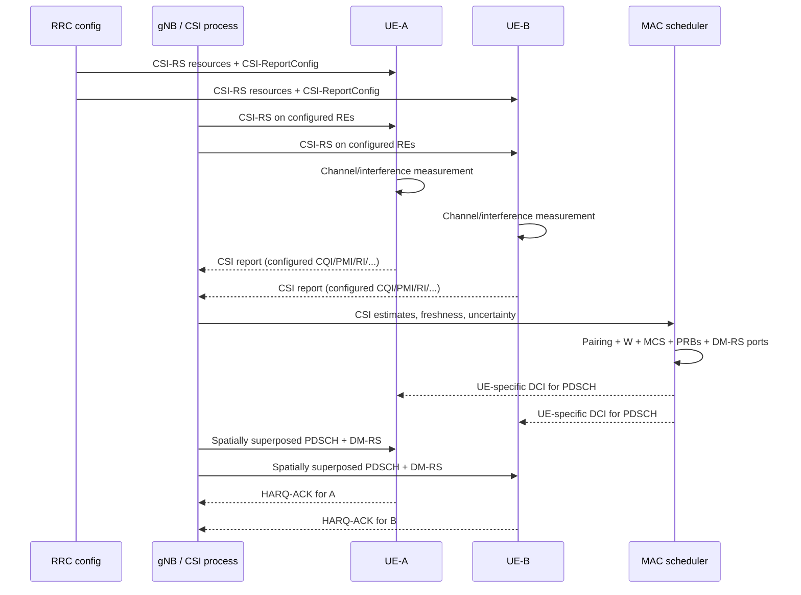
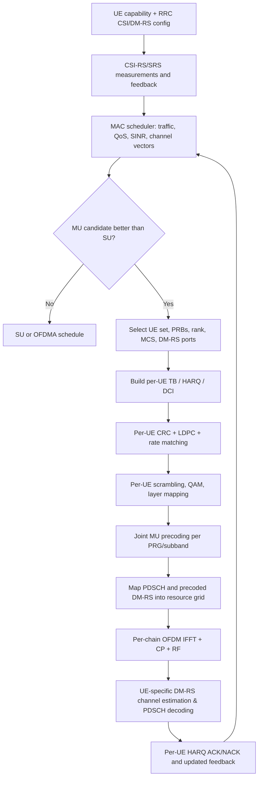
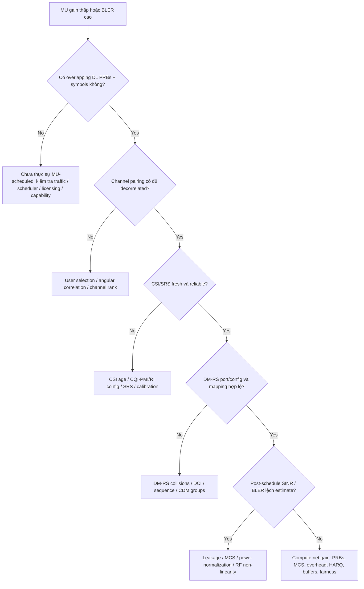

{
  "title": "MU-MIMO (Multi-User MIMO) trong 4G LTE và 5G NR: từ channel matrix đến scheduler và PHY",
  "date": "2026-11-19",
  "draft": false,
  "categories": [
    "5G NR",
    "4G LTE"
  ],
  "tags": [
    "5G NR",
    "4G LTE"
  ],
  "math": true
}

# MU-MIMO (Multi-User MIMO) trong 4G LTE và 5G NR: từ channel matrix đến scheduler và PHY

---

## 1. MU-MIMO thực sự khác SU-MIMO ở đâu?

**MU-MIMO (Multi-User Multiple-Input Multiple-Output)** cho phép một transmitter có nhiều chiều không gian (ví dụ eNB/gNB với nhiều antenna chains) phục vụ **nhiều UE đồng thời trên các time-frequency resources chồng lấn**, phân biệt các tín hiệu chủ yếu theo **spatial signatures**. Một UE không cần nhiều Rx antennas để tham gia MU-MIMO downlink: hai UE, mỗi UE có một Rx chain, có thể cùng nhận một spatial layer trên cùng tập PRB nếu gNB có đủ chiều không gian và tách được hai kênh của chúng.

**SU-MIMO**: nhiều layers được truyền tới *một UE*. **MU-MIMO**: layers thuộc *từ hai UE trở lên*. Trong thực tế có thể kết hợp: UE-A được 2 layers, UE-B được 1 layer trên phần PRB chung; tổng layers là 3, nếu giới hạn năng lực và mapping cho phép. Một gNB có 64 antenna elements không có nghĩa lúc nào cũng có 64 layers hoạt động; số RF chains, logical ports, UE capability, channel rank, DM-RS resources và scheduler cùng giới hạn.

```text
SU-MIMO                                      DL MU-MIMO

   gNB [Tx0 Tx1 Tx2 Tx3]                        gNB [Tx0 Tx1 Tx2 Tx3]
         |  |  |  |                                |  |  |  |
         +--+--+--+                               +--+--+--+
             |                                         |
       2 layers, SAME UE                      Beam/precoder A + B
             |                                         |
          UE-A (2 Rx)                              /       \
                                            UE-A (1 Rx)  UE-B (1 Rx)
                                               layer A     layer B

               SAME PRBs + SAME OFDM symbols may be spatially reused.
```

Trong **OFDMA thuần**, tránh inter-user interference bằng cách cấp PRB khác nhau. Trong **MU-MIMO**, tái sử dụng PRB giúp tăng số bits/cell/Hz, đổi lại phải trả chi phí CSI, precoding, DM-RS, xử lý và rủi ro inter-user interference. Đây là **spatial division multiple access (SDMA)** thực hiện trên hệ thống OFDM/OFDMA; không phải tự động là NOMA (non-orthogonal multiple access với SIC).

| Tiêu chí | Single-user scheduling / SU-MIMO | MU-MIMO |
|---|---|---|
| Cùng PRB tại một thời điểm | Thường một UE được cấp; UE đó có thể nhiều layers | Ít nhất hai UE có thể có PRBs chồng lấn |
| Đối tượng nhận data | Một UE | Nhiều UE |
| Phân tách | Layer detection trong **cùng UE** | Spatial beam separation giữa **các UE** |
| CSI thiết yếu | Channel/effective channel của UE | Channel của các UE **và tương quan giữa chúng** |
| SINR | Desired signal + noise + inter-cell interference | Thêm **residual inter-user interference** |
| KPI lợi ích | Peak UE throughput, diversity | Cell spectral efficiency, concurrent users |
| Rủi ro | Inter-layer interference | User pairing, CSI aging, pilot collision, beam leakage |

**Điểm gốc rễ:** các antenna không tự tạo thêm tài nguyên tần số; chúng tạo khả năng điều khiển **biên độ và pha của trường điện từ** để các tổ hợp sóng khác nhau đến các UE với độ lợi khác nhau. Nếu hai UE có channel vectors gần như song song, họ “nhìn thấy” gần giống cùng một tổ hợp antenna; cố gửi dữ liệu độc lập tới cả hai trên cùng RE đòi precoder triệt nhiễu rất tốn công suất. Khi đó chia theo time/frequency hoặc chọn UE khác thường tốt hơn.

## 2. Từ sóng vô tuyến tới phương trình MU-MIMO

### 2.1 Mỗi hệ số channel đại diện cho điều gì?

Với một subcarrier `k` và OFDM symbol `l` (giả sử kênh gần như không đổi trong một RE), tín hiệu từ antenna phát `m` đến UE `u` được mô tả bằng một hệ số phức:

\[
 h_{u,m}[k,l]=|h_{u,m}[k,l]|e^{j\phi_{u,m}[k,l]}.
\]

- `|h|`: độ lớn do path loss, shadowing, multipath combining, antenna pattern, polarization, beam pattern.
- `φ`: pha tổng hợp từ propagation delay, antenna phase, path geometry, Doppler và RF chains.
- `h` thường là **effective narrowband channel** sau OFDM FFT, không phải một hằng số chung cho mọi PRB hay cả slot.

Với `K` UE single-antenna và `N_t` Tx antennas, xếp kênh thành ma trận

\[
\mathbf H[k,l]=
\begin{bmatrix}
 h_{1,1}&h_{1,2}&\cdots&h_{1,N_t}\\
 h_{2,1}&h_{2,2}&\cdots&h_{2,N_t}\\
 \vdots&\vdots&\ddots&\vdots\\
 h_{K,1}&h_{K,2}&\cdots&h_{K,N_t}
\end{bmatrix}\in\mathbb C^{K\times N_t}.
\]

Tại một RE, gNB muốn truyền `K` symbols độc lập:

\[
\mathbf s=[s_1,\ldots,s_K]^T,\quad
E[\mathbf s\mathbf s^H]=\mathbf I.
\]

Tiền mã hóa (linear precoding) dùng ma trận `W ∈ ℂ^{N_t×K}`. Truyền thực tế qua không gian:

\[
\boxed{\mathbf x=\mathbf W\mathbf P^{1/2}\mathbf s,\qquad
\mathbf y=\mathbf H\mathbf W\mathbf P^{1/2}\mathbf s+\mathbf n.}
\]

Ở đây:
- `x ∈ ℂ^{N_t}`: complex baseband symbols phát trên `N_t` antenna chains tại RE đó;
- `P = diag(p_1,...,p_K)` với `p_u` là công suất stream theo quy ước chuẩn hóa `W`;
- `n` là noise và interference ngoài-cell, nếu xấp xỉ noise trắng: `E[nnᴴ]=σ²I`;
- Điều kiện power budget thông dụng: `tr(WPWᴴ) ≤ P_total`. **Không** được vừa dùng precoder chưa chuẩn hóa vừa mặc nhiên coi `p_u` là công suất tuyệt đối của mỗi antenna.

Tín hiệu riêng tại UE-u là

\[
 y_u=\underbrace{\sqrt{p_u}\,\mathbf h_u\mathbf w_u s_u}_{\text{desired}}
  +\underbrace{\sum_{v\neq u}\sqrt{p_v}\,\mathbf h_u\mathbf w_v s_v}_{\text{inter-user interference}}
  + n_u.
\]

Do đó, nếu coi interference của các stream khác là noise, **SINR sau spatial precoding**:

\[
\boxed{\mathrm{SINR}_u=
\frac{p_u|\mathbf h_u\mathbf w_u|^2}
{\sum_{v\ne u}p_v|\mathbf h_u\mathbf w_v|^2+\sigma_u^2+I_{u,\mathrm{other}}}.}
\]

Đây là phương trình cốt lõi cho mọi quyết định user pairing, precoder và power allocation. **Mục tiêu không chỉ làm `|h_u w_u|` lớn mà còn làm `|h_u w_v|` nhỏ** cho các UE khác. Bởi vậy, beam mạnh nhất cho từng UE tính riêng lẻ chưa chắc là beam tốt nhất khi hai UE truyền đồng thời.

### 2.2 Channel rank và “tách được hai UE” có ý nghĩa gì?

Ma trận `H` có rank `r ≤ min(K,N_t)`; muốn tách `K` streams bằng Zero Forcing (ZF) lý tưởng cần `rank(H)=K` (do đó `N_t≥K`). Nếu rank nhỏ hơn `K`, có những stream combinations phát ra tạo đáp ứng không phân biệt được tại phía nhận.

**Nhưng full rank vẫn chưa đủ để MU-MIMO hiệu quả.** Ma trận gần suy biến (ill-conditioned) làm nghịch đảo phóng đại noise/power hoặc làm desired gain suy giảm sau normalization. Singular values `σ_i(H)` mô tả gain theo các eigenmodes; `σ_min` rất nhỏ báo hiệu một chiều không gian yếu.

Với hai UE, mỗi kênh đã chuẩn hóa, định nghĩa độ tương quan hình học:

\[
\rho=\frac{|\mathbf h_1\mathbf h_2^H|}
{\|\mathbf h_1\|_2\|\mathbf h_2\|_2},\qquad 0\le\rho\le1.
\]

- `ρ ≈ 0`: channel vectors gần trực giao; dễ chia sẻ PRB, ít leakage.
- `ρ ≈ 1`: channel vectors gần song song; hai UE khó spatially separate.
- `ρ` chỉ là một **screening metric**; scheduler còn cần channel strength, noise, CSI uncertainty, MCS, fairness, traffic demand, UE capability và slot timing.

**Vì sao UE đứng cách xa nhau chưa chắc là pair tốt?** Physical distance giữa hai UE không trực tiếp cho biết **góc đến/đi, polarization và multipath spatial signature** tại array. Hai UE ở hai vị trí có thể vẫn cùng angular cluster; hai UE gần nhau đôi khi vẫn có scatterers và polarization khác. Không thay channel matrix bằng khoảng cách địa lý khi quyết định pairing.

### 2.3 Vì sao số antenna nhiều tạo lợi thế nhưng không đảm bảo?

Với một array đủ antenna elements và channels đủ decorrelated, không gian `ℂ^{N_t}` có nhiều vector `w` gần vuông góc với channels của các UE không mong muốn. Khi `N_t` tăng, gNB có nhiều degrees of freedom để (a) tạo beam gain, (b) chặn null tới UE khác, (c) giảm tổn thất khi phải hy sinh gain để triệt nhiễu. Tuy nhiên, cùng số antenna elements nhưng ít RF chains, mutual coupling mạnh, array calibration lỗi hoặc UE cùng hướng sẽ hạn chế lợi ích.

Phân biệt:

- **Physical antenna element**: phần tử bức xạ thật.
- **RF chain**: chuỗi phát/thu analog-digital có độ tự do điều khiển riêng.
- **Antenna port (3GPP)**: khái niệm logical gắn với channel/reference-signal assumptions, không nhất thiết một port = một antenna element.
- **Layer**: stream modulation symbols độc lập ở cấp PHY.
- **Beam**: pattern không gian sinh bởi vector trọng số trên array; một beam không nhất thiết tương đương một UE hoặc một layer.

Ví dụ `64T64R` không có nghĩa hệ thống sẽ gửi 64 DL MU layers, và một UE 1Rx không thể tự nhận 4 independent SU spatial layers chỉ nhờ gNB có 64Tx.

## 3. Downlink precoding: làm thế nào chặn một UE nhìn thấy data của UE khác?

### 3.1 Maximum Ratio Transmission / matched filter (MRT)

Cho mỗi UE-u, MRT chọn precoding vector gần hướng liên hợp channel:

\[
\mathbf w_u^{\rm MRT}=\frac{\mathbf h_u^H}{\|\mathbf h_u\|_2}.
\]

Vì bất đẳng thức Cauchy–Schwarz, với `||w_u||=1`, lựa chọn này cực đại `|h_u w_u|`. **Nhưng đó là cực đại desired signal *cho riêng UE-u*, không tối thiểu leakage tới UE khác.** Khi `h_1` và `h_2` tương quan cao, `h_1 w_2` cũng lớn. MRT có thể phù hợp ở vùng noise-limited, rất nhiều Tx antennas so với số UE (favorable propagation), hoặc khi mục tiêu đơn giản/độ phức tạp thấp; không có bảo đảm MU sum-rate luôn tối ưu.

### 3.2 Zero Forcing (ZF): triệt cross-talk bằng đại số tuyến tính

Khi `N_t ≥ K` và `H` full row-rank, chọn unnormalized precoder:

\[
\boxed{\widetilde{\mathbf W}_{\mathrm{ZF}}
=\mathbf H^H(\mathbf H\mathbf H^H)^{-1}.}
\]

Khi nhân lại:

\[
\mathbf H\widetilde{\mathbf W}_{\mathrm{ZF}}=\mathbf I_K.
\]

Vì vậy `h_u w_v =0` nếu `v≠u` với **CSI hoàn hảo**, đúng subcarrier/time, linear propagation và không có impairment. Các stream tách sạch *trước khi noise được xét*. Precoder phải được scale/normalize theo power budget; khi `H` ill-conditioned, `||W_ZF||` lớn, nên normalization làm desired signal yếu. Đây là **power penalty** của ZF; không được tuyên bố “ZF luôn triệt nhiễu nên luôn tốt hơn”.

**Tại sao chỉ CSI sai một chút vẫn gây MU interference?** Máy phát thiết kế từ `Ĥ`, nhưng kênh thật là `H=Ĥ+E`. Với precoder thỏa `ĤW≈I`:

\[
\mathbf H\mathbf W=\mathbf I+\underbrace{\mathbf E\mathbf W}_{\text{residual leakage}}.
\]

Lỗi `E` đến từ noisy estimation, quantized feedback, aging theo Doppler, beam calibration, pilot contamination/collision hoặc lệch giữa CSI measurement và actual transmission. Dù `(ĤW)_{u,v}=0`, leakage thật `(EW)_{u,v}` không bằng 0.

### 3.3 Regularized ZF (RZF) và MMSE intuition

Một cách giảm penalty tại kênh gần suy biến là regularization:

\[
\boxed{\widetilde{\mathbf W}_{\rm RZF}
=\mathbf H^H(\mathbf H\mathbf H^H+\lambda\mathbf I)^{-1},\quad\lambda>0.}
\]

- `λ→0`: tiến tới ZF (nếu full row-rank), ưu tiên hạ leakage.
- `λ` lớn: giảm xu hướng đảo những singular modes yếu, gần behavior matched-filter sau normalization trong những điều kiện thích hợp.
- `λ` phụ thuộc SINR/noise, CSI uncertainty, load, định nghĩa power normalization và objective. Công thức `λ=Kσ²/P` thường gặp trong mô hình đơn giản, **không phải một cấu hình 3GPP bắt buộc** và không đúng cho mọi implementation.

**Triết lý:** chấp nhận một phần leakage để đổi lấy desired gain và ổn định số học; trong noise-limited regime, hy sinh công suất triệt interference quá mạnh có thể làm performance giảm. Các biến thể weighted MMSE, SLNR precoding, block diagonalization, nonlinear precoding... là lựa chọn algorithmic, không phải tên một “MIMO mode” mà UE phải được RRC báo như một thuật toán vendor cụ thể.

### 3.4 Có thể dùng SVD để precoding cho nhiều UE không?

Với SU-MIMO, phân rã `H_UE=UΣVᴴ` giúp trực tiếp khai thác eigenmodes của **một UE**. Với MU-MIMO, mỗi UE có channel riêng, và nếu cứ lấy right singular vectors tốt nhất của từng UE một cách độc lập, các vectors đó có thể gây nhiễu lớn cho nhau. Phải dùng **joint multi-user channel** hoặc tối ưu coupled interference. SVD vẫn hữu ích cho đo rank, condition number và designing precoders, nhưng “SVD của mỗi UE + ghép tất cả beams” không tự tạo MU-MIMO interference-free.

## 4. Ví dụ tính toán tay: hai UE trên cùng một PRB, lúc nào MU-MIMO thắng SU?

Đây là ví dụ **theoretical per-RE spectral efficiency**, không phải throughput tính theo 3GPP TBS, vì chưa trừ DM-RS, PDCCH, control, finite code rate, BLER hay HARQ.

### 4.1 Channel có thể chỉnh “góc tách nhau”

Giả sử gNB có **2 Tx antennas**, hai UE mỗi UE **1 Rx antenna**, flat fading trên PRB được xét. Kênh thực, đã chuẩn hóa:

\[
\mathbf h_1=[1\quad 0],\qquad
\mathbf h_2=[\cos\theta\quad\sin\theta],
\quad 0<\theta\le90^\circ.
\]

`θ` ở đây là **góc toán học giữa channel vectors**, *không phải nhất thiết góc phương vị vật lý*. Giả sử `P_total = 2` (đơn vị công suất quy ước), noise power mỗi UE `σ²=0.1`, symbols có unit variance.

Một bộ ZF **unit-norm per-stream** đơn giản:

\[
\mathbf w_1=
\begin{bmatrix}\sin\theta\\-\cos\theta\end{bmatrix},\qquad
\mathbf w_2=
\begin{bmatrix}0\\1\end{bmatrix}.
\]

Kiểm tra zero leakage:

\[
\mathbf h_2\mathbf w_1
=\cos\theta\sin\theta-\sin\theta\cos\theta=0,\qquad
\mathbf h_1\mathbf w_2=0.
\]

Desired amplitudes đều là `sinθ`:

\[
\mathbf h_1\mathbf w_1=\sin\theta,
\qquad\mathbf h_2\mathbf w_2=\sin\theta.
\]

Cấp `p_1=p_2=1`, total power = 2 vì mỗi vector precoder có norm 1. Khi CSI đúng:

\[
\mathrm{SINR}_1=\mathrm{SINR}_2
=\frac{1\cdot\sin^2\theta}{0.1}=10\sin^2\theta.
\]

Dùng Shannon proxy cho tổng spectral efficiency (bits/s/Hz trên RE data lý tưởng):

\[
R_{\rm MU}=2\log_2\!\left(1+10\sin^2\theta\right).
\]

Nếu chỉ phục vụ UE-1 trên PRB bằng SU beamforming với toàn bộ công suất `P=2`, kênh norm 1, SNR = `2/0.1=20`, do đó:

\[
R_{\rm SU}=\log_2(1+20)=\log_2 21\approx4.392\ \text{bits/s/Hz}.
\]

| Góc channel `θ` | `sin²θ` | SINR mỗi MU UE | Tổng `R_MU` | So với `R_SU≈4.392` |
|---:|---:|---:|---:|---|
| 90° | 1.0000 | 10.000 (10 dB) | 6.919 | MU thắng |
| 60° | 0.7500 | 7.500 (8.75 dB) | 6.175 | MU thắng |
| 30° | 0.2500 | 2.500 (3.98 dB) | 3.615 | MU thua |
| 10° | 0.0302 | 0.302 (-5.21 dB) | 0.760 | MU thua mạnh |

**Tại sao góc chỉ đổi 90° → 30° mà rate tụt mạnh dù ZF vẫn bảo đảm interference bằng 0?** Vì để null đúng channel UE kia, mỗi precoder phải rời khỏi hướng gain tốt nhất của UE mình. Desired gain giảm từ 1 xuống `sinθ`; received power giảm theo **bình phương** `sin²θ`. Đây là **beamforming gain loss / ZF power penalty**, chứ không phải lỗi receiver.

**Tại `θ=0°`**: `h_1=h_2`, rank bằng 1, không thể gửi hai independent streams bằng ZF trên cùng tài nguyên. Đây là giới hạn hình học thông tin, không thể “bật thêm MU-MIMO” trong RRC để giải quyết.

**Một câu hỏi phản biện:** có thể dùng MRT thay vì ZF ở `θ=30°`? Có, nhưng khi đó `h_1w_2` và `h_2w_1` khác 0. MU performance cần tính lại SINR với interference; thậm chí chọn **SU scheduling** có thể tốt nhất. Kết luận “MU always 2× capacity” sai ngay trong ví dụ 2×1 + 2×1 này.

### 4.2 Ví dụ với matrix inverse và công suất chuẩn hóa

Cho

\[
\mathbf H=\begin{bmatrix}1&0.2\\0.2&1\end{bmatrix}.
\]

Ma trận nghịch đảo (vì `H` vuông, full rank):

\[
\widetilde{\mathbf W}_{\rm ZF}=\mathbf H^{-1}
=\frac1{1-0.2^2}\begin{bmatrix}1&-0.2\\-0.2&1\end{bmatrix}
=\frac1{0.96}\begin{bmatrix}1&-0.2\\-0.2&1\end{bmatrix}.
\]

Kiểm chứng `H W̃ = I`. Với `E[ssᴴ]=I`, năng lượng chưa chuẩn hóa là

\[
\operatorname{tr}(\widetilde W\widetilde W^H)
=\frac{2(1+0.2^2)}{0.96^2}\approx2.25694.
\]

Giới hạn tổng công suất `P_total=2`: đặt `W=α W̃`, với

\[
\alpha=\sqrt{\frac{2}{2.25694}}\approx0.9415,
\qquad\alpha^2\approx0.88615.
\]

Nhận `y=αs+n`: mỗi user có SNR `0.88615/0.1≈8.8615`, không phải 10 hay 20. **Tổn hao công suất** xuất hiện dù interference bị triệt lý tưởng. Nếu thay `0.2` bằng `0.99`, inverse norm tăng rất lớn; sau normalization, desired signal suy giảm đáng kể, khiến ZF MU kém phù hợp. Trong code thực tế nên tránh `inv()` trực tiếp nếu có thể; dùng decomposition ổn định như QR/SVD/Cholesky theo điều kiện ma trận và regularization.

### 4.3 Nếu CSI sai: tính residual interference như thế nào?

Giả sử gNB precoding với `Ĥ`, còn UE nhìn thấy `H=Ĥ+E`; sau khi transmitter normalization:

\[
\mathrm{SINR}_u=
\frac{p_u|[(\widehat H+E)W]_{u,u}|^2}
{\sum_{v\ne u}p_v|[EW]_{u,v}|^2+\sigma^2}.
\]

Như vậy lỗi CSI làm **hai việc đồng thời**: desired channel thay đổi, và cross-talk xuất hiện. Nếu MU chạy với MCS sát ngưỡng decoding, nhiễu thêm nhỏ cũng làm BLER tăng mạnh. Cũng bởi vậy *CSI age*, subband granularity, reciprocity calibration, beam tracking và UE speed ảnh hưởng trực tiếp đến MU scheduling gain.

## 5. Từ channel estimation đến user pairing: tại sao scheduler phải tính theo tập UE?

### 5.1 User selection là bài toán tổ hợp

Giả sử có `U=20` UEs active trong cell, `N_t` physical dimensions, gNB muốn chọn 2 UEs share một PRB. Có `C(20,2)=190` candidate pairs trên PRB, chưa tính số layers, power split, MCS, PRB sets, beam choices và HARQ states. Nếu chọn 4 UEs có `C(20,4)=4845` candidates. Exhaustive search trên từng subband/slot có thể quá đắt khi real-time scheduler phải chạy nhanh.

Một ví dụ **vendor-agnostic heuristic**:

1. Xác định UE có DL data trong buffer và scheduling eligibility.
2. Tính channel quality và CSI freshness của từng UE.
3. Chọn primary UE theo proportional fair (PF) hoặc QoS priority.
4. Chỉ xét secondary UEs có channel vectors đủ khác primary UE; loại UEs không đủ DM-RS/port/resource/capability.
5. Tạo candidate `W` cho từng pair (ZF, RZF hoặc precoder được implement), chuẩn hóa power.
6. Ước lượng **post-precoding SINR** của từng UE, trong đó có inter-user leakage và interference margins.
7. Chọn MCS dự kiến và tính TBS/throughput utility có tính BLER, DM-RS overhead, PDCCH/PUCCH/HARQ resource cost.
8. So sánh MU utility với best SU alternative. Chỉ chọn MU khi vượt tiêu chí của scheduler và không vi phạm QoS.
9. Áp dụng PRB/layer/DM-RS allocation và phát DCI cho từng UE.

Không phải mọi eNB/gNB đều dùng thứ tự/metric này. **3GPP chủ yếu xác định tín hiệu, thủ tục, báo cáo, DCI, giới hạn UE và mapping; phương pháp ghép UE hoặc chọn precoder của gNB đa phần là implementation-specific**.

Một utility đơn giản theo PF:

\[
U(\mathcal S)=\sum_{u\in\mathcal S}
\frac{R_{u,\mathrm{estimated}}(\mathcal S)}{\overline T_u},
\]

trong đó `S` là tập UE được ghép, `R_u` estimated instantaneous rate sau MU precoding, `T̄_u` là average served throughput của UE. Để tránh chia 0 dùng epsilon và initialization thích hợp. Đây là **ví dụ thuật toán**, không phải công thức quy định trong TS 38.214.

**Vì sao pair có sum-rate cao nhất chưa chắc được chọn?** Nếu chỉ ưu tiên UE có kênh mạnh và trực giao, UE cell-edge có thể đói tài nguyên. PF/QoS/GBR/HARQ deadlines phải điều hòa cell efficiency với latency và fairness. MU-MIMO cũng có thể giảm latency cho nhiều UE khi beam separation tốt, nhưng không phải đảm bảo mọi UE đều nhanh hơn.

### 5.2 Sự kiện nào kích hoạt MU-MIMO?

MU-MIMO không cần một “MU-MIMO attach procedure” hay một RRC flag chuẩn chung gọi `muMimoOn`. Quyết định thường là **per scheduling occasion**, dựa trên RRC capabilities/configuration có sẵn, trạng thái CSI, active BWP/carrier, DL buffers, scheduler, UL/DL slot pattern và radio conditions.

- **RRC layer**: thiết lập UE capability/configurations liên quan CSI-RS/SRS/DM-RS/PDSCH/PUSCH/BWP/CSI reporting; cấu hình ít thường xuyên hơn scheduling.
- **PHY measurement/feedback**: CSI-RS/SRS, channel estimation, CQI/PMI/RI/CRI và các report quantity tùy configured mode.
- **MAC scheduler tại eNB/gNB**: quyết định UE set, PRB, MCS, số layers, HARQ, scheduling timing.
- **PHY TX**: transport-block coding, modulation, layer mapping, precoding, DM-RS, resource mapping, IFFT, RF.
- **PHY RX**: control decoding, channel estimation qua DM-RS, equalization/detection, decoding, CRC và feedback ACK/NACK qua HARQ.

**Không có điều kiện chung rằng UE phải ở một vị trí hoặc giá trị CQI cụ thể mới được MU scheduling**. Các ngưỡng vendor tối ưu có thể tồn tại nhưng không được diễn giải như 3GPP-mandated.

### 5.3 Tại sao CSI rank của từng UE không nói toàn bộ khả năng MU?

Giả sử hai UE single-Rx. Mỗi UE chỉ có 1 receive spatial dimension, vậy **mỗi UE có rank 1**. Nhưng **joint DL channel** của hai UE khi xếp thành `H (2×N_t)` có thể rank 2. Do đó có thể truyền **2 MU layers trên cùng PRB** dù từng UE không thể nhận 2 SU layers.

Ngược lại, nếu UE-A tự hỗ trợ RI=4 thì không có nghĩa gNB có thể ghép thêm bốn UE rank-1 trên cùng PRB: tổng transmit degrees of freedom, DM-RS port resources, capability, CSI quality, per-user PDSCH limitations và interference đều là ràng buộc. **RI là report rank phù hợp cho một hypothesis/configuration**, không phải “số MU users đã được scheduler ghép”.

## 6. CSI và sounding: gNB biết channels của nhiều UE bằng cách nào?

### 6.1 Downlink CSI-RS path — phổ biến với FDD và cũng có ở TDD



Diễn giải: gNB cấu hình CSI measurement/report; UE đo hiệu ứng của channel theo CSI-RS và interference measurement resources được cấu hình. CSI report không nhất thiết là **full complex `H`**; codebook-based PMI/RI/CQI là feedback nén và có ràng buộc giả thiết đo. Vì vậy dùng PMI của UE-A/B để tái dựng joint channel chính xác đến từng complex coefficient có thể là không hợp lệ nếu implementation thiếu thông tin phase/port calibration. Sau khi nhận CSI, scheduler estimate MU compatibility, có thể thêm sounding/measurements nội bộ trước khi pair.

Theo **TS 38.214 V18.7.0 §5.2**, CSI framework có `CSI-ReportConfig`, CSI resource settings và các report quantities như CQI, PMI, RI, CRI, LI, L1-RSRP/L1-SINR tùy cấu hình; reporting có thể periodic, semi-persistent hoặc aperiodic. Không phải UE luôn gửi tất cả chỉ số trong mọi report. `CQI` cũng không phải “post-MU SINR thực tế đã chắc chắn”; CQI được tính dưới giả thiết CSI interference/channel đo và báo cáo cụ thể.

### 6.2 TDD UL SRS reciprocity path

Ở TDD, UL/DL dùng cùng carrier (khác thời điểm); **propagation channel có tính reciprocity** trong coherent interval, sau khi xét phù hợp frequency, timing và hardware calibration. gNB đo UL SRS từ UE để ước lượng channel spatially, sau đó có thể dùng thông tin này cho DL precoding.

```text
TDD within sufficiently short channel coherence interval

UE-A ---- SRS-A ---->  gNB Rx estimation -> H_UL,A
UE-B ---- SRS-B ---->  gNB Rx estimation -> H_UL,B
                              |
                          RF calibration
                              |
                      Approximate DL channels
                              |
                     MU precoder + PDSCH
```

**Quan trọng:** không được viết `H_DL = H_UL` tuyệt đối ở baseband đo được. Analog TX/RX chains và calibration matrices khác nhau:

\[
\mathbf H_{\rm UL,meas}=\mathbf C_{\rm gNB,RX}\,
\mathbf H_{\rm prop,UL}\,\mathbf C_{\rm UE,TX},
\]

\[
\mathbf H_{\rm DL,eff}=\mathbf C_{\rm UE,RX}\,
\mathbf H_{\rm prop,DL}\,\mathbf C_{\rm gNB,TX}.
\]

Ký hiệu chỉ minh họa chuỗi ma trận tương thích kích thước; muốn áp dụng calibration thực tế cần xác định reference planes và cấu trúc RF của hệ thống. Khi gNB calibration lỗi, beam null dựa trên UL channel sẽ lệch so với actual DL channel; hậu quả là MU leakage tăng, BLER tăng. **TDD reciprocity không có nghĩa “không cần calibration hoặc tracking”.**

SRS của các UE phải được multiplex phù hợp về time, frequency, comb, cyclic shifts, ports và resources tùy cấu hình. SRS collision, SRS power thấp, channel aging hoặc số antennas được sounding không đại diện dữ liệu làm spatial estimates kém. FDD không thể giả định UL SRS trực tiếp cho full DL channel tại một frequency khác, trừ khi có mô hình/thuật toán extra inference đã được kiểm chứng.

### 6.3 CSI aging dưới mobility

Doppler `f_D≈v f_c / c`, với `v` là radial speed component tương đối (m/s) trong mô hình đơn giản, `f_c` carrier frequency (Hz), `c≈3×10⁸m/s`. Ví dụ `v=15m/s` (~54km/h), `f_c=3.5GHz`: `f_D≈175Hz`; coherence time theo heuristic `T_c≈0.423/f_D≈2.42ms`. **Đây là ước lượng theo mô hình fading, không phải deadline reporting của 3GPP**. MU nulling dựa trên CSI vài ms trước có thể suy yếu ở tốc độ đó; trong multipath và angular spectrum khác, coherence time thực tế thay đổi.

Lỗi có thể xảy ra ngay cả khi CQI cao: CQI đo kênh mạnh lúc CSI-RS, nhưng sau vài slots UE dịch chuyển, joint channel có correlation khác. Scheduler ghép UE dựa vào thông tin cũ nên cross-talk vượt dự kiến.

### 6.4 CSI-RS dùng cho CSI khác DM-RS dùng để giải PDSCH

**CSI-RS** thường phục vụ channel measurement/feedback, tracking hoặc beam-related measurements theo cấu hình. **DM-RS** truyền cùng PDSCH/PUSCH để receiver estimate **effective channel** trên allocated data resources và thực hiện demodulation. CSI-RS không thay thế DM-RS; DM-RS không tự cho scheduler biết full channel của tất cả UE trước khi gửi nếu chỉ phát cùng data.

Một lợi ích của **precoded DM-RS**: UE ước lượng `g_u=h_u w_u` trực tiếp, thay vì cần toàn bộ channel vector `h_u` và precoder vector `w_u` để giải data. Theo **TS 38.300 V17.9.0 §5.2.1**, DM-RS và PDSCH tương ứng sử dụng cùng precoding và UE không cần biết precoding matrix để demodulate; điều kiện cụ thể còn liên quan mapping/PRG và reception assumptions. Đây là lý do UE không nhất thiết phải được thông báo “ZF hay RZF”.

## 7. Quy trình DL MU-MIMO trong NR — từ MAC PDU đến antenna samples

Đây là **mô hình các bước điển hình** cho hai UEs được schedule trên overlapping PRBs. Từng UE vẫn có transport block, HARQ process, MCS, DCI và decoding riêng. Không có một transport block “chung” bắt buộc cho MU pair.



### 7.1 Đầu vào và quyết định (trước khi PHY phát)

- **UE configuration:** PDSCH capabilities, max DL layers, applicable DM-RS configuration, BWP, CSI-RS and CSI reporting configs, DCI monitoring/search spaces. Cấu hình khác nhau giữa các UE được xử lý riêng, không được tùy tiện mix các mode không tương thích.
- **Channel knowledge:** estimates/feedback cho các UE trên PRBs cần phát. Có thể phải extrapolate từ CSI subband sang PRG hoặc use conservative margins.
- **Scheduler state:** DL buffers, HARQ retransmissions, latency/QoS, PDCCH CCE budgets, PUCCH resources, remaining DL symbols/PRBs.
- **Joint power/precoding:** chọn spatial layers, `W[k]`, power split và MCS để dự kiến decoding được trên từng UE.

Chẳng hạn `UE-A` được PRBs 20–29, `UE-B` được PRBs 24–33 trong một slot. **Chỉ PRBs 24–29 chồng lấn** là vùng có thể MU-MIMO giữa A/B; các PRBs 20–23 và 30–33 về mặt scheduling là vùng không chồng lấn của hai UE này. Precoder/scheduler có thể chọn khác nhau theo PRG/subband. Không được lấy cả bandwidth của hai UEs gắn nhãn “MU” nếu chỉ chồng lấn một phần.

### 7.2 Per-UE PHY chain và lý do phải tách transport blocks

Đối với mỗi UE, gNB xây dựng và truyền PDSCH qua các bước gần điển hình:

1. **MAC -> PHY**: MAC cấp TB(s) và các tham số transmission (scheduling, HARQ process, MCS, layers, data allocation...); thuật toán split TB và mode cần phù hợp capabilities.
2. **TB CRC, code-block segmentation, LDPC encoding, rate matching**: mỗi UE có stream bits và yêu cầu coding riêng (TS 38.212). Chọn rate matching theo allocated REs thực tế và số layers/MCS; không đơn giản lấy `nPRB × 12 × 14` vì có DM-RS/control/reserved REs.
3. **Scrambling + QAM**: symbols của từng UE là độc lập; có thể MCS A khác MCS B, vì effective SINR và QoS khác nhau.
4. **Codeword-to-layer mapping**: layers thuộc PDSCH của từng UE; nếu UE-A 1 layer, UE-B 1 layer, sau khi kết hợp ở gNB là 2 independent user streams trên overlapping resources. Việc “aggregate” thành joint matrix để precoding là cách mô hình hóa implementation; 3GPP không bắt buộc một block software `AggregateMUStreams`.
5. **Precoding**: tại cùng `(k,l)` của vùng chung, tính `x_m=Σ_u w_{m,u}(k,l)√p_u s_u(k,l)` cho mỗi antenna `m`. Đây là **superposition trong spatial/antenna domain**.
6. **PDSCH + DM-RS mapping**: đặt PDSCH symbols và DM-RS được configured/indicated lên resource grids theo antenna ports và rule phù hợp (TS 38.211 §7.3.1, §7.4.1.1; TS 38.214 §5.1.4). DM-RS được precoded nhất quán với data tại phần áp dụng.
7. **OFDM per antenna chain**: các frequency-domain grids của từng chain đi qua IFFT -> CP -> DAC -> RF -> antenna array. Ở không gian, điện từ trường của các chains cộng tuyến tính tại từng UE.
8. **UE receiver**: UE-A tìm PDCCH/DCI dành cho nó, nhận đúng PDSCH time-frequency/layers/DM-RS; từ DM-RS estimate effective channel, equalize, demap, decode LDPC/CRC và gửi HARQ feedback. UE-B làm tương tự, không cần biết UE-A là ai.

**Điểm đáng chú ý:** MU-MIMO chủ yếu ảnh hưởng chọn resource/layer/precoder và effective channel; pipeline CRC/LDPC/modulation vẫn là xử lý PDSCH theo UE, chứ không phải đổi loại channel coding vì được paired với UE khác.

### 7.3 Resource grid — nhiều UE thực sự “cùng RE” như thế nào?

Ví dụ minh họa với **Normal CP**, một PRB = 12 subcarriers, slot 14 OFDM symbols. Giả sử PDSCH mapping type A, PDSCH từ symbol 2; first DM-RS ở symbol `l=2` (khi `dmrs-TypeA-Position=pos2`), configuration type 1, basic DM-RS; A và B dùng **two orthogonal DM-RS ports trong cùng CDM group** nếu signalling và UE config cho phép.

Ở **TS 38.211 V18.7.0 §7.4.1.1.2**, đối với *basic* DM-RS configuration type 1:

\[
 k=4n+2k'+\Delta,\qquad k'\in\{0,1\},\quad
 l=\bar l+l',
\]

với `Δ`, CDM group, frequency/time OCC lấy từ Table 7.4.1.1.2-1; công thức trên là **relative subcarrier location của DM-RS mapping** trong quy định phù hợp, không phải công thức channel vector `h` hay PRB index. Enhanced DM-RS có biểu thức/tập port khác; **không được dùng bảng basic để suy ra tổng port limits của enhanced type**.

Theo Table 7.4.1.1.2-1:

- Port `1000`: CDM group 0, `Δ=0`, `w_f=[+1,+1,...]` cho cặp đầu; `w_t` tương ứng.
- Port `1001`: cùng CDM group 0, `Δ=0`, nhưng `w_f=[+1,-1,...]` cho hai RE đầu. Hai ports có cùng time-frequency pilot positions nhưng được phân tách bằng **orthogonal cover codes (OCC)** ở chiều tần số (với giả thiết channel đủ mượt qua các pilot REs).
- Port `1002`: CDM group 1, `Δ=1`, nên chiếm pilot REs ở offset khác port 1000/1001.

Trên một PRB (relative `k=0...11`), tại một symbol DM-RS mẫu:

```text
                OFDM symbols l ->
subcarrier k |  0   1   2    3    4   ...   13
-------------+-----------------------------------
 11          |  C   C  data  data  data ... data
 10          |  C   C  D01*  data  data ... data
  9          |  C   C  data  data  data ... data
  8          |  C   C  D01*  data  data ... data
  7          |  C   C  data  data  data ... data
  6          |  C   C  D01*  data  data ... data
  5          |  C   C  data  data  data ... data
  4          |  C   C  D01*  data  data ... data
  3          |  C   C  data  data  data ... data
  2          |  C   C  D01*  data  data ... data
  1          |  C   C  data  data  data ... data
  0          |  C   C  D01*  data  data ... data

C = symbols giả sử dùng control / không thuộc PDSCH trong ví dụ
D01* = DM-RS của hai orthogonal ports 1000 và 1001 trên cùng RE,
       phân biệt bằng OCC (không phải hai RE dữ liệu khác nhau)
data = vị trí có thể dùng PDSCH; phụ thuộc reservation/CDM groups,
       mapping allocations và các tín hiệu khác; chỉ là sơ đồ khái niệm.
```

**Quan trọng:** tại các data RE dùng chung, trên một **physical antenna chain** m: `x_m(k,l)=w_{m,A}s_A + w_{m,B}s_B`. Đây là **một mẫu IQ tổng**, không phải hai sóng OFDM “được cấp hai subcarriers riêng” hoặc hai physical RE khác nhau. Beamforming làm cho tổ hợp mẫu đó đến UE-A và UE-B có effective desired/interfering gains khác nhau. Các ports riêng giúp UE estimate effective channel cho dữ liệu của chính mình.

#### Ví dụ OCC có tính được bằng tay

Giả sử hai port dùng cùng hai pilot RE, `r` là pilot known symbol, cover code A `(+1,+1)`, B `(+1,-1)`. Gọi channel complex gần không đổi qua hai RE là `g_A` và `g_B`. Tại một antenna thu, bỏ noise:

\[
 z_0=r(g_A+g_B),\qquad z_1=r(g_A-g_B).
\]

Sau despreading:

\[
\widehat g_A=(z_0+z_1)/(2r)=g_A,\quad
\widehat g_B=(z_0-z_1)/(2r)=g_B.
\]

**Tại sao cần channel gần không đổi qua OCC span?** Nếu `g_A(k_0)≠g_A(k_1)` và tương tự `g_B`, cộng/trừ không còn triệt hoàn toàn thành phần port kia. Frequency selectivity quá mạnh, residual CFO/phase drift hoặc mapping/config sai làm **DM-RS orthogonality thực tế suy yếu**.

Đây là ví dụ minh họa cơ chế OCC, **không phải bảo rằng UE luôn estimate port của UE khác**. UE normalmente cần own DM-RS và corresponding PDSCH assumptions. Cũng không nên suy ra “chỉ cần pilots trực giao thì data streams trực giao”: data interference chủ yếu do `h_u w_v`, còn DM-RS OCC chỉ hỗ trợ **reference signal separation/estimation**.

#### DM-RS resource overhead và khả năng ghép nhiều UE

Nếu cần nhiều ports khác CDM groups, reserved RE pattern, number of DM-RS symbols hoặc enhanced DM-RS scheme thay đổi, lượng RE còn cho PDSCH có thể giảm hoặc ràng buộc multiplexing thay đổi. **Càng nhiều MU layers không mặc định càng nhiều net throughput**; lợi ích stream tăng có thể bị trừ bởi RS/control overhead và lower MCS do interference. Với một PRB × slot không phải mọi `12×14=168 RE` đều là data RE. Con số RE dùng thực phải tính theo TS 38.214 §5.1.3/§5.1.4, RRC/DM-RS config và resource reservations được áp dụng.

### 7.4 DCI và timing: sự kiện diễn ra lúc nào?

- CSI-RS/SRS measurements diễn ra theo periodic/semi-persistent/aperiodic resources được cấu hình; CSI feedback có một measurement-to-report latency, không phải tức thời.
- Tại scheduling opportunity, gNB chọn PDSCH resources và gửi **UE-specific PDCCH/DCI** (NR thường DCI format 1_0 / 1_1 / 1_2 tùy cấu hình và context). Hai UE có thể nhận hai assignments cùng chỉ tới overlapping PDSCH resources; mỗi UE chỉ đọc DCI có RNTI/context riêng.
- DCI liên quan time/frequency assignment, MCS/HARQ, antenna ports/DM-RS-related information theo format. **Không có một bắt buộc chung phải gửi cờ `MU=1` cho UE để UE nhận biết user pairing**.
- `K0` là PDCCH-to-PDSCH slot timing theo applicable NR scheduling procedure; `K1` liên quan PDSCH-to-HARQ feedback; `K2` là PDCCH-to-PUSCH timing. **Không được tự kết luận K0=0 hay K1 cố định cho mọi UE**. Chúng do configuration/grant/capability/timing constraints quyết định, cùng numerology/BWP/context.

```text
Illustrative NR timing (not a 3GPP-fixed K0/K1 assignment):

slot n:          gNB sends DCI-A + DCI-B
slot n+K0_A:     PDSCH-A allocated REs ---------------------->
slot n+K0_B:     PDSCH-B allocated REs ---------------------->
                 overlap => MU only if same time-frequency REs
slot n+K0_A+K1_A:            UE-A HARQ feedback
slot n+K0_B+K1_B:                        UE-B HARQ feedback

K0_A and K0_B need not be the same; for MU overlap their actual
PDSCH transmissions must coincide on some time-frequency resources.
```

Trong log cần phân biệt time được DCI scheduling với **time thực phát PDSCH**; hai DCI cùng slot không chứng minh PDSCH overlap. Ngược lại nếu PDSCH overlap về time-frequency, đó vẫn chưa đủ để chứng minh **gNB dùng spatial multiplexing** khi chưa có thông tin layer/beam/scheduler.

### 7.5 Những gì gNB biết và UE không cần biết

| Thông tin | GNB scheduler / PHY cần | UE được signalling/estimate |
|---|---|---|
| CSI của cả pair | Ưu tiên có channel compatibility / estimate | UE biết own measurements, không cần biết CSI của UE kia |
| Pairing set | Có, nội bộ scheduler | Không cần RRC/DCI chứa danh tính UE ghép |
| `W` algorithm ZF/RZF/... | Lựa chọn của transmitter | UE cần effective channel qua precoded DM-RS, không cần biết algorithm |
| Own resource allocation/MCS/DM-RS | Có | Cần theo RRC + DCI |
| Inter-user leakage actual | Estimate; có thể sai | UE chịu interference và decode theo receiver design |
| HARQ process, ACK/NACK | Per UE | Per UE |

## 8. Vì sao DM-RS orthogonal không triệt được inter-user data interference?

Xem phương trình ở UE-A:

\[
y_A=h_Aw_As_A+h_Aw_Bs_B+n_A.
\]

DM-RS ports trực giao giúp UE-A tách/ước lượng channel `g_A=h_Aw_A` từ pilot của A. Tuy nhiên trong phần **data symbols**, nếu `h_Aw_B≠0`, UE-A vẫn nhìn thấy `s_B` như interference. Không có thao tác cộng/trừ OCC trên unknown data symbols cho phép tự động loại `s_B` vì hai dữ liệu dùng modulation/codeword độc lập và UE-A không có thông tin giải mã UE-B. Chính **MU precoder** phải làm `h_Aw_B` đủ nhỏ; hoặc UE receiver nâng cao sử dụng interference suppression nếu đủ điều kiện.

Một error-chain thường thấy:

```text
Good DM-RS orthogonality  -> accurate own effective channel estimate
                    BUT
CSI is stale -> W no longer nulls UE-B at UE-A
                    -> inter-user leakage on DATA REs
                    -> effective SINR lower than expected
                    -> MCS too aggressive -> CRC fail / HARQ NACK
```

Vì thế “DM-RS ports khác nhau, nên không thể có MU interference” là **sai về PHY**. Ngược lại “pilot collision gây lỗi” cũng không chứng minh root cause là user pairing; phải đối chiếu timing/resource/port/sequences, channel estimates và decoder measurements.

## 9. Uplink MU-MIMO: vì sao bài toán đảo chiều?

Trong DL MU-MIMO, **một gNB phát nhiều streams tới các UE** và chủ động lựa chọn precoder để giảm giao thoa. Trong **UL MU-MIMO**, **nhiều UE phát độc lập trên những PRBs chồng lấn**, gNB có nhiều Rx antennas phải **separate** các streams tại receiver. Nếu các UE không thể trao đổi tức thời dữ liệu và precoder với nhau, không thể giả định hệ thống UL dùng chung một joint precoder như DL.

Với `N_r` antenna thu ở gNB, `K` UE mỗi UE một stream:

\[
\boxed{\mathbf y=\mathbf H_{\rm UL}\mathbf P^{1/2}\mathbf s+\mathbf n,}
\]

với `H_UL ∈ ℂ^{N_r×K}`, mỗi **cột** là channel vector từ một UE tới tất cả gNB Rx antennas. Đây là transpose về vai trò vật lý so với DL model, không phải luôn phép transpose baseband channel tuyệt đối.

### 9.1 Receive ZF, MMSE và điều kiện để tách streams

Nếu `N_r≥K` và `H_UL` full column rank, linear ZF equalizer:

\[
\mathbf G_{\rm ZF}=(\mathbf H_{\rm UL}^H\mathbf H_{\rm UL})^{-1}\mathbf H_{\rm UL}^H,
\qquad \widehat{\mathbf s}\approx\mathbf G_{\rm ZF}\mathbf y
\]

(chỉ đúng sát dạng trên nếu đã hấp thụ `P^{1/2}` vào effective channel hoặc có equalization sau đó). Khi đó `G H=I`, tách được users lý tưởng, **nhưng output noise covariance thành**

\[
E[(G n)(Gn)^H]=\sigma^2\mathbf G\mathbf G^H.
\]

Nếu channel vectors gần song song, norm của `G` tăng và noise enhancement rất lớn. Về mặt vật lý, receiver cố lấy hiệu của hai tổ hợp antenna quá giống nhau, dẫn tới cả desired signal lẫn noise phải bị khuếch đại trong phép giải.

Với `s` có covariance `R_s` và noise covariance `R_n`, LMMSE linear filter viết trong mô hình `y=Hs+n`:

\[
\boxed{\mathbf G_{\rm LMMSE}
=\mathbf R_s\mathbf H^H
(\mathbf H\mathbf R_s\mathbf H^H+\mathbf R_n)^{-1}.}
\]

Trường hợp `R_s=I`, `R_n=σ²I`, có thể viết `G=(HᴴH+σ²I)^{-1}Hᴴ`. Thuật toán receiver cụ thể có thể kết hợp interference cancellation, soft bits, channel estimation và decoder iterations; **3GPP không bắt buộc mọi gNB receiver dùng cùng một LMMSE implementation**.

### 9.2 Uplink resource/timing rất nhạy với near–far và synchronization

Trong UL mỗi UE có path loss, power control và Tx power headroom khác nhau. Ví dụ UE-A nhận ở gNB -65dBm, UE-B -85dBm, cách nhau 20dB. Trên same PRB, nếu gNB Rx channel separation không tốt, signal A mạnh có thể lấn B; ADC dynamic range, channel estimation, residual CFO/TA errors và non-linearities cũng quan trọng. Tăng power UE-B không phải lúc nào khả thi do max UE output power và inter-cell interference.

```text
                        SAME scheduled UL symbols + PRBs

UE-A (TA_A, P_A) -- PUSCH-A + DM-RS-A --> |
                                           | gNB [Rx0 Rx1 ... RxN]
UE-B (TA_B, P_B) -- PUSCH-B + DM-RS-B --> |       |
                                                   FFT + channel estimates
                                                   multiuser equalization
                                                   separate TB-A / TB-B
```

**Timing Advance (TA)** làm các UL signals từ các UEs khác nhau đến gNB với timing đủ phù hợp cho FFT window/CP. Nếu residual differential timing vượt điều kiện duy trì OFDM orthogonality, có ISI/ICI, suy giảm DM-RS separation và UL MU detection. Trong LTE UL kiểu DFT-s-OFDM, timing/frequency alignment cũng quan trọng; không chỉ dựa vào spatial channel.

### 9.3 UL DM-RS đóng vai trò gì?

Các UE có thể dùng **orthogonal/separable PUSCH DM-RS resources** theo cấu hình phù hợp, giúp gNB đo các column channels của `H_UL`. Nếu DM-RS của các UE collision/non-orthogonal quá mạnh, receiver không có estimate chính xác từng channel, nên effective matrix detection sẽ thất bại ngay cả khi physical array có nhiều antennas.

Theo **TS 38.211 V18.7.0 §6.4.1.1** có PUSCH DM-RS sequence generation/precoding/resource mapping, và **TS 38.300 V17.9.0 §5.3.1** mô tả codebook-based và non-codebook-based UL transmission. Trong NR với transform precoding enabled, **một PUSCH UE transmission chỉ có một MIMO layer** theo baseline mô tả tại TS 38.300 V17.9.0; điều này **không ngăn nhiều UE single-layer cùng ghép UL MU** nếu đủ receiver dimensions và resources. Ngược lại, khi transform precoding disabled, một UE có thể được truyền nhiều PUSCH layers theo capabilities/config.

### 9.4 UL grant và scheduler phải thống nhất điều gì?

1. `UE-A` và `UE-B` được scheduling trên partially/same UL PRBs và overlapping symbols (tùy slot/TDD pattern/BWP).
2. Từng UE nhận own UL grant (dynamic hoặc cơ chế scheduling thích hợp), MCS/DM-RS/configuration/precoding riêng; không cần biết có UE-B cùng tài nguyên.
3. UEs phát theo configured TA, power control và UL reference signal format; gNB nhận **tổng sóng**.
4. gNB estimate each user's effective channel từ DM-RS/SRS available, rồi equalize joint channel, decode riêng, trả HARQ feedback theo procedure áp dụng.
5. Nếu một UE retransmit, việc dùng cùng MU pair hoặc scheduling mode có thể thay đổi ở lần sau; HARQ entity và TB ownership vẫn theo UE.

**What if `N_r<K`?** Linear ZF cho `K` single-layer UE signals không còn đủ full column-rank; phải giảm số simultaneously scheduled independent streams hoặc dùng additional structure/techniques vượt mô hình ZF đơn giản. Không được suy luận rằng receiver 2Rx luôn tách được 4 independent rank-1 UEs bằng ZF thông thường.

## 10. LTE và NR khác nhau ở MU-MIMO chỗ nào?

### 10.1 LTE: có MU-MIMO tiêu chuẩn, không chỉ bắt đầu từ 5G

Trong **3GPP TS 36.213 V17.7.0, Release 17**:

- **§7.1 / Table 7.1-5**: LTE **Transmission Mode 5** có `DCI format 1D` trong UE-specific search space và scheme **Multi-user MIMO (§7.1.5)**; alternate `DCI format 1A` dùng transmit diversity theo context.
- **§7.1.5**: UE trong MU-MIMO PDSCH scheme có thể giả định **one-layer transmission**; `DCI format 1D` chứa downlink power offset field liên quan `δ_power-offset` theo Table 7.1.5-1.
- TM8/9/10 sử dụng các scheme và UE-specific reference signal/DM-RS-related transmission arrangements khác theo DCI và configuration. Một số implementation hỗ trợ MU pairing trong các transmission modes nâng cao; **không được đồng nhất “mọi TM9 PDSCH = MU” hoặc “chỉ TM5 mới có mọi biến thể MU-MIMO LTE”**.

**Vì sao LTE TM5 có power offset riêng?** Khi resource và transmit power có thể được chia/điều chỉnh cho nhiều users, UE cần assumptions thích hợp để estimate reception/power-related parameters; DCI-specific rules phục vụ đúng UE procedure. Không được kết luận chỉ từ field này rằng UE được công khai danh sách paired users.

**Lưu ý:** danh sách LTE TM/DCI không áp nguyên xi vào 5G NR. NR dùng các PDSCH/DM-RS/CSI/RRC and DCI configurations riêng, không có “TM5 của NR”.

### 10.2 NR: beam-centric, DM-RS-based PDSCH và CSI linh hoạt hơn

**3GPP TS 38.300 V17.9.0 §5.2.1** ghi nhận NR PDSCH hỗ trợ DM-RS-based closed-loop spatial multiplexing. Với cấu hình được mô tả trong tài liệu đó:

- Up to **8 orthogonal DL DM-RS ports** cho configuration type 1 và **12** cho type 2 (tổng theo cấu hình);
- Up to **8 orthogonal DL DM-RS ports per UE** cho SU-MIMO;
- Up to **4 orthogonal DL DM-RS ports per UE** cho MU-MIMO;
- Số codewords cho SU-MIMO là một ở 1–4 layers và hai ở 5–8 layers;
- UE **không cần biết DL precoder matrix** nếu nhận precoded DM-RS tương ứng.

Các con số trên lấy **đúng từ TS 38.300 V17.9.0** và nói về đối tượng/điều kiện nêu ở spec; không phải tuyên bố “số MU UE tối đa = 4” hoặc “gNB tối đa chỉ có 12 logical ports trong mọi NR Release”. Đặc biệt **số ports tổng, ports per UE, số layers per UE và số MU UEs là bốn đại lượng khác nhau**.

**Release 18 advanced DM-RS:** TS 38.211 V18.7.0 §7.4.1.1.2 chứa `dmrs-TypeEnh` và Tables 7.4.1.1.2-1/2 (basic/enhanced configurations), trong đó enhanced tables mở rộng các supported port indices. Vì vậy phải xác định Release và configuration trước khi tuyên bố upper limit; không lấy default basic port table rồi khẳng định số ports lớn nhất cho mọi NR deployment. Trong bản này không đưa một “UE count maximum” chung cho NR MU-MIMO vì không có một số chung chỉ từ cấu hình DM-RS. Các thay đổi theo Release khác cần kiểm tra capability/configuration tương ứng.

### 10.3 So sánh thực chất

| Khía cạnh | LTE | NR |
|---|---|---|
| Baseline PHY | CP-OFDM DL; UL DFT-s-OFDM dạng LTE | NR CP-OFDM DL; UL có CP-OFDM hoặc DFT-s-OFDM theo cấu hình |
| MU framework | TM5/1D classical, modes nâng cao với UE-specific RS | DM-RS-based PDSCH/PUSCH spatial multiplexing; beam/CSI flexible |
| Reference signals | CRS-based legacy modes; UE-specific RS/DM-RS ở modes nâng cao | CSI-RS (feedback), DM-RS (data demod), SRS (UL sounding), configurable beams |
| Scheduling | eNB MAC; PDCCH/DCI LTE | gNB MAC; PDCCH/DCI NR, BWP/CORESET/time-frequency flexible |
| User pairing | eNB implementation dependent | gNB implementation dependent |
| Typical antenna arrays | Khác nhau theo đời mạng/site | NR tích hợp tốt với Massive MIMO arrays nhưng **không phải NR bắt buộc Massive MIMO** |
| UE sees other users? | Không có nghĩa vụ luôn biết | Không có nghĩa vụ luôn biết |
| Precoder | Closed-loop codebook/DM-RS scheme tùy mode | Codebook feedback, sounding, reciprocity, vendor scheduling/precoding algorithms |

**LTE và NR đều tuân theo cùng bản chất `y=HWs+n`**. NR làm beamformed, DM-RS-based, flexible CSI/channel configuration mạnh hơn; **không xóa bỏ giới hạn rank, CSI aging, inter-user interference hay power penalty**.

## 11. Những câu hỏi “WHAT IF” quan trọng trong RAN thực tế

### 11.1 UE có CQI cao, vì sao ghép MU lại khiến BLER tăng?

CQI có thể phản ánh channel/interference measurement hypothesis được report, **không đảm bảo post-MU interference sau precoding** luôn đúng. Khi gNB pair thêm UE-B, denominator của `SINR_A` có `p_B|h_Aw_B|²`. Nếu CSI mismatch, user pairing tương quan cao hoặc MCS chosen too aggressive, A bị BLER tăng. Khả năng cần giảm MU layer count, thay pair, tăng interference margin hoặc đổi precoder/CSI tracking; không mặc định “UE báo CQI sai”.

### 11.2 Tại sao tăng antenna 32T -> 64T nhưng MU gain gần như bằng 0?

Một hoặc nhiều bottlenecks: ít active DL users đủ traffic, UE channels quá correlated; beams/RF calibration không tốt; low SINR/cell-edge dominated; underutilized PRBs; CSI resources/sounding quá sparse; PDCCH CCE limitation; vendor license/feature disabled; scheduler thiên về SU; fixed radio power budget; insufficient data-demand; UE capabilities. **Nhiều antenna cải thiện *potential spatial degrees of freedom*, không tự làm traffic tải cell tăng**.

### 11.3 Khi nào UE gần nhau vẫn được paired?

Khi effective channel vectors không correlated đáng kể, ví dụ paths khác theo polarization, angle clusters hoặc scattering. Sàng lọc qua `H`/beam correlation đáng tin hơn khoảng cách GPS. Đừng dùng một khoảng cách ngưỡng cố định làm standard rule.

### 11.4 MU-MIMO có giúp UE cell-edge không?

Có thể, tùy beamforming gain, interference và fairness. Với channel edge UE yếu, sử dụng gNB beam gain có thể bù đường truyền; nhưng power split và MU leakage thường khiến spatial reuse không đáng nếu cần robust low MCS và interference margin lớn. Trong một số KPI, **cell sum throughput tăng** nhưng **5th-percentile UE throughput giảm** nếu scheduler không cân bằng fairness. Cần báo đồng thời hai chỉ số.

### 11.5 Có thể pair UE ở hai numerologies/BWPs khác nhau?

Hai PDSCH cần **trùng các physical time-frequency resources tương ứng** mới là MU reuse trong nghĩa mô hình ở đây. Khi numerology/BWP khác nhau, việc khẳng định “same PRB index” không đủ vì PRB index có frame of reference, SCS và BWP mapping khác. Scheduler phải xét physical subcarriers và OFDM symbol overlaps cùng các ràng buộc hệ thống. Không thể chỉ dựa vào `PRB=10` trên mỗi UE để đếm MU pair.

### 11.6 MU-MIMO có bị giới hạn bởi số DM-RS ports?

Có, theo cấu hình/signalling và capabilities phù hợp: các receivers cần pilots tương thích và sufficiently separable. Nhưng **DM-RS ports không phải hạn mức duy nhất**. Có thể còn giới hạn số data layers, per-user max layer, RF/channel rank, codebook resources, scheduling complexity, power, CSI quality. Một triển khai có 16 separable pilots lý thuyết không có nghĩa cần hoặc có thể schedule 16 MU users.

### 11.7 Vì sao Rx equalizer “phát hiện interference tốt” vẫn không cứu được DL MU xấu?

UE 1Rx chỉ có một scalar observation tại mỗi RE. Nếu user-specific beam nulling yếu và unknown UE-B stream mạnh, UE-A không thể dùng linear spatial equalizer với extra Rx dimensions để tách hai streams. Một UE có nhiều Rx antennas có thể dùng IRC/MMSE receiver để suppress interferers trong điều kiện phù hợp, nhưng hiệu quả phụ thuộc channel, antenna count, correlation và interference estimation. **Receiver capability bổ trợ transmitter precoding**, không loại bỏ yêu cầu user pairing tốt.

### 11.8 CSI-RS/DM-RS overhead có thể “ăn hết” gain không?

Có. Giả sử gross spectral efficiency tăng 25%, nhưng thêm pilot/control overhead, MCS back-off, retransmissions và scheduler/PDCCH load làm effective payload tăng ít hoặc giảm. Một estimate đơn giản:

\[
T_{\rm net}\approx B_{\rm alloc}\,\eta_{\rm usable}\,
\mathrm{SE}_{\rm coded}\,(1-\mathrm{BLER}_{\rm residual}),
\]

trong đó `η_usable` phải trừ RS, control/reserved resources và overhead có liên quan. Đây là **engineering approximation**, không thay thế 3GPP TBS calculation. Không lấy Shannon `log2(1+SINR)` nhân trực tiếp bandwidth để bảo đảm commercial throughput.

### 11.9 Massive MIMO có đồng nghĩa MU-MIMO?

Không. Massive MIMO mô tả lớn về array/antenna processing, thường sử dụng nhiều spatial degrees of freedom; vẫn có thể dùng SU beamforming hoặc transmit diversity. Ngược lại 2Tx gNB serving two 1Rx UEs có thể là MU-MIMO. **Massive MIMO là enabler mạnh, MU-MIMO là transmission/scheduling use case.**

### 11.10 MU-MIMO có giống coordinated multi-point (CoMP) hoặc multi-TRP?

Không. MU-MIMO đơn TRP đang xét là một transmitter serving multiple users trên overlapping resource; CoMP/multi-TRP liên quan phối hợp nhiều transmission/reception points, synchronization và backhaul / architecture. Có thể kết hợp những ý tưởng này nhưng không đồng nhất, cũng không nên suy ra một gNB two sectors phối hợp nghĩa là luôn MU-MIMO.

## 12. Troubleshooting: suy luận root cause theo tín hiệu và counter, không chỉ nhìn “MU pair count”

### 12.1 Lập giả thuyết theo thứ tự nhân quả

Giả sử rollout MU feature; cell average throughput không tăng, BLER lên. **Đừng tắt/bật feature một cách mù quáng**: có thể do traffic, coverage, mispairing, outdated CSI, pilot collisions, gNB calibration hoặc receiver limitations. Quy trình có thể chia thành các nhánh sau:



### 12.2 Metric và ý nghĩa đúng

| Metric/log cần kiểm tra | Bằng chứng hữu ích | Cạm bẫy khi diễn giải |
|---|---|---|
| Active DL/UL users, buffer occupancy | Có nhiều users đủ traffic để ghép? | Không traffic thì có 64T cũng không “tạo” MU throughput |
| MU pair/triple scheduling count | Scheduler có dùng mode đồng thời không | Pair count cao nhưng net throughput thấp vẫn có thể xảy ra |
| Overlap PRB × OFDM symbol | **Chứng cứ trực tiếp** về reused time-frequency resources | Chỉ same PRB index ở BWP khác không đủ |
| Scheduled layers/user | Number of independent per-user streams | Tổng layers ≠ số RF elements/ports |
| Joint channel correlation/condition number | Khả năng spatial separation của pair | Không biết normalized channel convention dễ so sánh sai |
| CSI-RS/SRS interval + age | Lỗi channel aging/missing CSI | CQI cao không bảo đảm inter-user leakage thấp |
| DM-RS ports / CDM / scrambling / DCI | Port separation và demod assumptions | Pilot orthogonality ≠ data interference zero |
| Effective SINR, CQI, MCS | Link adaptation margin | CQI đo ở hypothesis khác post-MU SINR |
| DL/UL BLER, HARQ NACK, retransmissions | Chất lượng data thật sau decoding | Tổng BLER chung cell có thể che riêng MU cohorts |
| PDSCH/PUSCH RE usage, overhead | Net payload calculation | Gross Shannon rate không bằng application throughput |
| RSRP/RSRQ/SINR, UE speed | Radio condition, mobility | Mobility chỉ là một nguồn CSI error |
| gNB array/RF calibration | DL beam null accuracy | RF chain imbalance có thể phá reciprocity |
| UE capability / BWP/CORESET config | Giới hạn thiết bị và grant | UE layer cap khác gNB port count |

### 12.3 Ba ca failure đặc trưng

**Case A — MU throughput giảm khi pair nhiều hơn.**

- Quan sát: per-UE scheduled MCS giảm, HARQ NACK tăng; MU pair count tăng.
- Cơ chế nghi ngờ: channel vectors correlated -> ZF penalty hoặc interference leakage; scheduler so MU với SU chưa có power/overhead margin đúng.
- Kiểm tra: pairing `ρ`, `σ_min(H)`, normalized `||W||`, post-MU estimated SINR, power per layer, MCS vs actual BLER.
- Hành động: thử candidate pairing khác, điều chỉnh layer cap, CSI aging margin hoặc RZF/selection threshold; kiểm tra net throughput sau overhead theo bins đồng điều kiện tải.

**Case B — TDD 64T beamforming tốt khi SU, nhưng MU DL bị BLER cao dù pair channels tách được.**

- Cơ chế nghi ngờ: SRS-to-DL channel mismatch vì RF calibration, beam weights stale hoặc phase calibration drift; SU beam gain vẫn đủ nên issue chỉ lộ ra khi cần null sâu.
- Kiểm tra: channel estimates vs over-the-air CSI/DM-RS residual, calibration health, UE speed/CSI age, post-scheduling leakage, UE groups/ports.
- Hành động: xác minh calibration và feedback consistency, giảm MU aggressiveness để phân biệt root cause; không tùy tiện tăng total TX power khi interference đang là vấn đề chính.

**Case C — UL MU BLER lỗi một UE yếu trong khi UE mạnh bình thường.**

- Cơ chế nghi ngờ: near–far, TA residual, CFO, DM-RS contamination, gNB ADC/quantization hoặc rank/condition problem.
- Kiểm tra: received power per UE, PUSCH DM-RS channel estimation NMSE, UL timing/frequency offsets, `H_UL` singular values, ZF output noise enhancement, per-UE power headroom.
- Hành động: reassess UL co-scheduling, adjust power control within compliant constraints, tăng receiver robustness/regularization, kiểm tra DM-RS multiplexing; tránh coi near–far là lỗi UE duy nhất.

### 12.4 Phân biệt performance gain thật với thay đổi traffic mix

Một test MU ON vs OFF có thể sai nếu thời gian test khác traffic, channel, UE distribution, scheduler priorities. So sánh các bin gần tương đồng về PRB utilization, user count, SINR, mobility, QoS and offered load. Tham chiếu A/B switch với log-level data, giám sát cell throughput, MU scheduled throughput, DL/UL BLER, PRB usage, spectral efficiency, per-UE throughput percentiles, PDCCH limitation và power. Nếu chỉ báo **MU share tăng từ 10% lên 30%**, đó không chứng minh gain; cần thêm payload bits/RE và user experience.

## 13. Một scheduler skeleton và phương pháp kiểm thử toán học

### 13.1 Pseudocode logic (minh họa, không phải 3GPP procedure)

```text
for every scheduling occasion and candidate time-frequency group:
    eligible = UEs with data, valid grants, suitable BWP/DMRS/capability
    baseline = best feasible SU allocation utility

    candidates = preselect_by_priority_CQI_traffic_fairness(eligible)
    for each feasible user group S among candidates:
        if sum_requested_layers(S) > spatial_and_port_limits: continue
        Hhat = estimate_joint_channel(S, group, using_fresh_CSI_or_SRS)
        if unreliable_CSI(Hhat): continue

        for precoder_option in supported_vendor_implementations:
            W = precoder(Hhat, option)
            W = normalize_to_total_and_per_chain_power_limits(W)
            postSINR = predict_SINR(Hhat, W, error_margins, noise, interference)
            mcs = select_MCS_and_TBS_per_UE(postSINR, RE_budget, BLER_target)
            utility = estimate_net_utility(mcs, HARQ, reference_signal_overhead,
                                           control_cost, traffic, PF_and_QoS)
            if utility > baseline and all constraints respected:
                baseline = utility
                best_schedule = (S, W, DMRS_ports, PDSCH_allocs, MCS, DCIs)

    commit(best_schedule or SU baseline)
```

**Đâu là khó nhất?** Không phải công thức giả nghịch đảo ngắn gọn; khó là có **joint CSI đủ chính xác đúng PRB và thời điểm**, và dự đoán effective BLER khi channel/noise/interference biến thiên, đồng thời ra quyết định dưới latency/complexity constraint của scheduler.

### 13.2 Python/Numpy verification nhỏ (có thể chạy độc lập)

```python
import numpy as np

H = np.array([[1.0, 0.2], [0.2, 1.0]], dtype=complex)  # K x Nt
P_total = 2.0
noise_var = 0.1

# Numerically preferable to explicitly constructing inverse:
# solve(H, I) for a square full-rank H, i.e. H^{-1};
# the generic full-row-rank ZF matrix uses H^H (H H^H)^{-1}.
W0 = H.conj().T @ np.linalg.solve(H @ H.conj().T,
                                 np.eye(H.shape[0]))
alpha = np.sqrt(P_total / np.real(np.trace(W0 @ W0.conj().T)))
W = alpha * W0
G = H @ W

power = np.real(np.trace(W @ W.conj().T))
sinrs = []
for u in range(H.shape[0]):
    desired = abs(G[u, u]) ** 2
    leaked = sum(abs(G[u, v]) ** 2 for v in range(H.shape[0]) if v != u)
    sinrs.append(desired / (leaked + noise_var))

print("H W =\n", G)
print("total power =", power)
print("SINR per UE (linear) =", sinrs)
print("MU sum SE (ideal) =", sum(np.log2(1 + np.array(sinrs))))

# Expected: G approximately alpha * I, power 2,
# SINR approximately 8.8615 per UE.
```

Khi phát triển unit tests, nên thêm:

- `H=I`: zero leakage và normalization chính xác; cả hai UE cùng độ lợi như thiết kế.
- `H=[[1,0],[1,0]]`: rank 1; ZF solve không tồn tại; scheduler không nên chọn K=2 ZF pair.
- `H` nearly singular: condition number lớn; so ZF vs RZF và power penalty.
- `H_est != H_true`: đo residual leakage và BLER proxy; cần dùng **channel thật** để đánh giá, không dùng mỗi `Ĥ`.
- UL `Nr<K`: shape/rank test; linear ZF rank condition fail.
- Check per-antenna/per-chain power limit, không chỉ total power; PAPR sau OFDM và PA saturation có thể làm thực tế khác mô hình linear.

**Tại sao tách unit test theory khỏi conformance 3GPP?** Code trên mô phỏng 2×2 flat-fading linear algebra; nó **không triển khai** LDPC, DCI, OFDM, DM-RS mapping, actual 3GPP TBS, HARQ, UE capabilities. Pass unit test này **không chứng minh** gNB/UE compliant theo 3GPP.

## 14. Đọc 3GPP đúng cách: chuẩn nào định nghĩa phần gì?

| Tài liệu | Phần liên quan MU-MIMO | Vai trò | Mức xác minh trong tài liệu này |
|---|---|---|---|
| **3GPP TS 36.213 V17.7.0, Rel-17** | §7.1 / Table 7.1-5, **§7.1.5** | LTE TM5/DCI 1D và UE PDSCH MU-MIMO assumptions | Đã đối chiếu nội dung văn bản ETSI PDF |
| **3GPP TS 38.300 V17.9.0, Rel-17** | **§5.2.1**, **§5.2.2**, **§5.3.1** | NR DL/UL spatial multiplexing overview, DM-RS-based PDSCH, codeword/layer overview | Đã đối chiếu PDF và trang minh họa |
| **3GPP TS 38.211 V18.7.0, Rel-18** | **§4.4.1**, §6.3.1, **§6.4.1.1**, **§7.3.1.3–7.3.1.4**, **§7.4.1.1.2** | Antenna ports, PUSCH/PDSCH layer mapping, precoding và DM-RS resources/OCC | Đã đối chiếu PDF và tables/screenshot |
| **3GPP TS 38.214 V18.7.0, Rel-18** | **§5.1.3–5.1.4**, **§5.2**, §6 (UL procedures) | PDSCH MCS/TBS/resource mapping, CSI framework/reports, PUSCH procedures | Đã đối chiếu PDF và trang CSI framework |
| **3GPP TS 38.212** | PDSCH/PUSCH coding và DCI formats | LDPC, coding/rate matching và DCI bit fields | [CẦN XÁC NHẬN] điều khoản + Release/version cho từng cấu hình cụ thể nếu muốn triển khai bit-level |
| **3GPP TS 38.331** | CSI-RS/CSI-ReportConfig, SRS, DMRS/PDSCH/PUSCH RRC IEs | RRC cấu hình resources/capabilities | [CẦN XÁC NHẬN] vị trí/chi tiết từng ASN.1 IE theo Release/vendor trace |
| **3GPP TS 38.213** | DL/UL control procedures, HARQ/PUCCH/PDCCH timing | Thủ tục control/scheduling liên quan K1, monitoring/timing | [CẦN XÁC NHẬN] đúng release, subclause và field theo DCI mode nếu debug thời điểm cụ thể |

### 14.1 Trích nguồn trực tiếp (ETSI / 3GPP)

1. **[S1]** ETSI, **TS 136 213 V17.7.0 (2025-02)**, 3GPP TS 36.213 Release 17, §7.1.5 *Multi-user MIMO scheme* và Table 7.1-5:  
   https://www.etsi.org/deliver/etsi_TS/136200_136299/136213/17.07.00_60/ts_136213v170700p.pdf
2. **[S2]** ETSI, **TS 138 300 V17.9.0 (2024-08)**, 3GPP TS 38.300 Release 17, §5.2.1, §5.2.2, §5.3.1:  
   https://www.etsi.org/deliver/etsi_ts/138300_138399/138300/17.09.00_60/ts_138300v170900p.pdf
3. **[S3]** ETSI, **TS 138 211 V18.7.0 (2025-07)**, 3GPP TS 38.211 Release 18, §7.4.1.1.2/Table 7.4.1.1.2-1/2, §6.4.1.1, §7.3.1.3, §4.4.1:  
   https://www.etsi.org/deliver/etsi_ts/138200_138299/138211/18.07.00_60/ts_138211v180700p.pdf
4. **[S4]** ETSI, **TS 138 214 V18.7.0 (2025-07)**, 3GPP TS 38.214 Release 18, §5.2/§5.2.1 và §5.1.4:  
   https://www.etsi.org/deliver/etsi_ts/138200_138299/138214/18.07.00_60/ts_138214v180700p.pdf

### 14.2 Điều gì là “3GPP shall” và điều gì chỉ là vendor implementation?

**Được 3GPP quy định trong phạm vi applicable Release/configuration:** mapping DM-RS positions/ports/OCC, UE assumptions khi nhận PDSCH/PUSCH, CSI report framework, supported RRC configurations, DCI formats/fields, coding/resource/timing procedures và những limits mà spec phát biểu.

**Thường là vendor implementation choice:** chọn group UE nào để MU pair, real-time threshold `ρ`, ZF hay RZF hay proprietary precoder, per-layer power allocation objective, PF weights/quality margins, CSI extrapolation algorithm, channel prediction, UL detector architecture, MU feature activation/hysteresis và internal counters. Khi debug vendor, phải tham chiếu product release/function description và scheduler trace; không thể suy từ `TS 38.214` ra một thuật toán pairing duy nhất.

> **Lưu ý nguồn:** TS 38.300 được trích ở bản Rel-17, trong khi TS 38.211/38.214 ở Rel-18. Các statements phụ thuộc Release được gắn riêng nguồn và phiên bản; khi áp dụng cho một cell đang chạy Rel-18 enhancements phải kiểm tra chính configuration/version của UE/gNB. Các mô hình SINR/ZF/RZF/UL LMMSE và scheduler pseudocode là kiến thức lý thuyết + ví dụ kỹ thuật, **không** được trình bày như công thức normative của 3GPP.

## 15. Tự kiểm tra đã hiểu MU-MIMO đến tận gốc chưa?

1. **Hai UE 1Rx có thể nhận chung PRB từ 2Tx gNB không?** — Có, nếu joint channel có 2 spatial dimensions đủ khả dụng, DM-RS/CSI/capability và scheduler cho phép; mỗi UE chỉ nhận stream riêng.
2. **Full rank `H` có đủ để ghép MU hiệu quả không?** — Không; condition number và power penalty mới quyết định khả năng throughput; ZF ở gần-singular channel có thể kém SU.
3. **Tại sao ZF `ĤW=I` mà thực tế BLER vẫn tăng?** — Vì actual `H=Ĥ+E`, residual leakage `EW`, noise/inter-cell interference, nonlinearities và MCS mismatch.
4. **DM-RS port 1000 và 1001 có phải hai physical antennas không?** — Không; logical DM-RS ports với OCC patterns; effective radiating beams phụ thuộc precoding/array.
5. **Vì sao UE không cần biết W vẫn demodulate được?** — Precoded DM-RS cho biết effective channel `h_u w_u` dùng trên PDSCH assumptions tương ứng.
6. **DL và UL MU-MIMO đổi nhau thế nào?** — DL gNB thiết kế joint precoder để *phòng tránh* interference tại UE; UL gNB dùng nhiều Rx antennas và joint detection để *gỡ* các streams UE độc lập đã chồng lên nhau.
7. **Một UE rank-1 có cản trở cell có MU rank-2 không?** — Không. Joint channel có thể rank-2 nhờ hai single-Rx UEs với channel vectors khác nhau.
8. **Thông số 64T64R cho biết gì về MU layer count?** — Chỉ một phần năng lực array; không đủ để suy ra số user/layer được simultaneously scheduled.
9. **Đếm được 2 UEs trên cùng PRB có đủ kết luận MU không?** — Chưa; cần đối chiếu carrier, actual BWP/subcarriers, OFDM symbols, layer/resource overlaps và transmission context.
10. **Tại sao SINR/MCS của UE phải đánh giá sau MU scheduling?** — Vì inter-user interference và power split phụ thuộc **joint** precoding + paired UE set, không chỉ channel riêng của mỗi UE.

**Kết luận kỹ thuật:** MU-MIMO là bài toán **spatial separability có điều kiện**, được áp dụng bằng **joint CSI → user pairing → precoder/receiver → resource/DM-RS mapping → per-UE link adaptation → HARQ feedback**. Số antenna là nguồn degrees of freedom; **channel geometry, CSI reliability, power budget, orthogonal pilots và scheduler trade-off** mới quyết định độ lợi thực. Nếu kỹ sư tính được `H`, `W`, interference terms và net rate cho vài candidate pairs, họ có thể lý giải phần lớn các hiện tượng “MU bật nhưng throughput không tăng” mà không cần dựa vào khẩu hiệu “nhiều antenna = nhiều tốc độ”.
