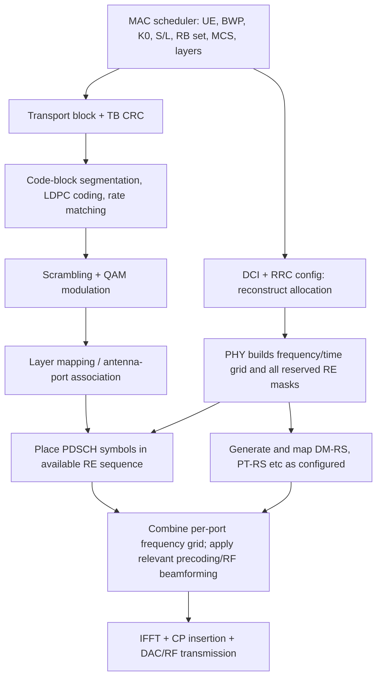
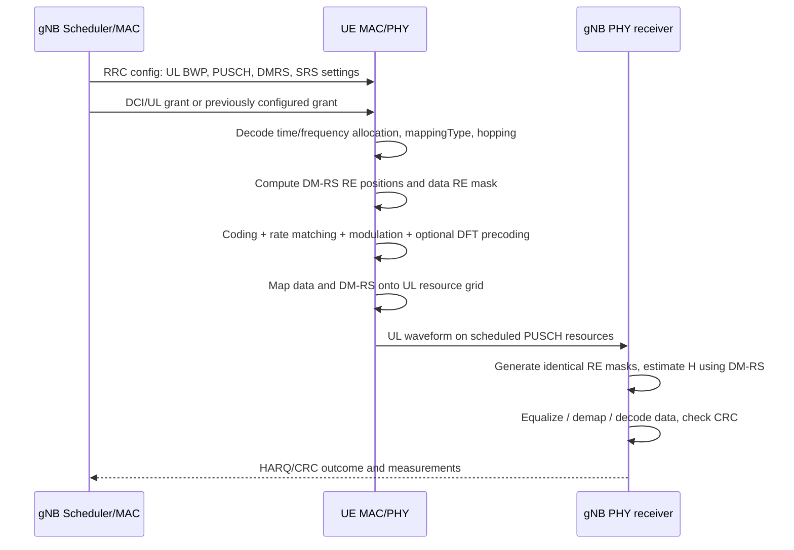
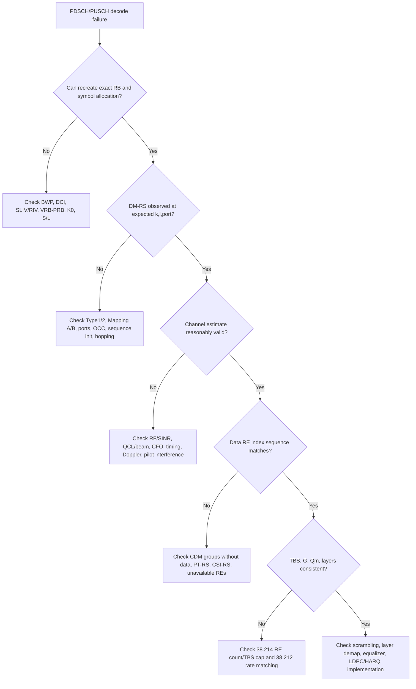

{
  "title": "RESOURCE MAPPING TRONG 4G LTE / 5G NR",
  "date": "2026-11-20",
  "draft": false,
  "description": "Từ lưới RE và PRB đến cách PDSCH, PUSCH và các tín hiệu tham chiếu ánh xạ tài nguyên trong LTE và NR.",
  "categories": ["4G LTE", "5G NR"],
  "tags": ["Resource Mapping", "PHY"],
  "math": true
}

# RESOURCE MAPPING TRONG 4G LTE / 5G NR

**Deep Technical Research — PHY Layer, RE/PRB mapping, PDSCH/PUSCH, DM-RS Type 1/2 và Mapping Type A/B**  
**Ngôn ngữ:** Tiếng Việt, giữ thuật ngữ Telecom bằng tiếng Anh  
**Ngày biên soạn:** 20/11/2026  
**Nguồn chính đã đối chiếu:** 3GPP TS 38.211 V18.10.0 (Release 18), TS 38.214 V18.9.0 (Release 18), TS 36.211 V17.4.0 (Release 17).  
**Quy ước:** Mọi sơ đồ đều mô tả *logical time-frequency resource grid*, không phải thứ tự các mẫu I/Q được phát trên dây cáp RF. Các ví dụ được giới hạn điều kiện rõ ràng; không áp dụng một pattern minh họa cho mọi Release/feature.

---

## 1. Resource mapping thực sự là gì? Vì sao nó tồn tại?

Trong OFDM, sau khi encoder và modulator tạo ra chuỗi symbol phức `d[0], d[1], ...`, phần cứng RF **không** phát trực tiếp chuỗi đó theo nghĩa mỗi phần tử tạo một xung riêng lẻ. PHY phải đặt chúng vào một **ma trận tài nguyên tần số–thời gian**. Mỗi ô là một *resource element* (RE) mang một giá trị phức (data, reference signal, control signal...) hoặc không được sử dụng. IFFT/OFDM modulation sau đó biến một cột theo trục frequency thành waveform miền thời gian cho OFDM symbol tương ứng.

Về mặt mô hình:

\[
 a^{(p,\mu)}_{k,l}\in \mathbb C,
\]

trong đó `p` là antenna port, `μ` là numerology, `k` là subcarrier index, và `l` là OFDM-symbol index. **Resource mapping** là phép ánh xạ có quy tắc từ chuỗi symbols và các reference signals vào các `a[k,l]` hợp lệ.

Một phép đặt tùy tiện sẽ khiến receiver không thể biết RE nào chứa dữ liệu, đâu là DM-RS dùng để estimate channel, đâu là control/reference resources. Khi gNB và UE cùng triển khai quy tắc 3GPP, receiver có thể xây dựng lại **cùng một resource mask** mà không phải nhận một bảng liệt kê từng RE qua radio.

Chỉ cần một trong các tham số `BWP start`, `PRB allocation`, `S/L`, `DM-RS position`, `DM-RS configuration type`, `CDM groups without data`, `antenna port indication`, `PT-RS` hoặc các resource reservations bị giải mã sai thì transmitter và receiver sẽ suy ra **hai tập RE khác nhau**. Hậu quả là channel estimate hỏng, constellation sai, LLR sai, CRC fail, BLER tăng hoặc UL không decode được.

**Ba quá trình khác nhau cần phân biệt:**

1. **Scheduling / resource allocation:** MAC scheduler chọn UE, RB, slot, OFDM symbols, MCS, layers và các cơ chế liên quan. 3GPP quy định cách báo hiệu/diễn giải, nhưng chính sách chọn UE/RB thường là thuật toán vendor.
2. **Rate matching / TBS:** PHY xác định số bits có thể truyền, chọn TBS theo quy tắc chuẩn, coding, puncturing/repetition/selection trên coded-bit sequence. Đây là miền **bits**.
3. **RE mapping:** PHY đưa các modulation symbols vào những RE không bị chiếm/dành riêng. Đây là miền **complex symbols**, sau điều chế và các thao tác layer/precoding liên quan.

Không được gọi bước `TB → LDPC → rate matching` là cùng một phép toán với `QAM symbol → RE(k,l)`.

### Nhìn trên trục thời gian–tần số

```text
  frequency ↑
  k = 11  |  ·  ·  ·  ·  ·  ·  ·  ·  ·  ·  ·  ·  ·  ·
  k = 10  |  ·  ·  D  ·  ·  ·  ·  ·  ·  ·  ·  ·  ·  ·
  k =  9  |  ·  ·  ·  ·  ·  ·  ·  ·  ·  ·  ·  ·  ·  ·
    ...   |                 ...
  k =  1  |  ·  ·  ·  ·  ·  ·  ·  ·  ·  ·  ·  ·  ·  ·
  k =  0  |  ·  ·  D  ·  ·  ·  ·  ·  ·  ·  ·  ·  ·  ·
          +------------------------------------------→ time
  symbol l   0  1  2  3  4  5  6  7  8  9 10 11 12 13

  D = một RE được DM-RS chiếm, · = RE cần phân loại tiếp
```

Sơ đồ mang tính khái niệm; chỉ hai ô `D` **không** biểu diễn đầy đủ DM-RS pattern. Trong phần 5 sẽ dựng chính xác cả 12 subcarriers/PRB.

## 2. Từ số Hz đến một ô RE: dựng hệ tọa độ đúng

### 2.1 Numerology quyết định độ phân giải

Trong NR, subcarrier spacing (SCS) là:

\[
\Delta f=15\cdot 2^{\mu}\ \text{kHz}.
\]

Với normal cyclic prefix (CP), mỗi slot chứa 14 OFDM symbols và thời lượng slot danh định là:

\[
T_{\mathrm{slot}}=\frac{1\ \mathrm{ms}}{2^\mu}.
\]

| Numerology `μ` | SCS | Slot danh định | Symbols/slot (normal CP) |
|---|---:|---:|---:|
| 0 | 15 kHz | 1 ms | 14 |
| 1 | 30 kHz | 0,5 ms | 14 |
| 2 | 60 kHz | 0,25 ms | 14 |
| 3 | 120 kHz | 0,125 ms | 14 |

Từng RE không mang đơn vị `bits`: số coded bits per data RE còn tùy `Q_m` (QPSK: 2; 16QAM: 4; 64QAM: 6; 256QAM: 8...) và số layers. Từng RE của **một antenna port/layer** mang một complex modulation symbol tương ứng.

Một RB tại một thời điểm biểu diễn **12 subcarriers**, tức băng thông danh định `12 × Δf`. Một PRB không mặc định có 14 symbols; các phát biểu `1 PRB = 12 × 14 = 168 RE` chỉ đúng khi ta đang đếm **toàn bộ 14 OFDM symbols của một slot normal-CP**, trước khi trừ điều khiển/reference/reservation. Nếu PDSCH chỉ có `L=4`, hình chữ nhật thô của nó trên một PRB chỉ là `12×4=48` RE.

### 2.2 Không được nhầm CRB, PRB, VRB và BWP

- **Point A**: frequency anchor cho numbering của common resource blocks (CRBs) trên một carrier/numerology.
- **CRB**: đánh số với gốc tham chiếu Point A. Chỉ số toàn carrier theo numerology.
- **BWP**: một tập CRBs liên tục được cấu hình để UE vận hành ở bandwidth/numerology tương ứng; UE có active BWP theo thủ tục cấu hình.
- **PRB**: RB được đánh số **bên trong BWP**, `n_PRB=0` ứng với CRB đầu tiên của BWP (trong ánh xạ thông thường).
- **VRB**: *virtual* RB index cho dữ liệu, sau đó được ánh xạ đến PRB qua non-interleaved hoặc interleaved scheme (tùy ngữ cảnh PDSCH và cấu hình).

Ở trường hợp non-interleaved điển hình và không có special offset:

\[
n^{\mathrm{CRB}}=N^{\mathrm{BWP}}_{\mathrm{start}}+n^{\mathrm{PRB}},
\qquad
k_{\rm local}=12n^{\mathrm{PRB}}+k',\;k'\in\{0,...,11\}.
\]

Chẳng hạn active BWP bắt đầu tại CRB 42, allocated PRBs `{3,4}` thì hai RB tương ứng CRBs `{45,46}`. Một lỗi `BWP start=41` thay vì 42 gây dịch **12 subcarriers** toàn bộ allocation, dù giá trị DCI `PRB index=3` vẫn giống hệt.

**Điểm quan trọng:** indexing của signal sequence (ví dụ DM-RS) còn sử dụng reference point riêng theo specification; không được lấy bừa `k_local = 12×PRB` thay cho `k` absolute trong mọi công thức. 3GPP TS 38.211 §4.4.2–4.4.5, §7.3.1.5–7.3.1.6, §7.4.1.1.2.

### 2.3 Resource grid không phải một bitmap duy nhất cho toàn bộ cell

Resource grid được mô tả theo numerology và antenna port. Cùng tọa độ `(k,l)` có thể có các complex symbols **khác nhau trên các antenna ports**; đây không tự động là collision. Ví dụ hai DM-RS ports trong cùng CDM group có thể chia sẻ RE location nhưng dùng OCC để nhận diện các pilot tương ứng.

Do đó phải phân biệt:

- *Physical RE coordinate*: cặp `(k,l)`.
- *Port-specific signal*: complex value trên antenna port `p` tại `(k,l)`.
- *RE unavailable for PDSCH data*: quy tắc reservation ở cấp resource mask, không đơn giản bằng phép cộng số antenna ports.

Nếu có hai ports cùng CDM group, không được tự nhân đôi số RE đã chiếm: hai ports có thể dùng cùng RE coordinates với orthogonal codes.

## 3. Downlink PDSCH: từ scheduling đến OFDM waveform

**Một chuỗi điển hình** (lược bỏ các nhánh feature-specific để tập trung resource mapping):



Sơ đồ là **logical processing flow**, không buộc mọi vendor thực hiện precoding ở đúng một vị trí code/module. 3GPP đặt ra nghĩa toán học của kết quả transmit waveform, không yêu cầu pipeline phần mềm phải giống nhau.

### 3.1 Cái gì đến từ RRC, cái gì đến từ DCI?

- **RRC** thiết lập cấu hình dài hạn/bán tĩnh: BWP, PDSCH-Config, DMRS-DownlinkConfig (`dmrs-Type`, `dmrs-AdditionalPosition`, `maxLength`...), danh sách time-domain allocation, resource restrictions, CSI-RS, PT-RS khi cần.
- **PDCCH/DCI** chọn một entry time-domain allocation, frequency-domain assignment, MCS, HARQ parameters, antenna-port-related indication và các trường tùy DCI format/feature.
- **MAC scheduler** ở gNB lựa chọn phương án truyền phù hợp; UE không cần biết thuật toán lựa chọn nhưng phải suy ra cùng tài nguyên từ signaling.

Trong ví dụ một UE nhận DCI ở slot `n`, `K0=1` nghĩa PDSCH áp dụng ở slot được xác định bởi offset K0 theo quy tắc TDRA và timing hiện hành, **không** được tự gán rằng mọi DCI→PDSCH đều cùng slot. PDCCH mang control ở CORESET, PDSCH data ở tài nguyên được chỉ thị, có thể cùng slot hoặc khác slot.

### 3.2 Time Domain Resource Allocation (TDRA) → `S`, `L`, Mapping Type

Các entry time-domain allocation cung cấp `K0`, `mappingType`, `startSymbolAndLength` (được mã hóa dưới dạng SLIV) hoặc trường liên quan theo release/format. Với normal CP, đối với một allocation nằm trong 14-symbol slot:

\[
0\le S\le 13,\quad 1\le L\le14,\quad S+L\le14.
\]

SLIV thông dụng theo định nghĩa (14 symbols/slot):

\[
\mathrm{SLIV}=\begin{cases}
14(L-1)+S,& L-1\le7,\\
14(14-L+1)+(13-S),& L-1>7.
\end{cases}
\]

Ví dụ `S=2, L=12`: `L-1=11>7`, nên `SLIV=14×3+(13-2)=53`. UE giải mã SLIV để lấy lại **đúng** `(S=2,L=12)` trong tập các tổ hợp hợp lệ; không thể coi SLIV là một vị trí symbol trực tiếp. Cần tuân theo bảng/giới hạn applicability, mapping type và DCI thực tế ở TS 38.214 §5.1.2.1.

### 3.3 Frequency Domain Resource Allocation (FDRA)

- **Type 0:** bitmap theo Resource Block Groups (RBG), với group size phụ thuộc BWP/configuration.
- **Type 1:** contiguous VRB assignment được mã hóa bằng Resource Indication Value (RIV). Trong mô hình BWP `N_RB`, start `RB_start`, length `L_RB`, phép encode tương tự nguyên lý SLIV nhưng phụ thuộc `N_RB`.
- **VRB→PRB:** sau allocation ở VRB domain, mapping scheme có thể đưa VRBs đến các PRBs tương ứng (non-interleaved hoặc interleaved khi được áp dụng).

**Lưu ý troubleshooting:** Log `RIV=...` không phải `PRB start`. Phải decode theo BWP size; nếu bỏ qua interleaving, toàn bộ mapping có thể sai dù `PRB count` đúng.

### 3.4 Tạo tập RE khả dụng

Đặt tập hình chữ nhật của PDSCH allocation là:

\[
\mathcal A = \{(k,l): k\in\mathcal K_{\rm PRB},\; l\in[S,S+L-1]\}.
\]

Tập data RE:

\[
\mathcal D = \mathcal A\setminus\big(\mathcal R_{\rm DMRS}\cup\mathcal R_{\rm PTRS}\cup
\mathcal R_{\rm CSIRS}\cup\mathcal R_{\rm unavailable}\big).
\]

Đây là dạng toán học **minh họa nguyên lý**. Cách xác định membership từng mask và điều kiện không collision phải theo 38.211/38.214, không mặc định các masks độc lập hoặc luôn present. Các RE vật lý gán PDSCH đi theo thứ tự tăng **subcarrier index trước**, sau đó **OFDM-symbol index** trên các VRB được chỉ định, bỏ qua các RE không hợp lệ (TS 38.211 §7.3.1.5).

**Ví dụ về hai kiểu không dùng RE:**

- RE nơi reference signal thực sự phát: chứa complex symbol của DM-RS hoặc CSI-RS, v.v.
- RE bị reserved / rate-matched / không khả dụng: **không nhất thiết chứa reference signal** cho UE này, nhưng PDSCH data vẫn không được chiếm.

Không được gọi tất cả reserved RE là pilot RE.

## 4. Phân tích hình minh họa: bốn trục cấu hình DM-RS không đồng nghĩa

Slide người đọc cung cấp nêu `single/double symbol`, `frequency Type 1/2`, `OFDM Symbol Type A/B`, `CDM group`. Cần tách chúng thành **các tham số gần như trực giao về ý nghĩa**:

| Trục | Giá trị | Nó kiểm soát điều gì? | KHÔNG có nghĩa là... |
|---|---|---|---|
| DM-RS frequency configuration | Type 1 / Type 2 | Frequency pattern, số CDM groups và các ports hỗ trợ | Không phải Mapping Type A/B |
| DM-RS maximum length | `len1` / `len2` | Cho phép một hoặc hai consecutive symbols trong mỗi DM-RS occasion, theo signaling hợp lệ | Không có nghĩa mọi allocation bắt buộc double |
| PDSCH/PUSCH mapping type | A / B | Mốc time index cho first DM-RS và bảng vị trí theo allocation | Không đồng nghĩa trực tiếp với FDRA Type 0/1 |
| `dmrs-AdditionalPosition` | `pos0...pos3` (theo mode) | Các DM-RS occurrences bổ sung trong thời gian | Không phải số port/number of RBs |
| `NumCDMGroupsWithoutData` | Giá trị được báo hiệu/hợp lệ | Bao nhiêu nhóm RE patterns sẽ không được PDSCH data sử dụng | Không phải số DM-RS ports thực sự phát |

### 4.1 Cách diễn đạt slide cần sửa

**Slide: “Type A = Slot based scheduling; DMRS starts in symbol 2 or 3 from slot boundary”.**  
Diễn đạt chính xác hơn: Với **mapping type A**, first PDSCH DM-RS nằm ở `l0=2` hoặc `3` **tính từ đầu slot** (theo `dmrs-TypeA-Position`); PDSCH allocation có thể bắt đầu ở các symbols khác nhau nếu đáp ứng điều kiện áp dụng. Không được kết luận mọi slot-based PDSCH dùng Type A hay dữ liệu bắt đầu tại `l0`.

**Slide: “Type B = Non-slot based scheduling; DMRS starts in PDSCH symbol 0”.**  
Đúng theo hệ tọa độ **relative to allocation**, không phải symbol 0 của slot. Nếu `S=9`, first DM-RS xảy ra tại `slot symbol 9`, chứ không phải symbol 0. Mini-slot là một use case quan trọng nhưng **định nghĩa của mapping type B là mốc tham chiếu**, không đơn thuần “mini-slot only”.

**Slide: “Type 1 = comb-based with 2 CDM groups; Type 2 = non-comb with 3 CDM groups”.**  
Đây là một mẹo hình dung tương đối: Type 1 chọn subcarriers dạng even/odd; Type 2 chọn các **pairs of adjacent subcarriers** trong chu kỳ 6. Cả hai đều có quy tắc toán học và OCC; không nên diễn giải Type 2 như RE hoàn toàn liên tục cho toàn PRB.

### 4.2 Antenna ports nâng cao trong Release 18

Trong TS 38.211 V18.10.0, Table 7.4.1.1.2-5 phân biệt `basic` và `enhanced` DM-RS multiplexing. Các con số quen thuộc (Type 1: 4 ports single/8 double; Type 2: 6 single/12 double) mô tả **basic**; các cấu hình **enhanced** có tập ports lớn hơn theo điều kiện hỗ trợ, RRC/signaling tương ứng. Do đó “Type 2 double-symbol luôn tối đa 12 ports” là phát biểu **không đầy đủ** nếu áp dụng cho mọi Release 18 configuration.

Không tự giả định một UE hoặc cell support enhanced mode chỉ vì specification định nghĩa nó. Phải kiểm tra capability, configuration, DCI và applicability.

## 5. Derive frequency pattern chính xác: DM-RS Type 1 và Type 2

Tập trung PDSCH DM-RS trong TS 38.211 V18.10.0 §7.4.1.1.2, **basic mode**, một RB và một DM-RS OFDM symbol; giả sử reference indexing đã đúng theo spec. Các công thức sau là nhánh mapping cơ bản; enhanced multiplexing có thêm cấu hình OCC/sequence và được kiểm tra riêng theo bảng.

### 5.1 Type 1: chọn các subcarriers cách nhau 2

\[
k=4n+2k'+\Delta,\quad k'\in\{0,1\},\quad n=0,1,\ldots
\]

Ở mỗi PRB, `Δ=0` tạo group 0 trên các subcarriers:

\[
G_0=\{0,2,4,6,8,10\}.
\]

`Δ=1` tạo group 1:

\[
G_1=\{1,3,5,7,9,11\}.
\]

**Minh họa một OFDM symbol trong một PRB:**

```text
local subcarrier:  00 01 02 03 04 05 06 07 08 09 10 11
Type 1 CDM λ=0 : D0 .. D0 .. D0 .. D0 .. D0 .. D0 ..
Type 1 CDM λ=1 : .. D1 .. D1 .. D1 .. D1 .. D1 .. D1
                  |-------- 12 subcarriers --------|
```

Hai nhóm tạo partition 12 RE vào các vị trí **không giao nhau**; mỗi group gồm 6 RE/PRB/symbol. Với `NumCDMGroupsWithoutData=1` và group 0 được dành, có 6 RE bị loại khỏi PDSCH data và 6 RE còn lại **có thể** chứa data (nếu không reservation khác). Với giá trị 2, cả 12 RE trên DM-RS symbol không dùng cho PDSCH data.

**Tại sao 2 ports có thể đặt trên cùng 6 RE?** Table 7.4.1.1.2-1 cho ports 1000 và 1001 thuộc cùng CDM group 0 nhưng dùng different frequency-domain orthogonal covers `w_f`. Khái niệm pilot được multiplex bằng code, không nhất thiết bằng các tọa độ `(k,l)` khác nhau.

### 5.2 Type 2: ghép theo pairs, lặp chu kỳ 6

\[
k=6n+k'+\Delta,\quad k'\in\{0,1\},\quad \Delta\in\{0,2,4\}.
\]

Trong một PRB:

\[
\begin{aligned}
G_0&=\{0,1,6,7\},\\
G_1&=\{2,3,8,9\},\\
G_2&=\{4,5,10,11\}.
\end{aligned}
\]

```text
local subcarrier:  00 01 02 03 04 05 06 07 08 09 10 11
Type 2 CDM λ=0 : D0 D0 .. .. .. .. D0 D0 .. .. .. ..
Type 2 CDM λ=1 : .. .. D1 D1 .. .. .. .. D1 D1 .. ..
Type 2 CDM λ=2 : .. .. .. .. D2 D2 .. .. .. .. D2 D2
```

Mỗi group chỉ cần **4 RE/PRB/symbol**. Khi `NumCDMGroupsWithoutData=1/2/3`, số RE bị reserved cho PDSCH data tương ứng là **4/8/12** trên DM-RS symbol, trong ví dụ không có reservation khác. Không được nhầm `RE reserved per CDM group` với `DM-RS power` hay số antenna ports.

### 5.3 Các ports sử dụng chung group qua OCC bằng cách nào?

Mô hình cơ bản cho signal trên port `p`:

\[
a^{(p)}_{k,l}=\beta_{\mathrm{DMRS}}\, w_f^{(p)}(k')\,w_t^{(p)}(l')\,r(2n+k').
\]

Trong đó `r` là pilot sequence phức được xác định theo generator/initialization, `w_f` là frequency-domain OCC, `w_t` là time-domain OCC nếu áp dụng, `β` là amplitude scaling, `k'` và `l'` là indices được chuẩn định nghĩa. Đây là dạng biểu diễn cho trường hợp cơ bản, không thay thế từng nhánh Release 18 được mô tả đầy đủ trong chuẩn.

Ví dụ đơn giản trên một cặp RE, hai orthogonal covers `(+1,+1)` và `(+1,-1)`:

\[
\mathbf w_0^H\mathbf w_1=(+1)(+1)+(+1)(-1)=0.
\]

Khi receiver combine các pilot theo một cover, thành phần tương ứng cover khác triệt tiêu **trong điều kiện lý tưởng**. Trên kênh frequency-selective, phase noise, Doppler hoặc đồng bộ không chính xác, tính trực giao hữu hiệu có thể suy giảm. Không thể từ đó kết luận multi-user data streams chắc chắn không gây nhiễu nhau: **pilot orthogonality khác data-layer/inter-user interference**.

### 5.4 Basic/Enhanced ports: đọc chuẩn, không đoán bằng hình

| PDSCH DM-RS multiplexing | Type 1 | Type 2 | Source |
|---|---|---|---|
| Basic single-symbol | ports 1000–1003 (4) | 1000–1005 (6) | TS 38.211 Table 7.4.1.1.2-5 |
| Basic double-symbol | ports 1000–1007 (8) | 1000–1011 (12) | Cùng bảng |
| Enhanced single-symbol | 1000–1003 và 1008–1011 (8) | 1000–1005 và 1012–1017 (12) | Cùng bảng |
| Enhanced double-symbol | 1000–1015 (16) | 1000–1023 (24) | Cùng bảng |

**Cẩn trọng:** Đây là số port được định nghĩa/hỗ trợ bởi mapping tables theo mode, **không** phải lời khẳng định một PDSCH đơn lẻ có thể truyền tối đa bấy nhiêu data layers trong bất cứ cấu hình nào. Layer constraints và DCI/UE capabilities có thể nhỏ hơn nhiều.


## 6. Time mapping: Type A/Type B, single/double symbol và additional positions

### 6.1 Hai hệ tọa độ thời gian là nguyên nhân của phần lớn nhầm lẫn

Giả sử một slot normal-CP chứa symbols `0..13`. Scheduler chọn `S=9, L=4` thì PDSCH chiếm `l_slot = {9,10,11,12}`. Với mapping type B, first DM-RS có `l_relative=0`, nên:

\[
 l_{\rm slot}=S+l_{\rm relative}=9+0=9.
\]

Trong khi với mapping type A, time indices được định nghĩa từ slot boundary; first DM-RS có:

\[
l_0=\begin{cases}2,&\mathrm{dmrs\mbox{-}TypeA\mbox{-}Position=pos2},\\
3,&\mathrm{dmrs\mbox{-}TypeA\mbox{-}Position=pos3}.
\end{cases}
\]

Điều này **không** nói `S=2/3` cho PDSCH. PDSCH có thể chứa OFDM symbols trước và sau first DM-RS tùy allocation hợp lệ. Nếu grant Type A không chứa first DM-RS position thì cấu hình đó không thể dùng như một PDSCH thông thường với DM-RS như mô tả; UE phải áp dụng các restrictions của specification.

```text
Slot symbols:    00 01 02 03 04 05 06 07 08 09 10 11 12 13
                 |-----------------------------------------|
Type A example:  P  P  R  P  P  P  P  P  P  P  P  P  P  P
                        ^ first DM-RS at slot l=2
Type B example:  .  .  .  .  .  .  .  .  .  R  P  P  P  .
                                              ^
                 first DM-RS at l_slot=9 (= S + l_relative=0)

P = PDSCH symbol interval (not necessarily every RE carries data)
R = OFDM symbol contains DM-RS REs
. = outside scheduled PDSCH
```

**Đừng nhầm:** `R` không có nghĩa **toàn bộ OFDM symbol** dành cho DM-RS. Với type 1 và 1 CDM group without data, trên một PRB chỉ 6/12 subcarriers ở `R` bị reserved. Một phần còn lại có thể mang PDSCH data.

### 6.2 Single-symbol vs double-symbol front-loaded DM-RS

Một *single-symbol DM-RS occasion* sử dụng một OFDM symbol. *Double-symbol* sử dụng một **cặp consecutive OFDM symbols** cho mỗi occasion. `maxLength` và associated signaling quyết định chế độ thực tế theo chuẩn.

```text
l slot:            0 1 2 3 4 5 6 7 8 9 10 11 12 13
Single Type A:     · · R · · · · · · ·  ·  ·  ·  ·
Double Type A:     · · R R · · · · · ·  ·  ·  ·  ·
```

Trong điều kiện lý tưởng, một cặp symbol giúp tạo thêm **time-domain OCC dimension** và hỗ trợ nhiều pilot ports. Đổi lại, nó loại thêm RE khỏi tập data nếu so với một single-symbol occasion tương ứng. Nó không mang lại một tỷ lệ reliability cố định: hiệu quả còn phụ thuộc fading/coherence, precoder, số ports và receiver estimator.

### 6.3 AdditionalPosition là bảng ánh xạ, không phải phép cộng máy móc

Trong TS 38.211 V18.10.0, Table **7.4.1.1.2-3** cho PDSCH single-symbol, Table **7.4.1.1.2-4** cho double-symbol. Vị trí phụ thuộc **`l_d`, mappingType, dmrs-AdditionalPosition, dmrs-TypeA-Position`**, đôi khi còn có exceptions (LTE coexistence, CORESET constraints và giới hạn UE expectations).

Quan trọng: với **Mapping A**, `l_d` trong các bảng là khoảng từ **đầu slot đến OFDM symbol cuối cùng của scheduled PDSCH**, tức `l_d = S+L` trong ví dụ single-slot bình thường. Với **Mapping B**, `l_d=L` (duration của allocation). Sai lầm dùng `L` thay cho `S+L` ở Mapping A sẽ chọn nhầm row bảng, kể cả khi `S` và `L` nhìn có vẻ hợp lý.

**Ví dụ A — full-slot Type A, `S=0`, `L=14`, `dmrs-TypeA-Position=pos2`, single-symbol:**

| `dmrs-AdditionalPosition` | DM-RS symbol indices, theo Table 7.4.1.1.2-3 | Giải thích |
|---|---|---|
| pos0 | `{2}` | Front-loaded DM-RS duy nhất |
| pos1 | `{2,11}` | Một DM-RS thêm về cuối slot |
| pos2 | `{2,7,11}` | Hai additional occurrences |
| pos3 | `{2,5,8,11}` | Ba additional occurrences |

Bảng là trích **các vị trí được tính lại cho trường hợp cụ thể**, không sao chép nguyên bảng 3GPP. `pos3` có restriction: chỉ được hỗ trợ với `dmrs-TypeA-Position=pos2` trong trường hợp chuẩn quy định. Các limitations liên quan đến LTE CRS match-around cũng phải xét khi applicable.

**Ví dụ B — mini-slot Type B `S=9`, `L=4`, single-symbol, pos0:** DM-RS relative `{0}`, absolute `{9}`. Nếu length tăng thành `L=5` và `pos1` hợp lệ, Table 7.4.1.1.2-3 có thể cho relative positions `{0,4}` → absolute `{S,S+4}`. Đây là hiệu ứng của **table-dependent additional positions**, không phải quy luật “mọi 5-symbol PDSCH đều có hai DM-RS”.

**Ví dụ C — double-symbol Type A `S=0`, `L=14`, front-loaded at 2:** `pos0` cho DM-RS occasion bắt đầu ở `l=2`, thực tế chiếm `{2,3}`; ở `pos1` theo Table 7.4.1.1.2-4, occasions bắt đầu ở `{2,10}` và thực tế chiếm `{2,3,10,11}`. Đây là cách đọc quan trọng: table cho **start symbol** của từng double-symbol occasion, không phải mọi OFDM symbol được ghi thành một ô riêng.

### 6.4 Ngoại lệ không thể bỏ qua

1. **Too-short allocation:** Với PDSCH duration `≤4 symbols`, TS 38.211 §7.4.1.1.2 chỉ support single-symbol DM-RS; không được bật double chỉ vì muốn tăng pilot density.
2. **CORESET overlap:** Trong những điều kiện được mô tả tại §7.4.1.1.2, first DM-RS position có thể cần dịch để tránh collision với CORESET; không viết hardcoded `l=2` cho mọi case.
3. **TDD DL/UL symbols:** Allocation phải được kiểm tra với usable DL/UL symbols và TDD configuration. Một PDSCH không được phát dữ liệu trên UL symbols bị chỉ định ở trường hợp không tương thích.
4. **Cross-slot assumptions:** Không được lấy `l=2` tại slot nhận DCI khi `K0` chỉ đến slot khác.
5. **Extended CP:** 12 OFDM symbols/slot thay vì 14; tables/valid configurations khác. Không dùng mặc định công thức normal-CP cho trường hợp này.
6. **Transform precoding, hopping, SRS và UCI trên PUSCH:** Các feature này liên quan PUSCH sẽ ảnh hưởng cách chọn và sử dụng data/DM-RS REs, không thể copy y nguyên bảng DL.

## 7. Ví dụ đầy đủ 1 PRB: từ cấu hình đến 168 ô RE

### 7.1 Đầu vào (giả định được xác nhận)

- 5G NR downlink, normal CP, SCS 30 kHz (`μ=1`).
- Active BWP chứa allocated PRB `n_PRB=3`; minh họa **1 PRB** này.
- PDSCH Mapping Type **A**, `S=0`, `L=14`.
- `dmrs-TypeA-Position=pos2`, `dmrs-AdditionalPosition=pos0`.
- DM-RS configuration **Type 1**, `maxLength=len1`, sử dụng group 0 cho pilot; `NumCDMGroupsWithoutData=1`.
- Không PT-RS, không CSI-RS/resource exclusions/other collision. Giả định này chỉ nhằm tách riêng hiệu ứng DM-RS; grant thực tế phải xét CORESET/TDD/other unavailable resources.

**Bước 1 — tạo candidate coordinates:** `12 subcarriers × 14 OFDM symbols = 168 RE`.

**Bước 2 — DM-RS time:** Type A pos2 pos0 → `l={2}`.

**Bước 3 — DM-RS frequency:** Type 1 group 0 → `k_local={0,2,4,6,8,10}`.

**Bước 4 — reserve:** 6 cặp tọa độ `(k,2)` thuộc mask, **không** dùng cho PDSCH data.

**Bước 5 — data mapping:** 162 RE còn lại có thể chứa PDSCH data trong ví dụ lý tưởng. Đối với exact TBS, xem §9 vì **156 RE cap** làm số RE tính TBS khác số data RE vật lý vừa đếm.

### 7.2 ASCII grid, mọi subcarrier và symbol đều hiện rõ

```text
             OFDM SYMBOL INDEX within SLOT
k(local)  |00 01 02 03 04 05 06 07 08 09 10 11 12 13
------------------------------------------------------
  11      | d  d  d  d  d  d  d  d  d  d  d  d  d  d
  10      | d  d  R  d  d  d  d  d  d  d  d  d  d  d
   9      | d  d  d  d  d  d  d  d  d  d  d  d  d  d
   8      | d  d  R  d  d  d  d  d  d  d  d  d  d  d
   7      | d  d  d  d  d  d  d  d  d  d  d  d  d  d
   6      | d  d  R  d  d  d  d  d  d  d  d  d  d  d
   5      | d  d  d  d  d  d  d  d  d  d  d  d  d  d
   4      | d  d  R  d  d  d  d  d  d  d  d  d  d  d
   3      | d  d  d  d  d  d  d  d  d  d  d  d  d  d
   2      | d  d  R  d  d  d  d  d  d  d  d  d  d  d
   1      | d  d  d  d  d  d  d  d  d  d  d  d  d  d
   0      | d  d  R  d  d  d  d  d  d  d  d  d  d  d
------------------------------------------------------
R = RE reserved by DM-RS CDM group 0
  = 6 positions: (0,2),(2,2),(4,2),(6,2),(8,2),(10,2)
d = available for PDSCH data only under our no-other-reservation assumption
```

Điểm khó thấy nếu chỉ nhìn slide: DM-RS không chiếm toàn bộ symbol `l=2`, nên các ô `(1,2),(3,2),...,(11,2)` có thể là data. Receiver cũng phải dùng cùng mapping mask; nếu UE sai DM-RS type và coi Type 2 thay cho Type 1, RE `(2,2)` có thể được nhận nhầm data thay vì DM-RS, khiến cả pilot estimation lẫn rate-matched data bit ordering sai.

### 7.3 Theo thứ tự `d[0], d[1], ...` mapping vào RE thế nào?

Trong ví dụ một PRB, assuming all other positions available, đầu slot `l=0`:

\[
d[0]\to(k=0,l=0),\ d[1]\to(1,0),\ldots,\ d[11]\to(11,0).
\]

Tại `l=1`, `d[12]...d[23]` lần lượt đi vào `k=0...11`. Ở `l=2`, `k=0` bị DM-RS reserved; do đó:

\[
d[24]\to (k=1,l=2),\quad d[25]\to(k=3,l=2),\quad \ldots,\quad d[29]\to(k=11,l=2).
\]

Sau đó `d[30]→(0,3)` nếu không có reservation nào khác. Đây là cách kiểm chứng practical **symbol stream index ↔ RE address**. Nếu PHY mapper skip 5 RE thay vì 6 tại `l=2`, tất cả symbols phía sau sẽ bị lệch một index.

### 7.4 Đổi một tham số: điều gì thay đổi?

Giữ `S=0,L=14`, single-symbol, pos0, chưa tính other reservations:

| DM-RS config | CDM groups without data | Reserved RE/PRB | Remaining data RE/PRB |
|---|---:|---:|---:|
| Type 1 | 1 | 6 | 162 |
| Type 1 | 2 | 12 | 156 |
| Type 2 | 1 | 4 | 164 |
| Type 2 | 2 | 8 | 160 |
| Type 2 | 3 | 12 | 156 |

**Các dòng mang tính tính toán trên RE mask**, không phải xác nhận mọi combination đều được báo hiệu cho mọi DCI, UE capability hay mapping configuration. Tại system level, nhiều pilot ports có thể đòi hỏi nhiều groups/OCC và làm tăng overhead; đổi Type 1→Type 2 không tự đảm bảo throughput tăng vì CSI quality, pilot collisions, channel rank và scheduling cũng thay đổi.

### 7.5 Đổi additionalPosition

Với Type A `S=0,L=14`, Type 1, 1 CDM group:

| AdditionalPosition | DM-RS OFDM symbols | DM-RS reserved RE/PRB | Remaining data RE/PRB |
|---|---|---:|---:|
| pos0 | `{2}` | 6 | 162 |
| pos1 | `{2,11}` | 12 | 156 |
| pos2 | `{2,7,11}` | 18 | 150 |
| pos3 | `{2,5,8,11}` | 24 | 144 |

Đây là trade-off: thêm DM-RS giúp **theo dõi kênh theo thời gian** tốt hơn khi channel biến động nhanh, nhưng sử dụng nhiều RE cho pilot hơn, làm giảm capacity data trong cùng grid. Không có lựa chọn tối ưu chung cho mọi Doppler/SINR/antenna configuration.

## 8. Ví dụ Type B với allocation ngắn: vị trí DM-RS theo slot và frequency

**Giả định:** NR PDSCH normal CP, `S=9`, `L=4`, mapping B, DM-RS Type 2, single-symbol, `pos0`, 1 CDM group without data, không có other reservations.

**Time:** first DM-RS at relative `l=0`, slot `l=9`.

**Frequency:** Type 2 CDM group 0 dùng `k={0,1,6,7}` trong mỗi PRB.

**Tính toán:**

\[
N_{\rm RE,raw}=12\times4=48,\quad
N_{\rm DMRS}=4,\quad
N_{\rm data}=44\ \mathrm{RE/PRB}.
\]

```text
                        slot symbol
                 8     9     10    11    12    13
                 |     |     |     |     |     |
subcarriers
11              .     d     d     d     d     .
10              .     d     d     d     d     .
 9              .     d     d     d     d     .
 8              .     d     d     d     d     .
 7              .     R     d     d     d     .
 6              .     R     d     d     d     .
 5              .     d     d     d     d     .
 4              .     d     d     d     d     .
 3              .     d     d     d     d     .
 2              .     d     d     d     d     .
 1              .     R     d     d     d     .
 0              .     R     d     d     d     .

R = reserved DM-RS Type 2 CDM group 0
```

Nếu trước đây tool kiểm tra mapping Type B của bạn luôn bắt đầu tính từ `slot l=0`, trường hợp này sẽ chỉ ra lỗi một cách dứt khoát: nó sẽ đặt 4 pilot RE sai lệch **9 OFDM symbols**. Nếu tool dùng Type 1 thay Type 2, nó sẽ sai **cả frequency pattern và count** (6 vs 4 RE per group).


## 9. Resource mapping và TBS: tại sao đếm đúng RE vẫn có thể tính sai transport block?

### 9.1 Hai số lượng RE khác nhau: physical mapping capacity vs TBS reference quantity

TS 38.214 V18.9.0 §5.1.3.2 định nghĩa (đối với những nhánh TBS determination có quy trình này):

\[
N'_{\rm RE}=N^{\rm RB}_{\rm sc}N^{\rm sh}_{\rm symb}
-N^{\rm PRB}_{\rm DMRS}-N^{\rm PRB}_{\rm oh},
\qquad N^{\rm RB}_{\rm sc}=12.
\]

Sau đó:

\[
N_{\rm RE}=\min(156,N'_{\rm RE})\,n_{\rm PRB}.
\]

Các biến:

- `N_symb^sh`: số OFDM symbols trong PDSCH allocation.
- `N_DMRS^PRB`: số RE overhead DM-RS trên mỗi PRB trong scheduled duration, **bao gồm CDM groups without data** chứ không đơn thuần pilot RE của một port.
- `N_oh^PRB`: overhead giả định do RRC `xOverhead` chỉ định trong nhánh áp dụng, thường `0,6,12,18`; **đây là quantity cho TBS calculation**, không đồng nghĩa chính xác với một mapping mask của một signal cụ thể.
- `n_PRB`: số PRBs cấp phát.
- `156`: ceiling của số RE/PRB dùng trong phương pháp TBS determination này.

Giá trị `N_RE` nói trên là **effective RE count for TBS**, không phải lệnh cấm PHY map data vào RE thứ 157 nếu nó hợp lệ. Cần giữ hai biến riêng:

\[
N_{\rm physical\ data\ RE}=|\mathcal D|,
\quad
N_{\rm TBS\ RE}=\min(156,N'_{\rm RE})n_{\rm PRB}.
\]

Trong hệ thống thực, các resource exclusions ở mức RB/symbol hoặc RE có quy tắc riêng (TS 38.214 §5.1.4) nên việc `N'_RE` trùng với `|D|` chỉ đúng trong những ví dụ lý tưởng được giới hạn.

### 9.2 Ví dụ tại sao `162 ≠ 156` mà cả hai đều đúng

Quay lại §7: `S=0,L=14`, 1 PRB, DM-RS Type 1 one CDM group, một DM-RS symbol, no other reservations:

\[
N_{\rm physical\ data\ RE}=168-6=162.
\]

Trong bước estimate TBS:

\[
N'_{\rm RE}=12\cdot14-6-0=162,
\quad
N_{\rm TBS\ RE}=\min(156,162)=156.
\]

Với `n_PRB=4`: có **648 physical RE** theo mapping mask lý tưởng, nhưng **624 effective RE** dùng làm đầu vào TBS. Nếu debug tool tự động cho `N_PHYSICAL=624` bằng cách cắt bớt 6 data RE/PRB chỉ vì công thức `min(156,...)`, có thể tool đang nhầm TBS calculation với actual RE mapping.

### 9.3 Ví dụ khác có cap không kích hoạt

`S=2,L=12`, Type 1 one CDM group, pos0, 4 PRB, no other reservations:

\[
N'_{\rm RE}=12\cdot12-6=138,
\quad N_{\rm TBS\ RE}=138\cdot4=552.
\]

Nếu QAM order `Q_m=6` (64QAM) và `ν=2` layers, **số coded modulation bits trên 552 data RE nếu thực sự tất cả dùng như giả định** là:

\[
G=552\cdot6\cdot2=6624\ \text{coded bits}.
\]

Nhưng **6624 không phải TBS**. Theo quy trình standard, intermediate information-bit estimate là:

\[
N_{\rm info}=N_{\rm RE}\,R\,Q_m\,\nu,
\]

trong đó `R` là target code rate theo MCS table. Nếu **chỉ để minh họa**, lấy `R=1/2`:

\[
N_{\rm info}=552\times0.5\times6\times2=3312\ \text{bits}.
\]

TBS cuối cùng **không được mặc định bằng 3312 bits**. Nó cần dùng quantization, branch thresholds, table và CRC/LDPC/segmentation liên quan theo §5.1.3.2 và TS 38.212.

### 9.4 Điều gì xảy ra khi tăng DM-RS density?

Với ví dụ §7, từ pos0 lên pos3 (Type 1 group 0):

\[
N_{\rm raw}=168\quad\Rightarrow\quad
N_{\rm DMRS}:6\to24,
\quad N_{\rm data}:162\to144.
\]

Kết quả không đơn giản “giảm throughput 18/162”: nếu pilot density tăng giúp giảm channel-estimation error, target MCS hoặc BLER có thể cải thiện, thậm chí **goodput tăng** dù data RE giảm. Scheduler phải cân nhắc Doppler/coherence time, pilot contamination, CQI, link adaptation và UE capabilities.

**Kết luận:** `N_RE` trong bộ tính TBS, `G` trong rate matching, `number of free RE` của mapper và `number of information bits` là bốn biến riêng. Không được gộp chúng thành một `resource_count` trong code.

## 10. Uplink PUSCH: tương đồng về grid, khác về waveform, DM-RS và hopping

Đối với PUSCH, gNB cấp phát UL grants (dynamic hoặc configured grant). UE dùng cấu hình UL BWP, time/frequency allocations, MCS, DMRS-UplinkConfig và các feature khác để tạo resource grid. Trong NR, PUSCH có thể hoạt động với **transform precoding disabled** (CP-OFDM UL) hoặc **enabled** (DFT-s-OFDM UL); điều này thay đổi processing path và một số quy tắc DM-RS.

### 10.1 Flow tương đương DL nhưng khác control direction



### 10.2 PUSCH Mapping A/B không có nghĩa UL luôn giống DL từng symbol

Theo TS 38.211 V18.10.0 **§6.4.1.1.3**:

- **PUSCH Mapping Type A:** first DM-RS symbol `l0` theo `dmrs-TypeA-Position`, với time reference theo slot hoặc theo từng hop nếu intra-slot frequency hopping được bật theo quy tắc chuẩn.
- **PUSCH Mapping Type B:** `l0=0` relative to scheduled PUSCH allocation (nếu không hopping) hoặc relative to each hop (nếu hopping).
- **`l_d`** với Type A/Type B phải xác định theo định nghĩa tương ứng; với intra-slot hopping, duration per hop được dùng trong các bảng áp dụng.

Ví dụ PUSCH Type B bắt đầu `S=4, L=7`, không hopping: DM-RS đầu `l=4` absolute. Nếu bật intra-slot hopping, phải tính DM-RS **cho từng frequency hop** và kiểm tra bảng theo hop duration, không thể tái sử dụng một bitmap `l=4` cho cả slot.

### 10.3 Transform precoding enabled khác gì?

**Transform precoding disabled:** QAM symbols có thể được đưa theo CP-OFDM mapping path; DM-RS configuration type 1/2 và multiplexer phù hợp signaling.

**Transform precoding enabled:** UE thực hiện DFT spreading trước khi ánh xạ tài nguyên dữ liệu, với DM-RS sequence/mapping branch tương ứng. Trong phạm vi PUSCH DM-RS §6.4.1.1.3, transform-precoded branch dùng **DM-RS configuration type 1**, không được chọn bừa Type 2 của CP-OFDM branch. Với uplink hopping, power control, PAPR và localized resources, DFT-s-OFDM tạo thêm ràng buộc mà một mapper đơn giản cho downlink không xử lý được.

Nếu tool chỉ thay `cp_ofdm` thành `dft_s_ofdm` trong trường waveform nhưng giữ nguyên generator Type 2, kết quả có thể không phù hợp spec. Ngược lại, cố tình áp dụng toàn bộ chuỗi DFT spreading trên pilot DM-RS theo đúng cách xử lý data QAM cũng có thể sai; DM-RS generator và mapping riêng theo branch.

### 10.4 UCI multiplex trên PUSCH

UCI có thể được multiplex vào PUSCH theo TS 38.212/38.213/38.214 với các quy định riêng về số coded bits và mapping. Không nên mô tả UCI như một vùng PRB nguyên vẹn luôn dành cố định cho control. Theo ngữ cảnh coding/mapping, các coded bits cho UCI và UL-SCH có thể được multiplex trên resource sequence của PUSCH và chịu **RE exclusion** của DM-RS, PT-RS cùng các điều kiện tương ứng.

Sai lầm debug phổ biến là tính `G_ULSCH = Qm * ν * (12*L - DMRS_RE)` rồi **quên** UCI payload/resource handling, sau đó nghi ngờ LDPC khi chỉ sai UCI multiplexing allocation. Đọc TS 38.212 §6.2/§6.3 và TS 38.214 §6.1 nếu case UL có UCI.

### 10.5 SRS và PUCCH không phải “PUSCH data tùy chọn”

- **SRS:** uplink sounding signal mapping có sequence, resource, bandwidth, comb/cyclic shift và symbol positions riêng theo TS 38.211 §6.4.1.4. Không vẽ nó như `PUSCH DM-RS Type 1`.
- **PUCCH:** nhiều PUCCH formats và các DM-RS rules riêng theo TS 38.211 §6.3.2, §6.4.1.3. Không lấy PDSCH Type A/B table áp dụng cho PUCCH.
- **PRACH:** preamble-specific time/frequency occasions theo cấu hình RACH; không phải OFDM QAM symbol mapper PUSCH thông thường.

## 11. Resource exclusions và các tín hiệu khác: tại sao `data = allocated − DM-RS` chưa đủ?

Đúng là DM-RS thường dễ nhìn trên hình, nhưng một RE có thể bị loại khỏi data vì nhiều lý do khác. Cần thiết kế resource-map engine kiểu **compose sets + validate conflicts**.

### 11.1 PDSCH và những tài nguyên không thể tùy tiện chiếm

Theo TS 38.211 §7.3.1.5 cùng TS 38.214 §5.1.4, PDSCH mapping phải xét (tùy điều kiện):

1. **Associated DM-RS / DM-RS intended for co-scheduled UEs:** data không được map vào RE dành riêng theo cấu hình CDM groups/antenna ports.
2. **Non-zero-power CSI-RS:** PDSCH data không map vào các tài nguyên liên quan khi điều kiện loại trừ có hiệu lực; một số ngoại lệ/feature-specific behaviors phải đọc chuẩn đầy đủ.
3. **PT-RS:** RE của Phase Tracking RS khi được cấu hình/scheduled.
4. **Resource not available for PDSCH:** các RE hoặc RB/symbol bị đánh dấu không khả dụng theo §5.1.4 TS 38.214; bao gồm rate-matching patterns và một số coexistence/resource restrictions.
5. **CORESET/PDCCH:** control placement và các reservation constraints tương ứng; không thể chỉ suy ra bằng giả định “control nằm ở symbols 0–2 nên PDSCH luôn trống các symbols đó”.
6. **SS/PBCH, LTE CRS coexistence, ZP CSI-RS, other release-specific features:** phải kiểm tra những cơ chế có hiệu lực trong config hiện tại. Không mặc định mọi thiết bị support mọi pattern.

**NZP CSI-RS vs ZP CSI-RS:** NZP là actual reference signal truyền năng lượng để UE đo; ZP là resource configuration phục vụ reservation/assumptions trong thủ tục tương ứng. Do đó resource bỏ qua không luôn có nonzero signal. Khi receiver capture FFT grid, một vùng ZP được reservation có thể trông như noise, nhưng đó không phải bằng chứng resource mapper lỗi.

### 11.2 Ví dụ priority/collision

Giả sử PDSCH ở PRB 3 và symbols 2–13. DM-RS nằm ở `(k_even,l=2)`. Đến lúc tạo PDSCH data, chỉ còn `(k_odd,l=2)` là candidate ở OFDM symbol 2. Nếu một CSI-RS resource được cấu hình và rule áp dụng loại thêm `(k=1,l=2)`, `data capacity` của symbol 2 giảm thêm **1 RE**; modulation-symbol stream phải skip RE đó. Nếu CSI-RS “collision” với DM-RS thì không được tự ý hợp nhất hai signal thành một giá trị cộng phức: phải kiểm tra UE expectations và constraint trong 3GPP/config.

Khi một reference signal có CDM/OCC, hai antenna ports có thể dùng cùng physical RE. Nhưng **collision của hai hệ signal khác loại không tự động được phép** chỉ vì “MIMO cho phép nhiều antennas”. Đây là hai khái niệm hoàn toàn khác nhau.

### 11.3 RE level, RB-symbol level, VRB-to-PRB level

Các restrictions có thể khác granularity:

- **RE-level:** loại một tập `(k,l)` cụ thể.
- **RB-symbol-level:** không dùng nguyên một resource block trong một OFDM symbol (`12` RE mỗi RB symbol), tùy quy tắc.
- **VRB-to-PRB mapping:** thay đổi RB vật lý nhận data, từ đó thay đổi absolute coordinates; không làm biến mất data symbol.

Một hệ thống sử dụng chung biến `reserved_re_count` nhưng không lưu **RE locations và reason** sẽ khó debug: hai masks khác nhau có thể cùng count nhưng gây lỗi mapping hoàn toàn khác.

## 12. LTE vs NR: hai hệ resource mapping giống triết lý nhưng không cùng pilot geometry

Cả LTE lẫn NR đều dùng resource grid theo OFDM/SC-FDMA, RE, RB và reference-signal placement. Tuy nhiên, ánh xạ cụ thể khác đáng kể.

| Khía cạnh | LTE (điển hình, legacy PDSCH/PUSCH) | 5G NR |
|---|---|---|
| Downlink subcarrier spacing truyền thống | 15 kHz | Flexible numerologies (`15×2^μ` kHz) |
| Thời gian | Subframe 1 ms, 2 slots × 7 OFDM symbols cho normal CP | Slot duration thay đổi theo SCS; normal CP 14 symbols/slot |
| CRS | Cell-specific RS trên antenna ports 0–3, pattern fixed theo cell ID/ports và subframe context | Không có LTE-style always-on cell-wide CRS; DM-RS/CSI-RS/SSB được thiết kế phục vụ data, tracking và beam management phù hợp NR |
| PDSCH DM-RS | UE-specific RS trên các ports/positions theo transmission mode, LTE §6.10.3 | Configurable Type 1/2, Mapping A/B, length/positions, ports 1000+ theo NR §7.4.1.1 |
| PDSCH mapping exclusions | Control region, CRS, UE-specific RS, CSI-RS... theo TM/config | BWP/VRB allocation, DM-RS/CDM groups, PT-RS, CSI-RS, resource not available... |
| PUSCH waveform | SC-FDMA/DFT-spread truyền thống | CP-OFDM hoặc DFT-s-OFDM (transform precoding), tùy config |
| Scheduling granularity | Legacy subframe/slot-oriented, có sTTI enhancements | Flexible symbol durations, mapping type A/B, mini-slot allocations |

### 12.1 LTE CRS khiến data “bị đục lỗ” theo cấu trúc khác NR

Trong LTE DL, **CRS** không chỉ gắn với một UE cụ thể. CRS dùng antenna ports 0–3 với frequency shift phụ thuộc Physical Cell ID, xuất hiện ở những OFDM symbols được định nghĩa bởi LTE spec. Khi mapping PDSCH data, eNB phải tránh CRS RE positions; UE dùng cùng cell ID và CRS-port configuration để reconstruct mask (TS 36.211 V17.4.0 **§6.10.1.2**, **§6.3.5**).

Nếu cell cấu hình số CRS ports lớn hơn, **CRS overhead có thể tăng** và data RE có thể giảm trong những subframes có cùng số PRB; không được mặc định LTE 1 PRB luôn tương đương NR 1 PRB về RE payload ngay cả cùng SCS. Đây cũng là lý do LTE→NR throughput comparison phải giữ các assumptions reference-signal overhead nhất quán.

### 12.2 LTE PDSCH DM-RS không đồng nghĩa NR Type 1/Type 2

LTE **UE-specific reference signals associated with PDSCH** có pattern và ports riêng theo TS 36.211 §6.10.3 (thường ports 7–14 theo transmission configurations). NR sử dụng PDSCH DM-RS config Type 1/Type 2 với ports `1000+` theo TS 38.211 §7.4.1.1. Không được thấy “DM-RS” rồi copy cùng công thức `k=4n+2k'+Δ` từ NR sang LTE.

### 12.3 LTE UL DM-RS vị trí thường xuyên bị nhớ nhầm

Với LTE uplink PUSCH normal CP truyền thống, hai slots mỗi subframe có mỗi slot một DM-RS SC-FDMA symbol theo pattern của LTE §5.5.2.1. Ở normal CP 7 SC-FDMA symbols/slot, first-slot DM-RS thường tại symbol 3 của slot và ở second slot lại tại symbol 3 của slot đó, tức absolute subframe indices `3` và `10` nếu đếm 0–13. Đây **không** phải một quy tắc tương đương cho 5G NR PUSCH DM-RS Mapping A/B.

Nếu hệ thu dùng chu kỳ pilots của LTE để estimate kênh NR (hoặc ngược lại), time interpolation và reference resource mask sẽ sai từ gốc.

## 13. Pseudocode chuẩn tư duy để viết một Resource Mapper

Giả mã dưới đây chỉ thể hiện **structure**: các hàm `from_3gpp_tables` cần triển khai thực tế theo đúng Release, DCI, RRC, feature branch. Không đủ để gọi là “3GPP-compliant” chỉ bằng đoạn pseudocode.

```python
# Illustrative logical pipeline, NOT production 3GPP implementation.

def map_scheduled_pdsch(rrc, dci, slot_ctx, coded_modulation_symbols):
    bwp = resolve_active_bwp(rrc, dci, slot_ctx)
    tdra = resolve_tdra(rrc, dci, slot_ctx)
    fdra = resolve_fdra(rrc, dci, bwp)

    # 1) Decode scheduled time/frequency geometry.
    S, L, mapping_type, K0 = tdra.S, tdra.L, tdra.mapping_type, tdra.K0
    validate_tdd_and_slot_timing(slot_ctx, S, L, K0)
    vrbs = decode_vrb_allocation(fdra, bwp)
    prbs = map_vrb_to_prb(vrbs, fdra.mapping_scheme, bwp, slot_ctx)

    # 2) DM-RS time/frequency/port selection according to 3GPP.
    dmrs_cfg = resolve_dmrs_config(rrc, dci, slot_ctx)
    dmrs_symbols = pdsch_dmrs_time_from_3gpp_tables(
        S, L, mapping_type, dmrs_cfg, slot_ctx)
    dmrs_re = pdsch_dmrs_re_from_3gpp_tables(
        prbs, dmrs_symbols, dmrs_cfg, bwp, slot_ctx)
    no_data_cdm_re = expand_cdm_groups_without_data(
        prbs, dmrs_symbols, dmrs_cfg, slot_ctx)

    # 3) Other reservations.
    no_ptrs = ptrs_reserved_re(rrc, dci, prbs, S, L, slot_ctx)
    no_csirs = csirs_unavailable_re(rrc, prbs, S, L, slot_ctx)
    no_pdcch_or_other = unavailable_re_from_38_214(
        rrc, dci, prbs, S, L, slot_ctx)

    candidates = all_re(prbs, S, L)
    excluded = (no_data_cdm_re | no_ptrs | no_csirs | no_pdcch_or_other)
    data_re = candidates - excluded
    assert dmrs_re <= candidates
    assert not (data_re & excluded)

    # 4) This order is defined, not left to container/set enumeration.
    ordered_data_re = sort_frequency_first_then_time_per_spec(
        data_re, vrbs, prbs, fdra.mapping_scheme)

    # 5) Build per-antenna-port symbols in the corresponding REs.
    grid = allocate_complex_resource_grid(bwp, slot_ctx)
    place_dmrs_with_correct_sequence_occ_power(grid, dmrs_re, dmrs_cfg)
    place_data_after_layer_and_port_mapping(grid, ordered_data_re,
                                            coded_modulation_symbols, dci)
    validate_no_unsupported_overlap(grid, slot_ctx)
    return grid
```

### 13.1 Ba nhóm test không thể thiếu

- **Geometry tests:** `S,L`, TDRA/SLIV, RIV/FDRA, BWP boundaries, VRB→PRB, TDD DL/UL symbols, frequency hopping.
- **Pilot-mask tests:** Type 1/2, CDM groups, `maxLength`, `dmrs-AdditionalPosition`, Type A/B, ports/OCC, Release-specific tables, exclusions (PT-RS, CSI-RS, CORESET).
- **Bit/symbol accounting tests:** number of available data RE, coded bits per modulation order/layer, rate matching length `G`, TBS estimate and CRC. Phải kiểm tra **thứ tự mapping** chứ không chỉ tổng số RE.

### 13.2 Python demo tự dựng hai pattern basic cho 1 PRB

Đây là mô phỏng có kiểm tra assertions và dựng ASCII grid. **Chỉ** áp dụng cho demo PDSCH: một PRB, basic Type 1 hoặc 2, one single-symbol DM-RS occasion, không có other reservations và không chạy 3GPP time-position table cho mọi allocation.

```python
from dataclasses import dataclass


def group_sc(dmrs_type: int, group: int):
    """Local subcarrier indices for one PDSCH DM-RS CDM group / PRB."""
    if dmrs_type == 1:
        assert group in (0, 1)
        return {4*n + 2*kp + group for n in range(3) for kp in (0, 1)}
    if dmrs_type == 2:
        assert group in (0, 1, 2)
        return {6*n + kp + 2*group for n in range(2) for kp in (0, 1)}
    raise ValueError("DM-RS type must be 1 or 2")


def build_prb_mask(S, L, first_dmrs_slot_symbol, dmrs_type, groups_without_data):
    assert 0 <= S <= 13 and 1 <= L <= 14 and S+L <= 14
    assert first_dmrs_slot_symbol in range(S, S+L)
    max_groups = 2 if dmrs_type == 1 else 3
    assert 1 <= groups_without_data <= max_groups

    allocated = {(k, l) for l in range(S, S+L) for k in range(12)}
    excluded = {(k, first_dmrs_slot_symbol)
                for g in range(groups_without_data)
                for k in group_sc(dmrs_type, g)}
    assert excluded <= allocated
    return allocated, excluded, allocated - excluded


def display_grid(allocated, excluded):
    print("       " + " ".join(f"{l:02d}" for l in range(14)))
    for k in reversed(range(12)):
        row = []
        for l in range(14):
            if (k, l) in excluded:
                row.append(" R")
            elif (k, l) in allocated:
                row.append(" d")
            else:
                row.append(" .")
        print(f"k={k:02d}  " + " ".join(row))


# Case A: Mapping type A, configured front-loaded DM-RS at slot symbol 2.
a, r, d = build_prb_mask(S=0, L=14, first_dmrs_slot_symbol=2,
                         dmrs_type=1, groups_without_data=1)
assert (len(a), len(r), len(d)) == (168, 6, 162)
print("Case A:", len(a), len(r), len(d))
display_grid(a, r)

# Case B: Mapping type B S=9,L=4 -> first DM-RS at slot symbol S=9.
a, r, d = build_prb_mask(S=9, L=4, first_dmrs_slot_symbol=9,
                         dmrs_type=2, groups_without_data=1)
assert (len(a), len(r), len(d)) == (48, 4, 44)
print("Case B:", len(a), len(r), len(d))
display_grid(a, r)

for t, expected_groups, expected_counts in [(1, 2, [6, 6]),
                                             (2, 3, [4, 4, 4])]:
    sets = [group_sc(t, g) for g in range(expected_groups)]
    assert [len(s) for s in sets] == expected_counts
    assert len(set.union(*sets)) == 12
    for i in range(len(sets)):
        for j in range(i+1, len(sets)):
            assert not (sets[i] & sets[j])
print("All simplified-pattern assertions passed")
```

**Giới hạn quan trọng của demo:** Không xử lý `dmrs-TypeA-Position`, timing tables cho additional/double symbols, OCC values theo port, sequence generation `c_init`, PRB/CRB/VRB offset, BWP, DCI, hopping, PTRS, CSI-RS, TBS, layers, PDCCH control region, PT-RS, physical waveform. Các khối này phải được thêm vào nếu mục tiêu là PHY implementation hoặc regression test thực tế.

## 14. Debug theo nguyên nhân gốc: nhìn log nào, kết luận gì?

### Tình huống 1: PDSCH CRC fail, channel estimate trông rất tệ

**Giả thuyết:** DM-RS mask sai Type 1/2 hoặc wrong `l0`.

**Phép kiểm tra:**

1. Capture RRC `DMRS-DownlinkConfig`, DCI antenna port indication, TDRA index, `S/L`, Mapping A/B, `NumCDMGroupsWithoutData`.
2. Dựng expected `(k,l,port)` theo TS 38.211 Release đúng với UE/gNB.
3. So với observed pilot correlation/estimated H ở expected REs; đặc biệt kiểm tra k pattern `{even}` vs `{adjacent pairs}`.
4. Nếu pilot correlation peak ở l khác (ví dụ absolute l=9 so với expected l=0), ưu tiên lỗi **time reference** trước khi nghi ngờ MCS.

**Không được kết luận:** “DM-RS không thấy = pilot không phát” nếu chưa xác nhận port/OCC, BWP, cell ID/sequence ID, scrambling initialization và beam/QCL state.

### Tình huống 2: Kênh estimate tốt nhưng data EVM/CRC fail

**Giả thuyết:** DM-RS đã đúng nhưng mapping skip RE sai, hoặc VRB→PRB order/port-layer mapping sai.

**Phép kiểm tra:** Compare first 30–50 modulation symbols `d[i]` với RE addresses của transmitter và receiver. Cần log `(i,vrb,prb,k,l,reason_skipped)`; đếm RE cuối cùng không đủ để phát hiện **permutation** của data symbols.

Một đơn vị code dùng inner loop `for k` rồi outer loop `for l` khác với code đảo loop khi mapping thì mặc dù `N_RE` vẫn đúng, constellation RE sẽ không tương ứng reference symbols của receiver.

### Tình huống 3: TBS trong scheduler và PHY encoder khác nhau

**Giả thuyết:** Quên `N_DMRS^PRB`, `xOverhead` hoặc 156-RE cap.

**Kiểm tra:** Log riêng `N'_RE`, `min(156,N'_RE)`, `nPRB`, `Qm`, `R`, `ν`, `N_info`, selected TBS, bit count `G`. Không nên chỉ log `PRB=10, MCS=...` rồi suy đoán TBS.

### Tình huống 4: LTE đúng, NR sai khi reuse DMRS mapper

**Giả thuyết:** LTE CRS/UE-specific DM-RS geometry được tái sử dụng cho NR. LTE antenna ports và OFDM symbol offsets không giống NR; NR có `Type 1/2`, `Type A/B`, configurable additional DM-RS.

**Kiểm tra:** Tách channel-specific dispatch theo `RAT`, `release`, `PDSCH/PUSCH`, `DMRS config` trước khi tạo mask. Không tạo `universal_dmrs_re()` thiếu các context này.

### Tình huống 5: PUSCH chỉ fail khi bật frequency hopping

**Giả thuyết:** Cả time-reference và frequency-reference của DM-RS chưa reset theo hop.

**Kiểm tra:** Decode two-hop allocation, kiểm tra slot symbol boundary, hop PRB start, DM-RS per-hop length, sequence init/indices theo 38.211 §6.4.1.1.3, rồi so sánh frequency-domain pilot estimates theo từng hop.

### Tình huống 6: Pilot RE count chính xác nhưng throughput tăng/giảm bất ngờ

**Giả thuyết:** TBS cap, other reservations, number of layers hoặc link adaptation; không nhất thiết là lỗi pilot geometry.

**Kiểm tra:** Chạy `actual data RE`, `TBS-effective RE`, `MCS`, `Qm`, `R`, `layers`, `effective SINR`, `BLER/HARQ`, và scheduler allocations. Nếu pilot tăng từ 1→4 occasions, throughput có thể giảm do data RE ít hơn hoặc tăng do BLER giảm mạnh; cần phân tích link-level goodput.

### Tình huống 7: Hai MU-MIMO UEs dùng cùng PRB nhưng dữ liệu không decode

**Giả thuyết:** Mapper của một UE chưa tránh DM-RS CDM groups intended for co-scheduled UE; hoặc layer precoding / port signaling / inter-user interference issue.

**Cơ chế:** Hai UE có thể dùng same time-frequency resources nhưng có khác DM-RS antenna ports và precoders. “DM-RS codes orthogonal” là điều kiện phục vụ **channel estimation**, không bảo đảm user channel vectors trực giao hay data interference bằng 0.

**Kiểm tra:** Tập CDM groups without data, ports/Occ, per-UE PDSCH RE masks, MU precoder/beam, per-UE SINR, channel correlation và BLER.

### Decision tree (triage)



## 15. Những hiểu lầm phổ biến cần chủ động loại bỏ

1. **“Một PRB luôn có 168 data RE.”** Sai: `168` là 12×14 raw grid ở normal-CP full slot, chưa trừ RS/control và không đúng với short allocation.
2. **“DM-RS Type 2 có 3 CDM groups nên tốn nhiều RE hơn Type 1.”** Không tất yếu: group 2 có 4 RE/PRB/symbol, Type 1 group có 6; overhead phụ thuộc **số groups without data**, length và occasions.
3. **“Hai DM-RS ports luôn tốn gấp đôi RE.”** Sai: two ports có thể cùng RE qua OCC. Phải xem port→CDM group mapping.
4. **“Type A = Slot-based, B = mini-slot, không có ngoại lệ.”** Quá đơn giản: bản chất là **mốc time index**, với các table/restrictions đi kèm.
5. **“Type B DM-RS ở slot symbol 0.”** Sai: ở symbol đầu tiên của scheduled allocation, tính relative.
6. **“DM-RS length 2 nghĩa toàn bộ PDSCH có hai pilot symbols.”** Không luôn: additional DM-RS occasions có thể tạo **nhiều cặp** symbols theo bảng.
7. **“`dmrs-AdditionalPosition=pos2` nghĩa DM-RS được đặt tại symbol 2.”** Sai: pos2 là cấu hình **additional DM-RS positions**, không phải `dmrs-TypeA-Position=pos2`.
8. **“Nếu `N'_RE=162` thì gNB phải map data vào đúng 156 RE.”** Sai: `156` cap dùng cho TBS procedure; actual mapper dùng resource mask và quy tắc riêng.
9. **“`N_INFO` chính là transport block size.”** Sai: còn TBS quantization và các bước chuẩn khác.
10. **“LTE và NR cùng dùng DM-RS nên dùng chung mapper được.”** Sai: geometry, antenna ports, time references và feature sets khác.
11. **“Resource element blank = phải có 0 I/Q.”** Sai: một reserved RE có thể không có PDSCH data cho UE hiện tại nhưng có signal khác, hoặc vendor implementation ghi 0 ở một port trong khi physical waveform tổng chứa năng lượng từ ports khác.
12. **“Pilot orthogonality bảo đảm MU-MIMO data không gây interference.”** Sai: data beamforming/channel separation là bài toán khác với pilot CDM/OCC.

## 16. Bộ bài tập tự kiểm tra và đáp án có tính toán

### Bài 1 — Type 1 frequency locations

Một PDSCH dùng DM-RS Type 1, CDM group 1, một DM-RS symbol. Hỏi RE frequencies trong PRB?

**Đáp án:** `Δ=1`, `k={1,3,5,7,9,11}`. Đúng 6 RE per PRB cho group đó. Nếu group 0 cũng reserved thì cả 12 RE của DM-RS symbol unavailable for data.

### Bài 2 — Type B offset

`S=8, L=5`, mapping B, `dmrs-AdditionalPosition=pos1`, single-symbol. Hỏi vị trí DM-RS absolute nếu không có special restrictions?

**Đáp án:** TS 38.211 Table 7.4.1.1.2-3 với Mapping B, `l_d=5`, pos1 → relative `{0,4}`, absolute `{8,12}`.

### Bài 3 — Count data RE và TBS reference count

Full-slot PDSCH, normal CP, Type 2, 1 CDM group without data, pos0, không other reservations, `nPRB=10`, `xOverhead=0`.

**Đáp án:** actual mapping count `10×(168−4)=1640` data RE; TBS reference count = `10×min(156,164)=1560` effective RE. **Không** kết luận 80 RE bị zeroed; đây là chênh lệch giữa hai công thức khác mục đích.

### Bài 4 — Additional DM-RS trade-off

Type 1, 2 CDM groups without data, `S=0,L=14`, single symbol, `pos2`; bỏ qua other exclusions. Đếm số data RE/PRB.

**Đáp án:** Type A `l_d=14`, pos2 → 3 DM-RS symbol positions `{l0,7,11}`. Mỗi occasion 12 RE unavailable (2 groups × 6); `168−3×12=132` data RE/PRB.

### Bài 5 — Port count vs RE count

Type 1, ports 1000 và 1001 có hai DM-RS sequences. Có được kết luận họ chiếm tổng 12 RE/PRB/symbol không?

**Đáp án:** Không. Cả hai thuộc CDM group 0, dùng chung 6 physical RE coordinates với different OCC. 12 là số pilot-symbol *entries across two ports*, không phải 12 distinct frequency-time REs.

### Bài 6 — Phân biệt LTE/NR DL pilot

Trong LTE, cell đổi CRS port count từ 2→4, còn NR PDSCH đổi `NumCDMGroupsWithoutData=1→2`. Có thể mô tả cả hai chỉ bằng tăng `DMRS density` không?

**Đáp án:** Không. LTE tăng CRS port geometry/overhead theo CRS mapping rules; NR thay đổi number of CDM groups unavailable for PDSCH data trong DM-RS symbols. Đây là hai cơ chế với reference-signal ownership và resource mapping constraints khác nhau.

---

## 17. Nguồn 3GPP đã kiểm tra và mức độ áp dụng

Các phần dưới đây đã được đối chiếu với PDF ETSI chính thức. Không mặc nhiên gọi đây là “latest release” trên mọi nhánh 3GPP: tài liệu cố ý chọn **Rel-18** để đọc các mapping rules NR và **Rel-17** cho LTE, đồng thời ghi rõ version cụ thể. Các features có thể thay đổi applicability giữa các Release.

### [S1] 3GPP TS 38.211 V18.10.0, Release 18 (ETSI 2026-09)

**Physical channels and modulation:**

- **§4.2–4.4:** Numerology, frame/slot, antenna ports, resource grid, RE/CRB/PRB/VRB/BWP.
- **§6.3.1, §6.4.1.1.3:** PUSCH/DM-RS, precoding và physical mapping, time/frequency patterns, hopping.
- **§7.3.1.5–7.3.1.6:** PDSCH mapping to virtual resource blocks và VRB→PRB; điều kiện không dùng reserved RE.
- **§7.4.1.1.2:** PDSCH DM-RS mapping rules; Tables 7.4.1.1.2-1/-2 (ports/CDM/OCC), -3/-4 (single-/double-symbol positions), -5 (basic/enhanced ports).
- **§7.4.1.2, §7.4.1.5:** PT-RS, CSI-RS physical mapping khi liên quan.

Chính thức: https://www.etsi.org/deliver/etsi_ts/138200_138299/138211/18.10.00_60/ts_138211v181000p.pdf

### [S2] 3GPP TS 38.214 V18.9.0, Release 18 (ETSI 2026-04)

**Physical layer procedures for data:**

- **§5.1.2.1:** PDSCH time-domain resource allocation (TDRA), SLIV, K0, mapping type.
- **§5.1.2.2:** Frequency-domain resource allocation, RBG/Type 0, RIV/Type 1.
- **§5.1.3.2:** TBS determination; `N'_RE`, `min(156,N'_RE)`, `N_info`, MCS/target R/number of layers.
- **§5.1.4:** PDSCH resource mapping unavailable resources at RB-symbol and RE granularity.
- **§6.1:** PUSCH-related procedures và TBS/resource assignment, khi cần.

Chính thức: https://www.etsi.org/deliver/etsi_ts/138200_138299/138214/18.09.00_60/ts_138214v180900p.pdf

### [S3] 3GPP TS 36.211 V17.4.0, Release 17 (ETSI 2023-09)

**LTE physical channels and modulation:**

- **§5.2, §5.3.4, §5.5.2.1:** LTE uplink grid/PUSCH/DM-RS resource mapping.
- **§6.3.5:** LTE PDSCH data resource element mapping.
- **§6.10.1.2:** Cell-specific reference signal (CRS) geometry.
- **§6.10.3.2:** UE-specific PDSCH reference signal mapping.

Chính thức: https://www.etsi.org/deliver/etsi_ts/136200_136299/136211/17.04.00_60/ts_136211v170400p.pdf

### Các tài liệu liên quan nên mở khi triển khai đầy đủ

| Tài liệu | Vai trò | Tình trạng kiểm tra trong nghiên cứu này |
|---|---|---|
| TS 38.212 | DCI fields, LDPC coding, rate matching, UCI multiplexing | Dẫn đến theo liên kết chuẩn từ 38.211/38.214; **chưa kiểm chứng từng sub-clause trong PDF trực tiếp** `[CẦN XÁC NHẬN]` khi implement cụ thể |
| TS 38.213 | Control procedures, TDD/UL-DL, PDCCH/PUSCH related rules | Giới thiệu phạm vi liên quan, không đưa ra số bảng chưa xác minh |
| TS 38.331 | RRC IEs như DMRS-DownlinkConfig, DMRS-UplinkConfig, BWP/PDSCH configs | Tên IE theo 38.211/38.214 và ngữ cảnh; cần kiểm tra ASN.1 đúng Release khi implement |
| TS 36.213 | LTE scheduling/resource allocation behavior | Chưa kiểm tra trực tiếp clauses chi tiết trong bản này |

**Quy định bắt buộc vs vendor:** Các phép xác định RE/DM-RS positions, DCI interpretation, các điều kiện UE expectations ở phần viện dẫn specification là *conformance-facing behavior*. Thuật toán UE selection, MCS scheduling policy, data structures, các hàm cache resource masks, vectorized kernels, SIMD/FPGA implementation và log format là *vendor implementation choices* miễn sao waveform/signaling đúng chuẩn.

---

## Kết luận kỹ thuật

Để hiểu resource mapping tận gốc, hãy hình dung **cùng một quy trình xác định địa chỉ** được chạy ở cả transmitter và receiver:

\[
\boxed{\mathrm{RRC/DCI}\;\to\;\mathrm{BWP/VRB/PRB}\;\to\;
(S,L,\mathrm{mappingType})\;\to\;\mathrm{DMRS\ mask}\;\to\;
\mathrm{other\ masks}\;\to\;\mathrm{ordered\ data\ RE}\;\to\;\mathrm{OFDM\ grid}}
\]

Từ góc nhìn lỗi, **đúng số lượng RE chưa đủ**: chính xác hơn phải đúng **tọa độ RE, antenna ports/OCC, thứ tự mapping, slot/BWP reference và coding/TBS assumptions**. Với ảnh minh họa làm điểm xuất phát, khác biệt đáng nhớ nhất là Type 1/2 chọn **frequency geometry**, Type A/B chọn **time reference**, single/double chọn **time-domain pilot length**, còn additional position và CDM groups quyết định mức overhead/pilot separation. Chỉ sau khi tính đủ các yếu tố này mới xác định được RE nào thật sự dành cho PDSCH/PUSCH data.
